# PC-E500 シリーズ エミュレータ 説明書（PokeCom）

[English](MANUAL_en.md) ・ [README（概要）](README.md)

エミュレータの使い方と仕組みの詳しい説明です。概要と見どころは [README.md](README.md) にあります。画像付きの利用者向け説明書は [app/manual/index.html](app/manual/index.html) です（ツールバーの「使い方」からも開けます。英語版は [index_en.html](app/manual/index_en.html)）。画面表示は日本語／英語を「設定」で切り替えられます。

対応する機種は、256KB ROM の PC-E500・PC-E550・PC-1480U・PC-1490U・PC-1490UII と、384KB ROM の PC-E650・PC-U6000 です。

**ROMイメージは含まれていません。** お手持ちの実機から吸い出してください（[実機からのROM吸い出し](#実機からのrom吸い出しと-toolsmerge_savem_rompy)）。

CE-2S01について行った実機試験、ROM解析、失敗した方法、実装を撤回した理由はローカルの解析ノート（`Analysis/CE2S01_INVESTIGATION.md`、本リポジトリには含みません）にまとめています。現在、CE-2S01固有機能は実装していません。

## 起動

配布は[リリース](https://github.com/litchi-gh/pc-e500_emulator_pockecom/releases)のインストーラー（`PC-E500-Emulator-<版>-win-x64-setup.exe`）と zip（`PC-E500-Emulator-<版>-win-x64.zip`）の2通りです。

- **インストーラー**：最初に「自分だけ」（管理者の権限なし。既定）か「すべてのユーザー」かを選べます。プログラムは `%LocalAppData%\Programs\PockeComE500\`（すべてのユーザーなら `C:\Program Files\PockeComE500\`）に入ります。ROM・RAM・設定などのデータは、どちらでも利用者ごとの `%LocalAppData%\PockeComE500\` に置きます（スタートメニューの「PC-E500 Emulator のデータフォルダ」や、右クリックのメニューの「データフォルダを開く」で開けます）。アンインストールしてもデータは残ります。
- **zip**：展開したフォルダの `PC-E500.exe` を起動します。データは今までどおり `PC-E500.exe` の横に置きます。

ソースからビルドした場合は、`Start-PC-E500.cmd` をダブルクリックしてください。`app/PC-E500.exe` を直接開くこともできます。

- Windows x64用。ビルド済みアプリには.NETランタイムを同梱しており、Pythonや開発環境のインストールは不要です。
- zip とソースからのビルドでは、アプリが使うファイルはすべて `app` フォルダ内で完結します。`app` フォルダごと別の場所へコピーしても動作します。インストーラーで入れた場合、下の表のフォルダは `%LocalAppData%\PockeComE500\` の中にあります。

| フォルダ | 内容 |
|---|---|
| `app/rom/` | 内蔵ROMイメージ。起動時にここから読み込みます |
| `app/ram/` | RAMカードのイメージファイル（作成・装着先の既定） |
| `app/drive-x/` | CE-140F（X:ドライブ）の既定の保存フォルダ |
| `app/state/` | 設定、内蔵RAMの内容、自動保存スナップショット、リセット前のバックアップ |
| `app/manual/` | 画像付きの取扱説明書（`index.html` 日本語、`index_en.html` 英語）。ツールバーの「使い方」で開きます |

- `app/rom/` にあるROMを読み込みます。「ROMを開く」で256KBまたは384KBのROMを選択できます。実機の `SAVEM` で吸い出したままの16バイトヘッダー付きファイル（256KB+16）もそのまま開けます。PC-E500・PC-E550・PC-1480U・PC-1490UII・PC-E650・PC-U6000 の ROM で動作確認済みです。
- 動作環境（OS・CPU・メモリなど）は [README.md](README.md#動作環境) にあります。動作を確かめたのは Windows 11（x64）です。Windows 10 と ARM 版の Windows では確かめていません。

### 新しい版のお知らせと更新

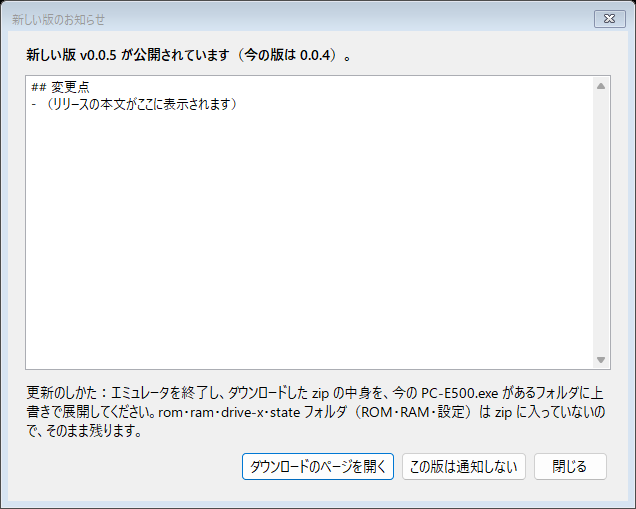

起動したとき、1日に1回まで GitHub の[リリース](https://github.com/litchi-gh/pc-e500_emulator_pockecom/releases)に新しい版が出ていないかを問い合わせ、あればツールバーと右クリックのメニューで知らせます。ダウンロードや置き換えはしません。更新するときは、エミュレータを終了し、インストーラーで入れた場合は新しい `-setup.exe` を実行、zip の場合は中身を今の `PC-E500.exe` があるフォルダに上書きで展開してください。どちらでもデータはそのまま残ります。

問い合わせは GitHub の公開 API（`api.github.com`）に対して、アカウントなしで行います。送るのは今の版の番号（User-Agent）だけです。自動の確認は「設定」の「起動時に新しい版を確認する」で止められ、右クリックのメニューの「新しい版を確認...」でいつでも確認できます。

## 最初の操作

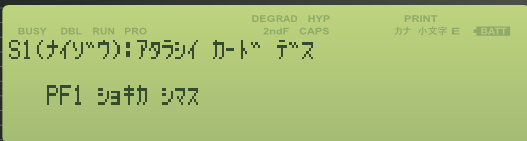

1. `S1(MAIN): NEW CARD`（日本語ROMでは `アタラシイ カードデス`）と出たら **PF1**（PCの **F1**）を押してメモリを初期化します。新しいRAMカードを装着したときはカード側の初期化にもPF1を押します。大容量では完了まで数秒かかります。
2. **BASIC**（PCの **F7**）を押します。液晶上部が **RUN** 表示になります。
3. `1+2` を入力して **Enter**。結果の `3` が表示されます。

プログラムを入力するときは **BASICをもう一度押し、PRO表示に切り替えます**。

```basic
10 PRINT 123
```

Enterで登録し、**BASIC** で **RUN** 表示に戻してから `RUN`、Enterを入力すると `123` が表示されます。RUNモードのまま行番号付きプログラムを入力するとSyntax errorになります。

文字列出力はRUN表示で `PRINT "HELLO"`、Enterを入力してください。

## キー操作

画面のキーをクリックするか、PCのキーボードを使います。英字は大文字としてポケコンのキーに送ります。入力は実機と同じくキー行列を通して順次処理します。

ROMは64Hzでキー行列を走査するため、1キーあたり約55ms（毎秒18キー程度）が上限です。キーを押しっぱなしにするとWindowsのキーリピート（毎秒31回）で連打しますが、機械が受け取れない分は捨てるので入力が溜まりません。押している間は毎秒18文字程度で連打し、離せばその場で止まります。実際に打鍵した分は捨てないため、速く打っても文字は落ちません。

| PCのキー | PC-E500の操作 |
|---|---|
| 英数字、空白、演算子 | 対応するキー |
| Enter / Backspace / Delete / Insert | ENTER / BS / DEL / INS |
| 矢印 | カーソル移動 |
| F1〜F5 | 機能キー |
| F6 | MENU |
| F7 | BASIC、RUN/PRO切替 |
| F8 | 2ndF |
| Esc | ON/BRK |
| Ctrl | CTRL |
| Shift | SHIFT |

画面上の **SHIFT** と **CTRL** はクリックすると次の1キーまで保持します。再クリックで解除できます。

`"`、`:`、`$` などのPCからの記号入力は7.3 ROMの変換表に合わせてSHIFT操作に変換します。ROMはキー行列の1つ前の走査からSHIFTを読むため、SHIFTは文字キーより1走査（約23ms）先に押し、離すのも1走査後にしています。日本語IMEの文字列入力には対応していません。

## 表示とウィンドウ

### 右クリックのメニュー

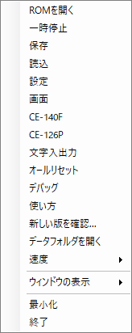

本体・ツールバー・ステータスバーのどこを右クリックしても、ツールバーと同じ操作のメニューが出ます。速度、ウィンドウの表示、新しい版の確認、データフォルダを開く、最小化・終了もここにあります。タイトルバーやボタンのない表示では、ここから操作します。

### ウィンドウの表示（ダブルクリックで切り替え）

本体のキーのない所をダブルクリックすると、**通常 → 本体だけ → 画面だけ → 通常** と切り替わります。右クリックのメニューの「ウィンドウの表示」や、「画面」でも選べます。

| 本体だけ | 画面だけ |
|---|---|
| 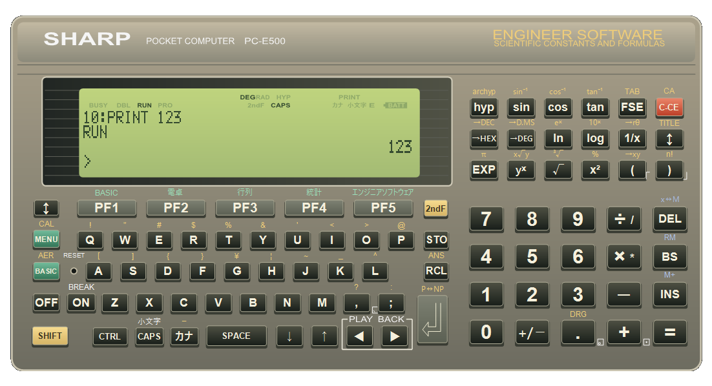 | 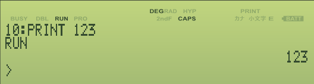 |
| タイトルバーとボタンをなくし、本体の絵だけにします（角は透明） | 液晶の部分だけにします |

- 切り替えても、液晶の位置と大きさは変わりません。通常に戻すと、元の位置と大きさに戻ります。
- 本体だけ・画面だけの表示では、絵をドラッグするとウィンドウが動き、絵の縁（本体の外形、または液晶の縁）をドラッグすると大きさが変わります。縦横の比は保ちます。
- 表示・大きさ・位置は次の起動に引き継ぎます。
- キーの上のダブルクリックは、これまでどおり2回の入力です。

### 液晶の表示とコントラスト（「画面」）

| | |
|---|---|
| 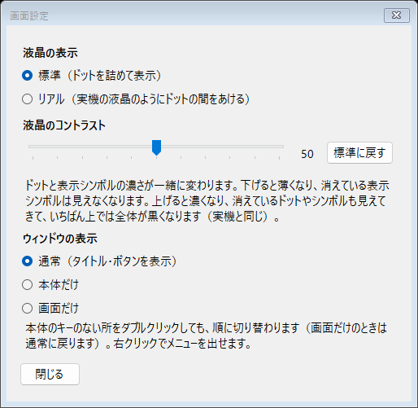 | 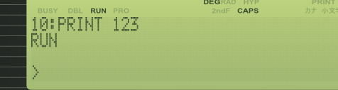 |
| ツールバーの「画面」 | リアル表示の液晶 |

- **液晶の表示**：「標準」はドットを詰めて描きます。「リアル」は実機の液晶のように、ドットの間を少しあけます。
- **液晶のコントラスト**：0〜100 で、50 が既定です。実機のつまみと同じく、ドットと表示シンボルの濃さが一緒に変わります。下げると消えている表示シンボルが見えなくなり、上げると消えているドットも見えてきて、100 では全体が黒くなります。
- 変更はすぐに反映し、設定に保存します。

## 画面文字のコピー・貼り付け

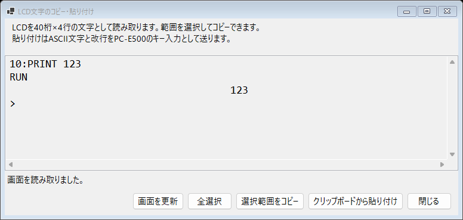

ツールバーの「文字入出力」または **Ctrl+C** を開くと、現在のLCDを40桁×4行の文字として表示します。通常文字と反転表示をROM内の6×8フォントから判定します。テキスト欄をドラッグして範囲を選び「選択範囲をコピー」を押してください。選択していない場合は画面全体をコピーします。「画面を更新」で現在のLCDを読み直します。グラフィック、倍角、フォントにない形は `□` になる場合があります。

「クリップボードから貼り付け」または **Ctrl+V** はASCII文字を実機のキー入力へ変換し、改行をENTER、タブを空白4個として送ります。英小文字は現在のPCキーボード入力と同様に大文字として入力します。日本語などキー配置にない文字は省略し、一度に4096文字まで受け付けます。長いBASICプログラムは順番に入力されるため、完了まで待つか一時的に速度を上げてください。

実機と同様に、BASICキーとAキーの間に小さな **RESET穴** があります。画面では穴の周囲もクリックできます。リセットは2種類あります。

| 操作 | 動作 |
|---|---|
| RESET穴 | CPU・LCD・キー・外部バスのみ再起動。データは残ります |
| 「オールリセット」 | 実機のON＋RESETと同じ。ROMが `S1(ナイゾウ): スベテノ データヲ ショウキョ シマスカ? (Y/N)` を表示し、Yで全消去、Nで元のデータのまま復帰します |

「オールリセット」はROMのリセット処理にON/BRKキーを押したまま入るだけの操作で、消去するかどうかの判断とその実行はROM側の処理です。直前の状態は `app/state/before-reset-日時.e500state` に保存します。内蔵RAMを消したいときはオールリセットにYで答えてください（実機と同じ手順です）。

## サブウィンドウ

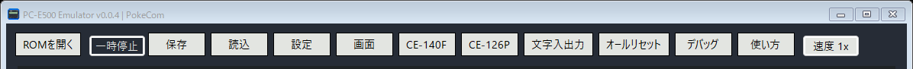

「設定」「画面」「CE-140F」「CE-126P」「文字入出力」「デバッグ」はモードレスで開きます。開いている間もメインウィンドウのキー入力やボタン操作はそのまま使えます。ポケコンを動かしながら通信履歴やレジスタを見たり、設定画面を開いたまま画面を確認したりできます。

同じボタンをもう一度押すと、新しく開かずに既にあるウィンドウを前面に出します。メインウィンドウを閉じると、開いているサブウィンドウもまとめて閉じます。「設定」の「適用」は設定に問題があればメッセージを出してウィンドウを開いたままにするので、値を直してから適用し直せます。

「ROMを開く」「保存」「読込」「BIN書込み／書出し」のファイル選択と「使い方」は、Windows標準のダイアログのため従来どおりモーダルです。

## デバッグ（CPUレジスタ・メモリ表示・書換え）

ツールバーの「デバッグ」または **Ctrl+D** で、CPUの状態を見るウィンドウを開きます。実行を止めずに見られるよう別ウィンドウで開き、250msごとに自動更新します（「自動更新」を外すと「更新」を押したときだけ読み直します）。

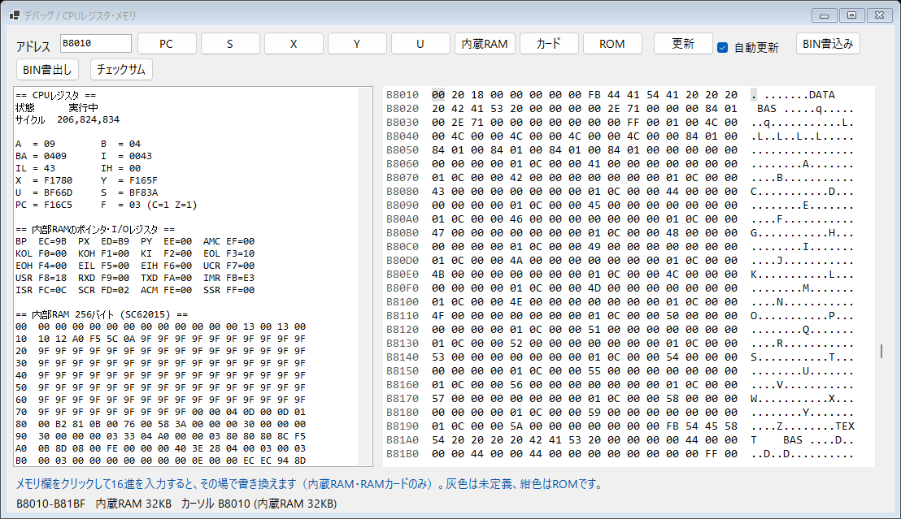

- **CPUレジスタ**: A、B、BA、I、IL、IH、X、Y、U、S、PC、フラグ（C/Z）と、実行中／HALT／電源OFF／エラー停止の状態、経過サイクル数。
- **内部RAM**: SC62015内蔵の256バイト。BP・PX・PYのポインタと、KOL〜SSRのI/Oレジスタは名前とアドレスを付けて別に並べます。
- **メモリ**: `00000-FFFFF` の16進ダンプとASCII表示。右端のスクロールバーで全域を移動できるほか、アドレス欄に16進を入れてEnter（`B8000`、`&HB8000`、`0xB8000` のいずれでも可）、ホイール、矢印キー・PageUp/PageDown・Ctrl+Home/End、「PC」「S」「X」「Y」「U」「内蔵RAM」「カード」「ROM」のボタンで飛べます。下段に、表示範囲とカーソル位置がどの領域かを表示します。

メモリ欄は領域ごとに色分けします。

| 色 | 領域 |
|---|---|
| 黒 | 内蔵RAM・RAMカードとそのミラー（書き換え可） |
| 紺 | 内蔵ROM（CE2）、E650/U6000の拡張ROM（CE3） |
| 灰 | 未定義（カード未装着時のスロット、CE6、内部エリアなど） |

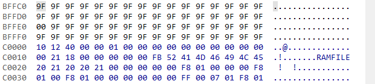

### バイナリエディタ

メモリ欄のバイトをクリックしてカーソルを置き、`0`〜`9`・`A`〜`F` を打つとその場で書き換わります。上位・下位の順に1桁ずつ入力し、2桁で次のバイトへ進みます。書き換えられるのは内蔵RAMとRAMカードの範囲だけで、ROMや未定義領域に打っても変化せず、下段にその理由を表示します。書き換えた内容は通常のRAMと同じく自動保存されます。

### チェックサム

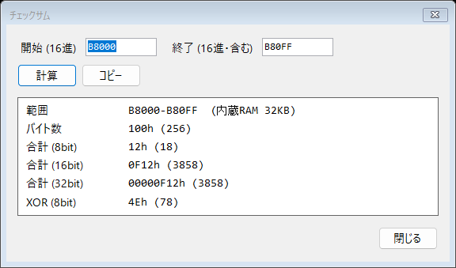

「チェックサム」ボタンで、開始・終了アドレス（どちらも含む）で指定した範囲の合計（8bit・16bit・32bit）とXOR、バイト数を表示します。雑誌掲載の機械語プログラムを打ち込んだあとの照合に使えます。開始欄にはカーソル位置が入ります。

### BIN書込み・BIN書出し

| 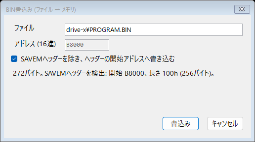 | 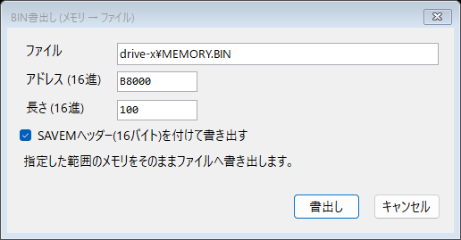 |
|---|---|

- **BIN書込み**: ファイルの内容を指定アドレスから書き込みます。CE-140Fの `SAVE M` が作る16バイトヘッダー付きファイルはヘッダーを自動検出し、ヘッダーに記録された開始アドレスへヘッダーを除いて書き込みます（チェックを外せば任意のアドレスへ書き込めます）。書込み先はRAMの範囲に収まっている必要があり、1バイトでもROMや未定義領域にかかる場合は何も書き込みません。
- **BIN書出し**: 指定アドレスから指定した長さをファイルへ書き出します。既定では `SAVE M` と同じ16バイトヘッダーを付けるので、`LOAD M` やBIN書込みでそのまま元の位置へ戻せます。

メモリの読み出しはLCDコントローラを通さないため、`2000-3FFF` を覗いても表示は乱れません。

## ハードウェア設定とBEEP

「設定」で表示言語（日本語／English。適用時にエミュレータを再起動します）、本体の外観（PC-E500 / PC-E650）、内蔵RAMの容量、RAMカードの作成・装着・取り外し、CE-140Fの接続・保存先・書込み禁止、音量・消音を変更できます。

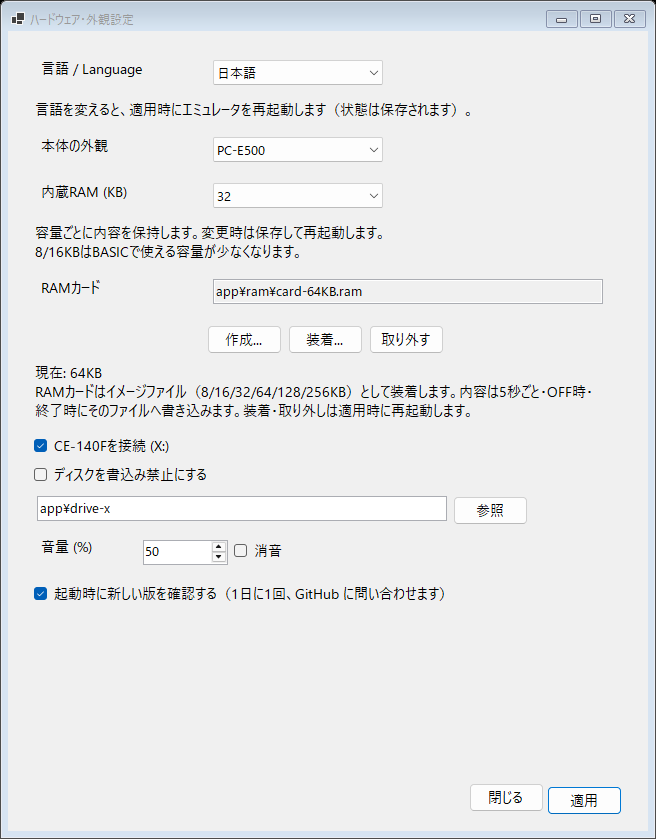

「画面」で、液晶の表示とコントラスト、ウィンドウの表示を変更できます。液晶は既定ではドットを隙間なく拡大します（標準）。「リアル」にすると、実機の液晶のようにドットの間を少しあけて表示します。コントラストは実機のつまみと同じく、ドットと表示シンボルの濃さを一緒に変えます。下げると消えている表示シンボルが見えなくなり、上げると消えているドットやシンボルも見えてきて、100 では全体が黒くなります。

本体を右クリックすると、ツールバーと同じ操作のメニューが出ます（速度・ウィンドウの表示・最小化・終了も含みます）。本体のキーのない所をダブルクリックすると、ウィンドウの表示が「通常 → 本体だけ（枠なし） → 画面だけ（液晶のみ） → 通常」と切り替わります。枠のない表示では、絵をドラッグしてウィンドウを動かし、絵の縁をドラッグして大きさを変えられます（縦横の比は保ちます）。ウィンドウの表示・大きさ・位置は保存され、次の起動でもその表示で始まります。

外観設定は筐体の形・色、液晶とキーの位置、機種銘板を切り替えます。PC-U6000はPC-E650と同じ筐体で銘板が違うだけのため、外観の選択肢はPC-E500とPC-E650の2つです。外観はROMやRAM容量を自動変更しないため、使用する機種のROMとRAMは別途選択してください。

### PC-E650 / PC-U6000 の384KB ROM

PC-E650 / PC-U6000の内蔵ROMは、提示されたメモリマップに合わせて次のように配置します。

| ROMファイル内 | CPUアドレス | 大きさ | チップ選択 |
|---|---:|---:|---|
| `00000-1FFFF` | `20000-3FFFF` | 128KB | CE3 |
| `20000-5FFFF` | `C0000-FFFFF` | 256KB | CE2 |

「ROMを開く」では、PC-E500の256KBイメージとPC-E650/PC-U6000の384KBイメージを自動判別します。ステータスバーにもROM容量と判別した系列を表示します。384KBファイルは、アドレスの低い追加ROMを先頭、その後ろに256KB本体ROMを置いた形式です。

画面下部のステータスバーには`ROM Ver.x.y`も表示します。この値はファイル名ではなく、サービスメンテ画面が使う本体ROM末尾16バイト内のメジャー／マイナーバージョンから取得します。動作確認に使ったPC-E500 ROMはVer.7.2、PC-E650 ROMはVer.8.5です。

### 実機からのROM吸い出しと `tools/merge_savem_rom.py`

実機の `SAVEM "d:ファイル名",開始アドレス,終了アドレス`（`d:` は接続した機器のデバイス名）でROMをファイルへ書き出します。

```basic
SAVEM "L:S3A.ROM",&HC0000,&HFFFFF
SAVEM "L:S3B.ROM",&H20000,&H3FFFF     ' PC-E650 / PC-U6000 のみ必要
```

`SAVEM` の出力には16バイトのヘッダー（`FF 00 06 01 10` + 長さ3バイト + 開始アドレス3バイト + `FF FF FF 00 0F`）が付きます。PC-E500系の `S3A.ROM` はヘッダー付きのまま開けます。PC-E650/U6000は `S3A.ROM` と `S3B.ROM` を `tools/merge_savem_rom.py`（Python 3）で384KBに結合します。

```powershell
python tools/merge_savem_rom.py S3A.ROM S3B.ROM --info                              # ヘッダーの確認
python tools/merge_savem_rom.py S3A.ROM S3B.ROM -o app/rom/PC-U6000-full.rom         # 384KBに結合
python tools/merge_savem_rom.py S3A.ROM -o "app/rom/PC-E500(7.2).ROM"                 # ヘッダー除去のみ (256KB)。名前は「機種名(版).ROM」
python tools/merge_savem_rom.py S3A.ROM S3B.ROM --strip                              # 各ファイルのヘッダーを取り除いて上書き
python tools/merge_savem_rom.py S3B.ROM --main-rom PC-U6000.rom --layout full -o app/rom/PC-U6000-full.rom   # 除去済み本体ROMと結合
```

カバー率が100%でない場合は吸い出しが欠けています。手順の詳細と確認方法は取扱説明書の13章にあります。

E650/U6000の標準内蔵RAMは64KBで、`B0000-BFFFF`へ配置されます。RAMカードは`40000`から容量に応じて配置されます。

#### 内蔵RAMの増設（62256 → 628128 換装）

内蔵RAMは`C0000`の直下へ、容量に応じて下方向へ伸びる形で配置されます。実機のE500は32KBのSRAM（62256）1個、E650/U6000は2個で64KBを構成しており、これを128KBの628128へ置き換えるメモリ増設改造が知られています。エミュレータでも同じ結果を選べます。

| 機種 | 実機標準 | 628128×1 | 628128×2 |
|---|---:|---:|---:|
| PC-E500 | 32KB (`B8000-BFFFF`) | 128KB (`A0000-BFFFF`) | — |
| PC-E650 / PC-U6000 | 64KB (`B0000-BFFFF`) | 128KB (`A0000-BFFFF`) | 256KB (`80000-BFFFF`) |

384KB ROMを開いた場合、「設定」の内蔵RAMでは64 / 128 / 256KBを選べます。容量の判定はROM側が起動時に行うため、選んだ容量はそのままBASICの空き容量に反映されます（`PRINT FRE(0)`が64KBで61368、128KBで126904、256KBで257976）。8/16/32KBは実機のE650/U6000には存在しない構成のため選択肢に出さず、設定ファイルにそれらが残っていた場合は64KBとして起動します。

参考: [E500系機のメモリ増設改造](https://www.oit.ac.jp/labs/rd/rssrv/kobayashi-lab/~yagshi/old_web/misc/pocketcom/memup/index.html)

- 内蔵RAMは **8 / 16 / 32 / 64 / 128 / 256 KB**。既定は32KBです。E650/U6000の384KB ROMでは **64 / 128 / 256 KB** になります。
- 容量を変えると現在の内容を保存して再起動します。容量ごとに別の内容を保持するため、元の容量に戻すとその容量の保存内容を読み込みます。

### RAMカード（イメージファイル）

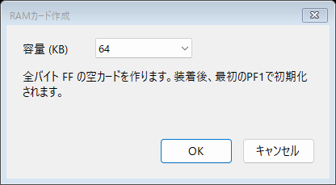

RAMカードは1枚ごとにイメージファイルとして扱います。ファイルの大きさがそのままカードの容量（**8 / 16 / 32 / 64 / 128 / 256 KB** のいずれか）で、中身がカードの内容です。実機でカードを差し替えるのと同じ感覚で、複数のカードを作って入れ替えられます。

| 操作 | 内容 |
|---|---|
| 作成... | 容量を選んで新しいイメージファイルを作ります（全バイトFF）。既定の保存先は `app/ram/` です。作成後は装着状態になります |
| 装着... | 既存のイメージファイルを選んでスロットに装着します |
| 取り外す | スロットを空にします |

「適用」で装着・取り外しを反映し、現在の内容を保存してから再起動します。新しいカードを装着して起動すると、ROMが `NEW CARD` としてPF1での初期化を求めます。

カードの内容は5秒ごと、電源OFF時、アプリ終了時、カードの取り外し時にそのイメージファイルへ書き込みます。ファイルを別名でコピーすればカードの複製になります。RAMカードの容量が変わっても内蔵RAMの内容には影響しません。
- RUN表示で `BEEP 1`、Enterを入力すると鳴ります。CPUのXOUT波形をWindowsの音声出力へ送ります。音の確認は速度1xで行ってください。高速・低速実行時の音声同期は実機同等ではありません。
- 音声はwinmm（waveOut）へ専用スレッドから書き出します。`waveOutWrite` は停止したストリームを開始し直すときに呼び出し元を止め、実測で平均91ms・最大1.4秒かかります。これをCPUを進めるスレッドで呼ぶと機械ごと止まるため、UIスレッドはサンプルを渡すだけにしています。デバイスには常に42ms分（256サンプル×8）を持たせます。これを32ms程度より浅くするとフレームの合間に枯渇し、書き込みのたびにストリームが再開されて音が途切れます。
- キーを押したときのクリック音の長さと、押しっぱなしにしたときの連打間隔は、SC62015のサブタイマ（64Hz）が決めます。実機PC-E500の録画と突き合わせて、クリック13.5ms・連打62.5msに合わせています。
- ツールバーのボタンはフォーカスを取りません。フォーカスされたボタンはスペースやEnterを自分の押下に使ってしまい、ポケコンへ届かなくなるためです。

## CE-140F（X:ドライブ）

`Sharp_ce140f_emul` を参考に、11ピン通信のデバイス選択、ACK/BUSY、4ビット転送、チェックサムを実装しました。PC上のフォルダを仮想ディスクとして使い、既定の保存先は `app/drive-x/` です。「CE-140F」で通信履歴を表示し、保存フォルダを開けます。履歴は0.5秒ごとに自動更新するので、SAVEやLOADの通信を実行しながら見られます。

PRO表示でプログラムを入力してから、次のように保存・読み込みできます。

```basic
SAVE "X:TEST.BAS"
SAVE "X:TEXT.BAS",A
LOAD "X:TEST.BAS"
```

2行目はASCII形式です。ASCII形式のファイルは、CE-140F のエミュレータ（ハード）と同じく、最後に 1Ah（EOF）を付けずに保存します。実機とやり取りするときの注意は「[実機とのファイルのやり取り](#実機とのファイルのやり取り)」を見てください。読み込みでは、ファイルの中に 1Ah があればそこをファイルの終わりとして扱うので、PC などで 1Ah を付けたファイルも読めます。読み込んだプログラムの実行はBASICキーでRUN表示に戻して `RUN` を入力します。

RUN表示での連続ファイル入出力例:

```basic
OPEN "X:DATA.DAT" FOR OUTPUT AS #2
PRINT #2,"HELLO"
CLOSE #2
OPEN "X:DATA.DAT" FOR INPUT AS #2
INPUT #2,A$
CLOSE #2
PRINT A$
```

FILES、COPY、NAME、SET、KILL、INITと、EOF/LOF/LOC/DSKFの通信処理も実装しています。ファイル名は英数字・`_`・`-`の8.3形式、最大1MB/ファイルです。サブフォルダには対応しません。**INITは選択したフォルダのディスク対象ファイルを削除するため、CE-140F専用フォルダを指定してください。** 実フロッピーのセクタイメージや機械動作は再現しません。詳細・検証範囲はローカルの解析ノート `Analysis/hardware.md`（本リポジトリ外）に記録しています。

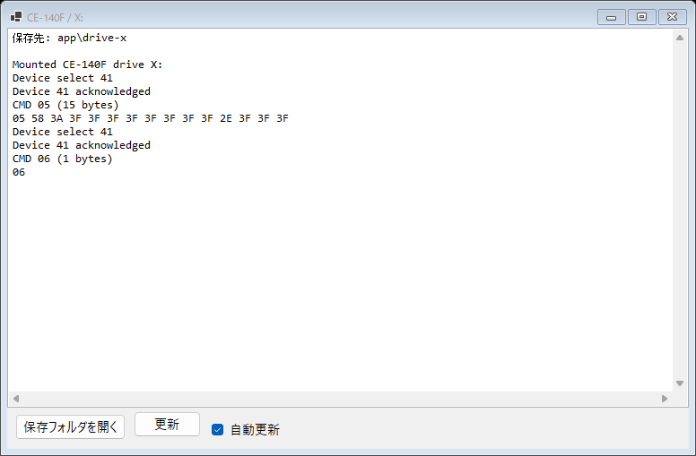

### 実機とのファイルのやり取り

| 形式 | エミュレータ → 実機 | 実機 → エミュレータ |
|---|---|---|
| 通常（中間コード、`SAVE "X:..."`） | 問題なし（実機で SAVE したものと1バイトも違わない同じファイルになります） | 問題なし |
| 機械語（`SAVE M`／`LOAD M`） | 問題なし | 問題なし |
| テキスト（`SAVE "X:...",A`） | 全行は届きますが、CE-140F のエミュレータ（ハード）では読み込みの最後にエラーが出ます（下記） | 問題なし |

**CE-140F のエミュレータ（ハード）でテキストを LOAD すると、最後にエラーになる。** ハードのエミュレータ（ffxx68 版。これを元にしたものも同じ）は、テキストの LOAD でファイルの終わりに来ると、終わりの値（0FFh）を1文字として送ってから 1Ah を送ります。ROM はこれを余計な1行として扱うので、どんな形のファイルでも、読み込みの最後にエラーになります。

- 最後の行まで改行（CR+LF）があれば、全行は届き、最後に「Undefined line」が出るだけです。プログラムはそのまま RUN できます。
- 最後の行に改行がないと、その行が壊れるか落ちます（「Line buffer overflow」など）。最後に 1Ah があると「I/O error」になります。
- 実機へ渡すときは、通常の形（`,A` なし）にしてください。テキストのファイルは、エミュレータで `LOAD` してから `SAVE "X:..."` で保存し直せば、通常の形になります。エミュレータはテキストの最後の行に改行がなくても、1Ah があっても読めます。

エミュレータのテキストの保存は、ハードのエミュレータと同じく 1Ah を付けず、最後の行まで CR+LF を付けます。

## CE-126P（プリンタ）

ROMのプリンタドライバがそのまま動くように、11ピンのCE-126Pを再現しました（手順は pc-e500_tools の [CE-126P_PRINTER.md](https://github.com/litchi-gh/pc-e500_tools/blob/main/Analysis/CE-126P_PRINTER.md)）。起動時から接続されていて、`LPRINT`・`LLIST`・`PRINT=LPRINT` の出力が24桁で印字されます。「CE-126P」で紙を表示します。紙はROMの文字フォントで描き、テキストまたはPNGで保存・コピーできます。

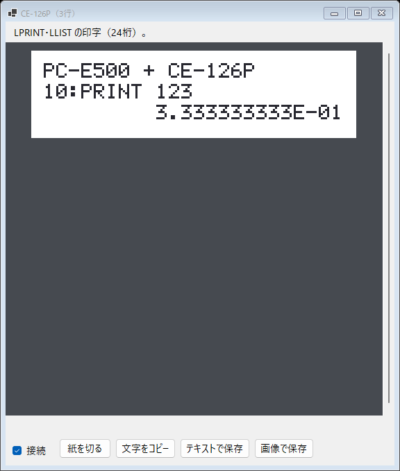

```basic
LPRINT "HELLO"
LLIST
```

- 「接続」を外すと、実機でプリンタをつないでいないときと同じく `Printer error` になります。接続の状態は設定に残ります。
- CE-140Fと同じ11ピンにつないだ状態で、両方使えます。
- 紙は最大2000行で、古い行から消えます。紙は状態保存に含めませんが、プリンタのバス上の状態は含めるので、印字の途中でもいつでも保存できます（読み込むと、その行をもう一度最後まで印字します）。
- 印字の時間は再現しません（すぐ印字します）。

## 保存と復元

- RAMは5秒ごと、OFF時、アプリ終了時に保存し、電源を切っても保持します。異常終了時は最後の自動保存まで戻る場合があります。
- 以下のパスはデータフォルダからの位置です（zip とソースからのビルドでは `app/`、インストーラーで入れた場合は `%LocalAppData%\PockeComE500\`）。
- 内蔵RAMの内容は `state/memory/<ROMのSHA256>/internal-容量KB.ram` に、RAMカードの内容は装着中のイメージファイル自身に保存します。
- CPU・内蔵RAM・LCD・タイマーと、プリンタ・CE-140F のバス上の状態のスナップショットは `state/<ROMのSHA256>.i内蔵容量-cカード容量.e500state` に自動保存します。設定は `state/settings.json` に保存します。
- 「保存」「読込」で任意のスナップショットを保存・復元できます。読込時は保存時の内蔵RAM容量にも戻ります。RAMカードはスナップショットの復元対象外で、装着中のイメージファイルの内容がそのまま使われます。保存時と容量の異なるカードを装着していると読み込めません（未装着で保存したものは未装着で読み込んでください）。
- CE-140Fの通信中・ファイルOPEN中はCPUスナップショットを保存・復元できません。`CLOSE` 後に操作してください。RAMファイルの自動保存は継続します。仮想ディスクのファイルはスナップショットの復元対象外です。
- 「オールリセット」は直前の状態を `state/before-reset-日時.e500state` に保存してから実行します。RAMカードは保持します。
- 保存ファイルはハッシュを検証し、一時ファイルから置き換えます。ROM本体は含みません。
- 状態ファイルの形式は版3（中身は `E500ST04`）です。0.0.3 までの版1・版2（`E500ST01`・`E500ST02`）も読めます。新しい版のエミュレータで保存したファイルは古い版では読めず、0.0.4 以降はその旨を表示します。他のエミュレータとの互換性はありません。

## 対応範囲

SC62015命令実行、256KB ROM（PC-E500・PC-E550・PC-1480U・PC-1490U・PC-1490UII）と384KB ROM（PC-E650・PC-U6000）、内蔵RAM／RAMカードとミラー、HD61102液晶2個（240×32ドット）、キー行列、タイマー割込み、ON/BRK・OFF、0.5/1/2/4倍速、状態保存・復元、BEEP、フォルダ型CE-140F、CE-126Pプリンタを実装しています。

**未対応:** CE-126P以外のプリンタ、カセット、RS-232C/UART、RTCなど。全命令・全BASIC命令・実機同等のタイミングを網羅検証したものではありません。LCDのBUSY時間は省略しています。機械語プログラムや周辺機器を使うプログラムには追加検証が必要です。

PC-E500・PC-E550・PC-1480U・PC-1490UII・PC-E650・PC-U6000 の ROM で動作確認済みです。

## 取扱説明書

利用者向けの説明は [app/manual/index.html](app/manual/index.html)（英語版 [index_en.html](app/manual/index_en.html)）にまとめています。ツールバーの「使い方」ボタンは表示言語に合わせた方を開きます。掲載している画像は `PC-E500.exe --manual-shots <ROM> <出力フォルダ> [ja|en]` でエミュレータ自身が描画したもので、`build.ps1` がビルドのたびに `app/manual/images/`（日本語UI）と `app/manual/images-en/`（英語UI）を作り直します。

## 開発

ビルド環境: Visual Studio C++ x64ビルドツールと.NET 10 SDK。全テストにはPython 3とPillowも必要です（アプリ起動には不要）。

```powershell
cd Emulator
./build.ps1
./test.ps1
./package.ps1   # リリース用の zip とインストーラーを dist\ に作る
```

`package.ps1` は、ビルドしてから配布するファイルを1つのフォルダに集め、そこから zip とインストーラーの両方を作ります（同じファイルが入ります）。版は `src/desktop/PcE500.csproj` の `<Version>` で、`app/README.txt` の1行目にも同じ版が書かれていなければ止まります。インストーラーには [Inno Setup 6](https://jrsoftware.org/isinfo.php)（`winget install JRSoftware.InnoSetup`）が要ります。定義は `installer/PockeComE500.iss` です。

- `src/native/`: CPUコアとハードウェア、C ABI DLL
- `src/desktop/`: C# / Windows Formsの画面・入力・保存（`Lang.cs` が言語切替。表示文字列は使用箇所で `L.T(日本語, 英語)` と書きます）
- `tests/test_core.cpp`: CPU・全RAM容量・デバッガ書込み・LCD・タイマー・音声・CE-140F・CE-126P と11ピンのバス・保存形式（2万あまりのチェック）
- `src/desktop/ManualShots.cs`: 取扱説明書用の画面画像の生成（`--manual-shots`）
- `src/desktop/SmokeTest.cs`: 配置ROM、UI入力、内蔵RAMファイルとRAMカードイメージの復元、設定画面、デバッガのメモリ書換えとBIN入出力、Windows音声出力、CE-126P の紙、右クリックのメニューとウィンドウの表示、液晶の表示、新しい版のお知らせ、データフォルダの決め方の結合テスト
- `tests/test_hardware.py`: 実ROMから全RAM容量、E650/U6000の増設RAM、ON＋RESETのオールリセット、BEEP波形とキークリックの時間、複数ブロック／ASCII保存・復元、連続ファイルとファイル操作を検証
- `tests/test_roms.py`: `app/rom` にあるすべての ROM で、起動・計算・プログラム・CE-140F への SAVE と LOAD・LPRINT を試す（各段階の画面は `tests/output/roms/`）
- `installer/`、`package.ps1`: インストーラーの定義と、zip とインストーラーを作るスクリプト
- `tests/output/`: テスト結果と画面画像
- `Analysis/architecture.md`（本リポジトリ外のローカルノート）: 実装方針、資料、今後の作業
- `third_party/pockemul/`: 移植元のソースとライセンス

CPUファイルは `tools/prepare_core.py` で移植元から抽出しています。再生成にはPythonが必要です。通常のビルドには不要です。

## ライセンス

[README.md](README.md#ライセンス) を参照してください。

## 謝辞

[README.md](README.md#謝辞) を参照してください。
