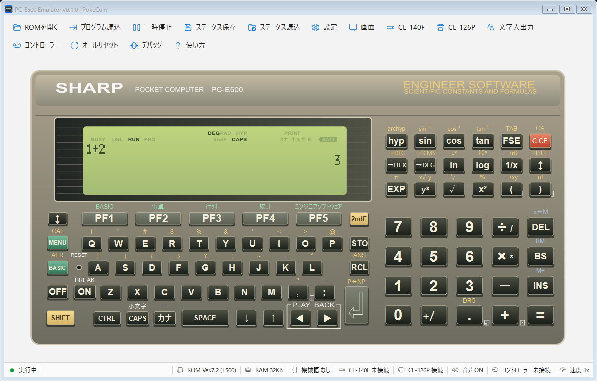
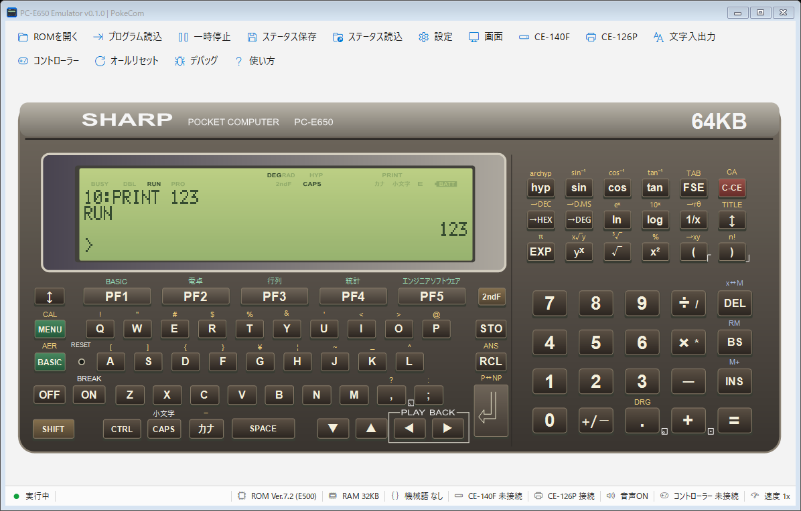
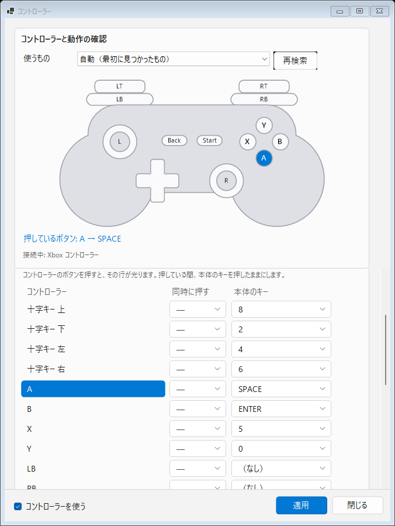
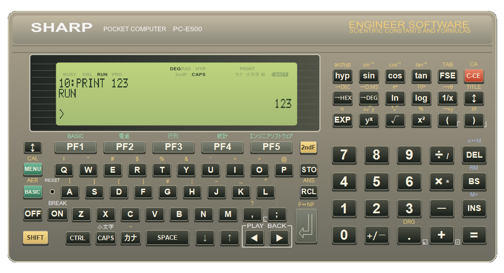
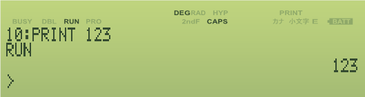
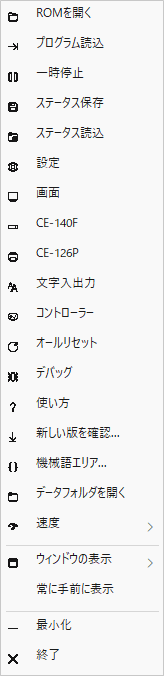
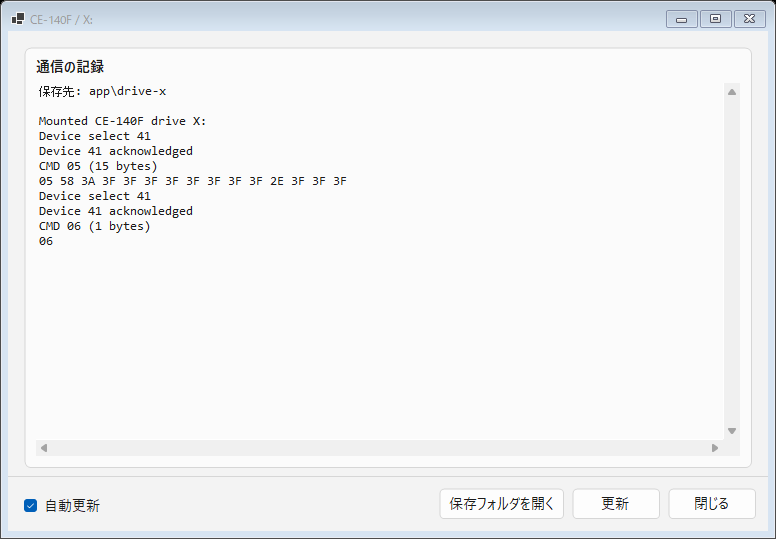
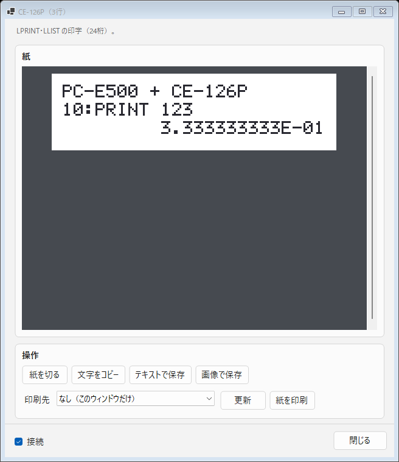
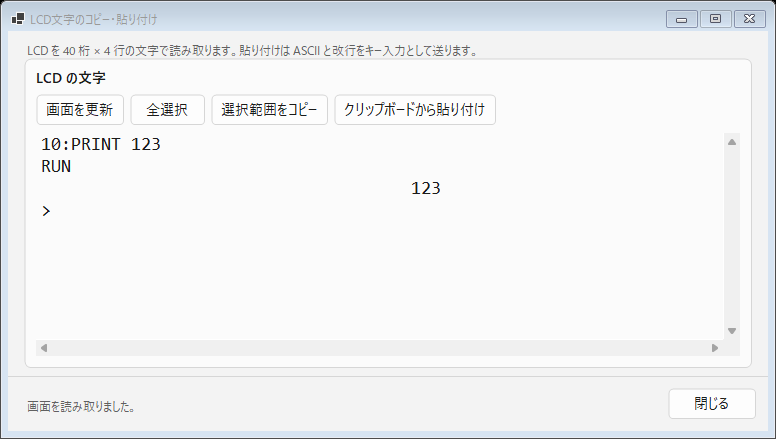
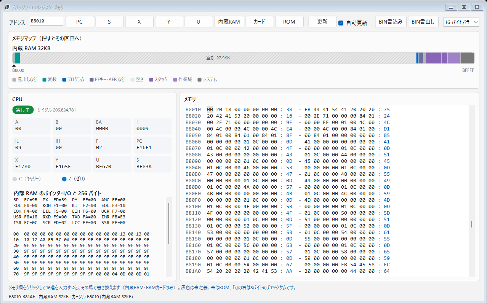

# PC-E500 シリーズ エミュレータ for Windows（PokeCom）

[English](README_en.md)

シャープのポケットコンピュータ **PC-E500 シリーズ** を、実機の ROM のまま Windows で動かすエミュレータです。CPU（SC62015）から液晶・キー・周辺機器までを再現しているので、BASIC も関数電卓も、ROM に入っている実機の処理がそのまま動きます。

## 対応機種

| 機種 | ROM | 本体の外観 |
|---|---|---|
| PC-E500・PC-E550・PC-1480U・PC-1490U・PC-1490UII | 256KB | PC-E500 |
| PC-E650・PC-U6000 | 384KB（本体の S3A と拡張の S3B を結合） | PC-E650 |

**ROM は含まれていません。** お手持ちの実機から吸い出してください（[吸い出しの手順](MANUAL.md#実機からのrom吸い出しと-toolsmerge_savem_rompy)）。PC-E500・PC-E550・PC-1480U・PC-1490UII・PC-E650・PC-U6000 の ROM で動作確認済みです。

## 動作環境

| 項目 | 内容 |
|---|---|
| OS | **Windows 10 / 11（64ビット版、x64）**。.NET のランタイムを同梱しているので、別に入れるものはありません |
| CPU | x64 の CPU。目安は 2コア・2GHz 程度以上（ここ10年ほどの PC なら足ります） |
| メモリ | アプリが使うのは 150MB 程度です。PC としては 4GB 以上を推奨します |
| ディスク | 約 120MB（ROM・RAM カードなどのデータは別） |
| 画面 | 1280×800 以上を推奨します（ウィンドウの大きさは変えられます） |
| 音 | BEEP を鳴らすときはサウンドデバイスが要ります（なくても動きます） |

- 実測：Core i5-1235U で、エミュレーションの処理は1コアで実機の約50倍の速さで進みます。等速なら CPU の1コアの2%ほど、4倍速でも1割ほどです。アプリが使ったメモリは、最大で約130MBでした。
- 動作を確かめたのは Windows 11（x64）です。Windows 10 と ARM 版の Windows（x64 のエミュレーションで動くはずのもの）は確かめていません。

## 見どころ

### 実機そっくりの本体

キーの配置・形・印字、液晶の表示シンボルは、実機の写真で測った位置に合わせています。外観は PC-E500 と PC-E650 の2種類です。キーはマウスでも PC のキーボードでも押せます。

| | |
|---|---|
|  |  |
| PC-E650 の外観 | 実機のようにドットの間をあける「リアル」表示 |

### 液晶のリアル表示とコントラスト

ドットの間をあける実機らしい表示と、コントラスト（0〜100）を選べます。消えている表示シンボルも、実機と同じくコントラストに合わせて薄く・濃くなります。

### フレーム補完で、なめらかな動き

「残像（フレーム補完）」を入れると、1ドットずつ動くもの（ゲームの自機や流れる星など）を、前の位置から次の位置へなめらかに滑らせて描きます。ゲームが1秒に数回しか画面を書き換えなくても、動きがカクカクしません。リアル表示のドットの間の線は動きません。

### ゲームパッドで遊ぶ

XInput（Xbox 系）や DirectInput のゲームパッドのボタンに、本体のキーを割り当てられます。パッドの絵で押したボタンが光るので、割り当てを確かめながら決められます。割り当てはプリセットとしていくつも持てます。

### 本体だけ・画面だけのウィンドウ

本体のキーのない所をダブルクリックすると、「通常 → 本体だけ → 画面だけ」と表示が切り替わります。枠のない表示でも、ドラッグで動かしたり大きさを変えたりできます。操作は右クリックのメニューからできます。

| 本体だけ | 画面だけ | 右クリックのメニュー |
|---|---|---|
|  |  |  |

### 周辺機器：CE-140F と CE-126P

- **CE-140F（フロッピー）**：PC のフォルダを X: ドライブとして使います。`SAVE "X:..."`・`LOAD`・`OPEN`・`FILES` などが、実機と同じ11ピンの通信で動きます。実機とプログラムをやり取りするときは、通常の形（`,A` なし）を使ってください。テキストの形は、CE-140F のエミュレータ（ハード）の不具合で、実機での読み込みの最後にエラーが出ます（[詳しく](MANUAL.md#実機とのファイルのやり取り)）。
- **CE-126P（プリンタ）**：`LPRINT`・`LLIST` を24桁で印字します。紙はテキストや PNG で保存できます。USB のサーマルプリンタ（58mm）や、Windows のプリンタにも印刷できます。

| | |
|---|---|
|  |  |
| CE-140F の通信の記録 | CE-126P の紙 |

### 画面の文字のコピーと、プログラムの貼り付け

液晶の文字を読み取ってコピーできます。クリップボードのテキストはキー入力として送れるので、PC で書いた BASIC のプログラムを貼り付けて入力できます。

### デバッガ

CPU のレジスタ、内部 RAM、メモリを見ながら、その場で書き換えられます。BIN ファイル（SAVEM のヘッダー付きにも対応）の読み書きができ、メモリの表示には8バイトごとのチェックサムが付きます。機械語のプログラムを試すのに使えます。

### そのほか

- **プログラム読込**：PC の BAS・BIN を、ツールバーかドラッグ＆ドロップで本体に読み込めます。本体で保存した形の BAS は、`LOAD` を打たずに RAM へ直接入ります。
- **メモリ**：内蔵 RAM は 8〜256KB です（E650/U6000 の増設改造相当まで）。RAM カードはイメージファイルとして作り、差し替えられます。
- **AMC**：CPUの番地変換に対応し、カードを内蔵RAMの直前へつなぐアクセスを再現します。物理カード画像と状態ファイル形式は維持します。[実装・検証範囲](src/native/AMC.md)を参照してください。
- **保存**：電源を切っても内容は残ります。いつでも状態を保存・復元できます。
- **速度**：0.5〜4倍で動かせます。BEEP の音も鳴ります。
- **表示言語**：日本語と英語を選べます。
- **更新**：新しい版が出たらツールバーで知らせます（更新は手動です）。

## はじめかた

1. [リリース](https://github.com/litchi-gh/pc-e500_emulator_pockecom/releases)から、インストーラー（`-setup.exe`）か zip を入手します。Windows x64 用で、.NET などを別に入れる必要はありません。0.0.4 より後のリリースでは、本文に各ファイルの SHA-256 を載せています。ダウンロードしたファイルが本物かは、PowerShell の `Get-FileHash <ファイル名>` で出る値と比べて確かめられます。
2. 実機から吸い出した ROM を、データフォルダの `rom` に置きます。右クリックのメニューの「データフォルダを開く」で開けます。
3. 起動して **PF1**（PC の F1）でメモリを初期化し、**BASIC**（F7）を押せば使えます。

## 0.1.0 の主な変更（0.0.5 から）

- **プログラム読込**：PC の BAS・BIN を、ツールバーかドラッグ＆ドロップで本体に読み込めます。本体で保存した形の BAS は、`LOAD` を打たずに RAM へ直接入ります。
- **ゲームパッド**：XInput・DirectInput のパッドのボタンに本体のキーを割り当てて遊べます。パッドの絵で押したボタンが光り、割り当てはプリセットで切り替えられます。
- **フレーム補完**：1ドットずつ動くものを、次の位置へなめらかに滑らせて描きます。画面もディスプレイの書き換えに合わせて描くようにしました。
- **キーの長押し**：PC のキーを押している間は、本体のキーも押したままになります。
- **見た目とステータスバー**：Windows 11 の作りにし、ライト・ダークのテーマを選べます。ステータスバーに本体の状態・ROM・RAM・機械語エリア・周辺機器・音・コントローラーが並び、押すとそれぞれの画面が開きます。
- **機械語エリア**：内蔵 RAM の並びを見ながら確保できます。デバッグにはメモリマップと 8 バイトごとのチェックサムが付きました。
- **設定**：常に手前に表示、自動電源 OFF の切り替えを足しました。

一覧は [CHANGELOG.md](CHANGELOG.md) にあります。

## ドキュメント

| ファイル | 内容 |
|---|---|
| [MANUAL.md](MANUAL.md) | 詳しい使い方と仕組み（キー操作、設定、コントローラー、RAM、CE-140F・CE-126P、プログラム読込、保存、ROM の吸い出し、ビルドとテスト） |
| [app/manual/index.html](app/manual/index.html) | 画像付きの取扱説明書（ツールバーの「使い方」で開きます） |
| [CHANGELOG.md](CHANGELOG.md) | 変更履歴 |

## ライセンス

| 対象 | ライセンス |
|---|---|
| 本プロジェクトのソースコード（`src/`、`tests/`、`tools/`） | [GNU General Public License v2.0 or later](LICENSE) |
| SC62015 CPUコア（`src/native/sc62015.*`、`third_party/pockemul/`） | GPL-2.0。[matsumo/PockEmul](https://github.com/matsumo/PockEmul/tree/898c891abb25da94df8951f13a9fc4a0b986c69d) から移植。Copyright (C) Matsumo 1998,1999 |
| ビルド済みアプリに同梱する .NET ランタイム / Windows Forms | MIT。通知は `app/DOTNET-LICENSE.txt`、`app/DOTNET-THIRD-PARTY-NOTICES.txt`、`app/WINDOWSDESKTOP-LICENSE.txt` |
| 内蔵ROM・テクニカルリファレンスマニュアル | 本プロジェクトに**含まれません**。シャープ株式会社の著作物であり、利用者が所有する実機から各自で吸い出してください。ROMのダウンロード・埋め込み・再配布は行いません |

詳細な由来は [THIRD_PARTY_NOTICES.md](THIRD_PARTY_NOTICES.md) にまとめています。SHARP、PC-E500、CE-140F などの名称は各権利者の商標です。本プロジェクトはシャープ株式会社とは無関係です。

## 謝辞

- **[matsumo/PockEmul](https://github.com/matsumo/PockEmul)** — SC62015 CPU コアと E500 系の周辺ハードウェア実装。本エミュレータの土台です。
- **[ffxx68/Sharp_ce140f_emul](https://github.com/ffxx68/Sharp_ce140f_emul)** — CE-140F の11ピン通信プロトコル（デバイス選択、ACK/BUSY、4ビット転送、チェックサム）の解析資料と実装。X:ドライブ実装の参考にしました。
- **[E500系機のメモリ増設改造](https://www.oit.ac.jp/labs/rd/rssrv/kobayashi-lab/~yagshi/old_web/misc/pocketcom/memup/index.html)** — 62256→628128 換装による内蔵RAM増設の情報。128KB/256KB設定の根拠です。
- PC-E500 実機の録画・実測データ（キークリック13.5ms、連打62.5ms）と、ROM解析・CE-2S01・CE-140F の調査ノートを提供してくれた利用者のみなさん。
- 本エミュレータの実装・テスト・ドキュメントは Anthropic の [Claude Code](https://claude.com/claude-code) と共同で作成しました。
