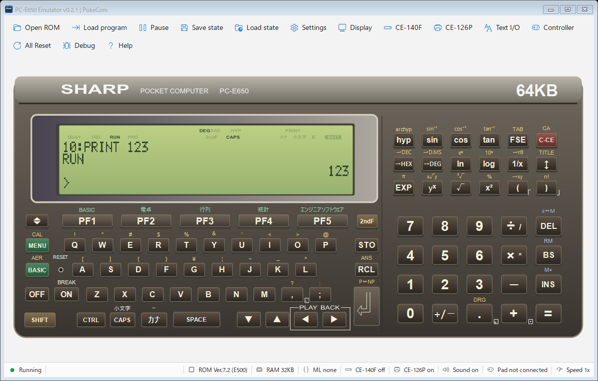
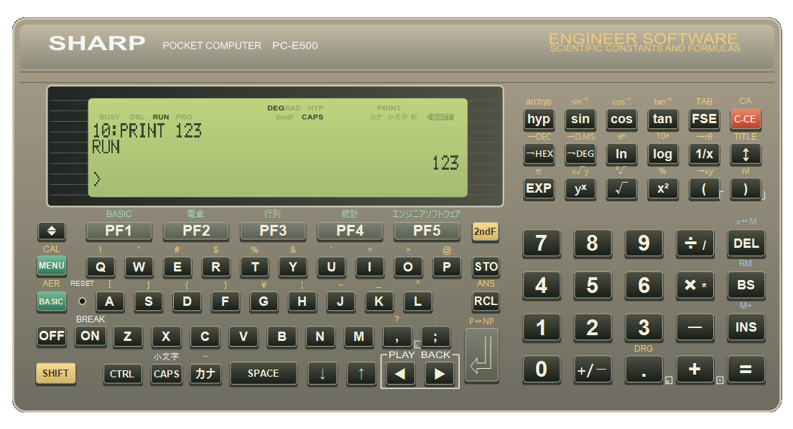
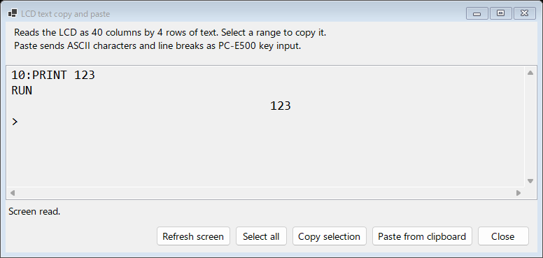
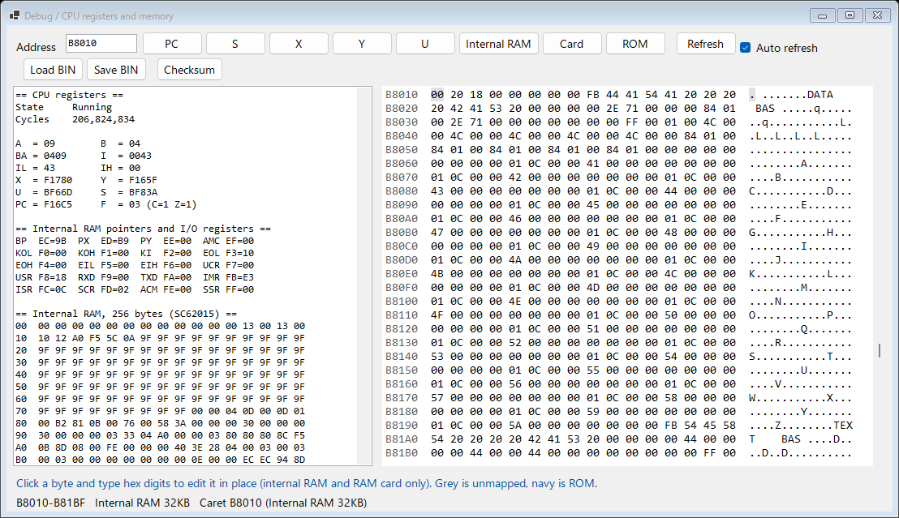

# PC-E500 Series Emulator (PokeCom)

[日本語](README.md)

An emulator that runs the SHARP **PC-E500 series** pocket computers on a PC, straight from the real machine's ROM: in a window on Windows and Ubuntu, and from the command line or AI tools (MCP) on Windows, Linux and the Mac. The CPU (SC62015), the LCD, the keys and the peripherals are emulated, so BASIC and the scientific calculator are the machine's own code running from its ROM.


## Supported models

| Model | ROM | Case |
|---|---|---|
| PC-E500, PC-E550, PC-1480U, PC-1490U, PC-1490UII | 256KB | PC-E500 |
| PC-E500S | 384KB (the main S3A merged with the S3B extension) | PC-E500 |
| PC-E650, PC-U6000 | 384KB (the main S3A merged with the S3B extension) | PC-E650 |

**ROM images are not included.** Dump the ROM from your own machine ([how](docs/manual_en/04_ROM.md#dumping-the-rom-from-your-machine)); with no peripherals, [PC-E500 BEEP ROMDump](https://github.com/litchi-gh/pc-e500_beep_romdumper/blob/main/README_en.md) does it by recording the buzzer with a phone. Verified to work with ROMs of the PC-E500, PC-E500S, PC-E550, PC-1480U, PC-1490UII, PC-E650 and PC-U6000.

## System requirements

| System | What runs | See |
|---|---|---|
| Windows 10 / 11 (x64) | The emulator with a window, the command line, MCP | [Chapter 1](docs/manual_en/01_WINDOWS.md) |
| Ubuntu 24.04 or later (x86-64) | The emulator with a window, the command line, MCP | [Chapter 2](docs/manual_en/02_LINUX.md) |
| macOS 15 or later (14 is expected to work), Apple silicon or Intel | The command line, MCP | [Chapter 3](docs/manual_en/03_MACOS.md) |

On Windows, in detail:

| Item | Requirement |
|---|---|
| OS | **Windows 10 / 11, 64-bit (x64)**. The .NET runtime is bundled; nothing else to install |
| CPU | Any x64 CPU; about 2 cores at 2 GHz or more as a guide (any PC from the last ten years or so) |
| Memory | The app itself uses about 150 MB; 4 GB or more for the PC is recommended |
| Disk | About 120 MB (plus your ROM, RAM cards and other data) |
| Display | 1280×800 or more recommended (the window can be resized) |
| Sound | A sound device for BEEP (it runs without one) |

- Measured on a Core i5-1235U: the emulation runs about 50 times faster than the real machine on one core, so normal speed takes about 2% of one core, and 4x about a tenth. The app used about 130 MB of memory at most.
- Tested on Windows 11 (x64). Windows 10 and Windows on ARM (which should run it through x64 emulation) have not been tested.

## Highlights

### A case like the real one

The keys' layout, shapes and lettering, and the LCD legends, sit where photographs of the real machines put them. Two cases are available, the PC-E500 and the PC-E650. Press the keys with the mouse or on the PC keyboard.

| | |
|---|---|
|  |  |
| The PC-E650 case | The Real LCD look, with space between the dots |

### Real LCD look and contrast

Choose dots drawn apart as on the real glass, and a contrast from 0 to 100. As on the real unit, the legends that are off fade and darken with the contrast too.

### Smooth movement with frame interpolation

With "Afterimage (frame interpolation)" on, something that moves a dot at a time (a game's ship, scrolling stars) is drawn sliding smoothly from its last place to the next. Even when a game redraws the screen only a few times a second, the movement does not jerk. The lines between the dots in the Real look stay still.

### Playing with a gamepad

Map the machine's keys to the buttons of an XInput (Xbox-style) or DirectInput gamepad. The buttons you press light up on a picture of the pad, so you can check the mapping as you set it. Keep as many mappings as you like as presets.


### Case-only and screen-only windows

Double-click the case away from the keys to step through normal → case only → screen only. The frameless views still move and resize by dragging, and the right-click menu holds every command.

| Case only | Screen only | Right-click menu |
|---|---|---|
|  |  |  |

### Peripherals: CE-140F and CE-126P

- **CE-140F (floppy)**: a PC folder serves as drive X:. `SAVE "X:..."`, `LOAD`, `OPEN`, `FILES` and the rest run over the same 11-pin protocol as the real drive. To exchange programs with a real machine, use the normal form (no `,A`): a bug of the hardware CE-140F emulator ends a text LOAD on the real machine with an error ([details](docs/manual_en/10_PROGRAMS.md#exchanging-files-with-a-real-machine)).
- **CE-126P (printer)**: `LPRINT` and `LLIST` print 24 columns; save the paper as text or PNG, or print it on a 58 mm USB thermal printer or any Windows printer.

| | |
|---|---|
|  |  |
| The CE-140F transfer log | The CE-126P paper |

### Copying the screen, pasting programs

Copy the LCD as text. Clipboard text is typed in as key presses, so a BASIC program written on the PC can be pasted in.



### Debugger

Watch the CPU registers, the internal RAM and memory, and edit them in place. Load and save BIN files (SAVEM headers included), and check what you type with the checksum the memory view shows for every eight bytes: handy for trying machine-code programs.



### The command line, and AI tools (MCP)

`pokecom` runs the emulator with no window: it runs BASIC and hands back the LCD and what was printed, so programs can be tested automatically. `pokecom mcp` is an MCP server with which AI tools (Claude Code, VS Code, Cursor and others) write BASIC programs and really run them.

```console
$ pokecom exec "PRINT 12*34"
PRINT 12*34
                                     408
>
```

[Using the command line](docs/manual_en/16_CLI.md) · [Using the MCP server](docs/manual_en/18_MCP.md)

### The same on Ubuntu


### And more

- **Load program**: load a BAS or BIN file from the PC into the machine, from the toolbar or by drag and drop. A BAS in the form the machine saves goes straight into RAM, with no `LOAD` typed.
- **Memory**: 8 to 256KB of internal RAM (up to the E650/U6000 expansion mod). RAM cards are image files you create and swap.
- **AMC**: the CPU's address conversion is supported, so a RAM card can join directly below the internal RAM. The card image and state file formats are unchanged.
- **Saving**: the contents survive power-off. Save and restore the whole state at any time.
- **Speed**: 0.5x to 4x, with BEEP sound.
- **Language**: Japanese or English.
- **Updates**: a newer release is announced on the toolbar (you update by hand).

## Getting started (Windows)

For Ubuntu see [chapter 2](docs/manual_en/02_LINUX.md#installing), for the Mac [chapter 3](docs/manual_en/03_MACOS.md#installing): one line pasted in a terminal downloads and installs.

Ubuntu:

```sh
wget -qO- https://raw.githubusercontent.com/litchi-gh/pc-e500_emulator_pockecom/main/install.sh | sh
```

Mac (the `pokecom` command line):

```sh
curl -fsSL https://raw.githubusercontent.com/litchi-gh/pc-e500_emulator_pockecom/main/install.sh | sh
```

What follows is for Windows.

1. Get the installer (`-setup.exe`) or the zip from [Releases](https://github.com/litchi-gh/pc-e500_emulator_pockecom/releases). It is for Windows x64 and needs no separate .NET install. From the release after 0.0.4 on, the release notes list each file’s SHA-256: compare it with what PowerShell’s `Get-FileHash <file>` prints to check a download.
2. Put the ROM dumped from your machine (with [ROMDump](https://github.com/litchi-gh/pc-e500_beep_romdumper/blob/main/README_en.md), for one) in the data folder's `rom`. "Open the data folder" in the right-click menu opens it.
3. Start it, press **PF1** (F1 on the PC) to initialise memory, then **BASIC** (F7).

## What is new in 0.1.0 (since 0.0.5)

- **Load program**: load a BAS or BIN from the PC through the toolbar or by dropping it on the window. A BAS saved by the machine goes straight into RAM, with no `LOAD` typed.
- **Game pads**: XInput and DirectInput pads can press the machine's keys. The pad picture lights the buttons pressed, and presets hold the key sets.
- **Frame interpolation**: things moving a dot at a time slide smoothly to their next place. The screen is also drawn in step with the display's refresh.
- **Held keys**: while a PC key is held down, the machine's key stays down too.
- **Look and status bar**: a Windows 11 look with light and dark themes. The status bar shows the machine's state, ROM, RAM, machine-code area, peripherals, sound and controller; click a field to open its window.
- **Machine-code area**: reserve it while seeing the internal RAM layout. The debugger has a memory map and a checksum every 8 bytes.
- **Settings**: Always on top, and a switch for the auto power off.

The full list is in [the change history](docs/CHANGELOG.md) (Japanese).

## Documents

| File | Contents |
|---|---|
| [docs/README_en.md](docs/README_en.md) | The contents of the manual (20 chapters: Windows, Ubuntu, the Mac, using it, the command line, MCP, troubleshooting) |
| [app/manual/index_en.html](app/manual/index_en.html) | The illustrated user manual (the Help button opens it) |
| [docs/BUILD.md](docs/BUILD.md) | Building and testing (Japanese) |
| [docs/CHANGELOG.md](docs/CHANGELOG.md) | Change history (Japanese) |

## License

| Component | License |
|---|---|
| This project's sources (`src/`, `tests/`, `tools/`) | [GNU General Public License v2.0 or later](LICENSE) |
| SC62015 CPU core (`src/native/sc62015.*`, `third_party/pockemul/`) | GPL-2.0, ported from [matsumo/PockEmul](https://github.com/matsumo/PockEmul/tree/898c891abb25da94df8951f13a9fc4a0b986c69d). Copyright (C) Matsumo 1998,1999 |
| .NET runtime / Windows Forms bundled in the build | MIT; notices in `app/DOTNET-LICENSE.txt`, `app/DOTNET-THIRD-PARTY-NOTICES.txt`, `app/WINDOWSDESKTOP-LICENSE.txt` |
| Internal ROM, Technical Reference Manual | **Not included.** Copyright Sharp Corporation; dump the ROM from your own machine. No ROM is downloaded, embedded or redistributed |

Provenance details are in [THIRD_PARTY_NOTICES.md](docs/THIRD_PARTY_NOTICES.md). SHARP, PC-E500, CE-140F and other names are trademarks of their respective owners. This project is not affiliated with Sharp Corporation.

## Acknowledgements

- **[matsumo/PockEmul](https://github.com/matsumo/PockEmul)** — the SC62015 core and E500 peripheral implementation this emulator is built on.
- **[ffxx68/Sharp_ce140f_emul](https://github.com/ffxx68/Sharp_ce140f_emul)** — analysis and implementation of the CE-140F 11-pin protocol, the reference for drive X:.
- **[E500 series memory expansion](https://www.oit.ac.jp/labs/rd/rssrv/kobayashi-lab/~yagshi/old_web/misc/pocketcom/memup/index.html)** — the 62256 → 628128 mod behind the 128KB/256KB settings.
- Users who contributed recordings and measurements of real PC-E500s (13.5 ms key click, 62.5 ms repeat) and the ROM, CE-2S01 and CE-140F analysis notes.
- Implementation, tests and documentation were written together with Anthropic's [Claude Code](https://claude.com/claude-code).
