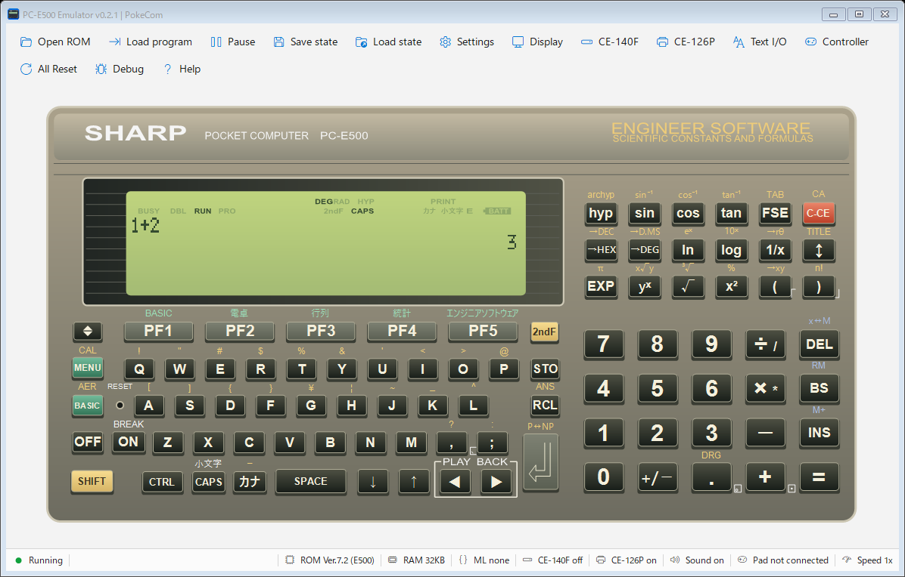
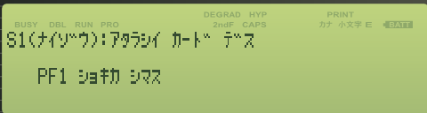
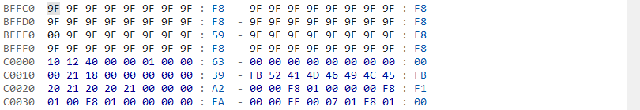
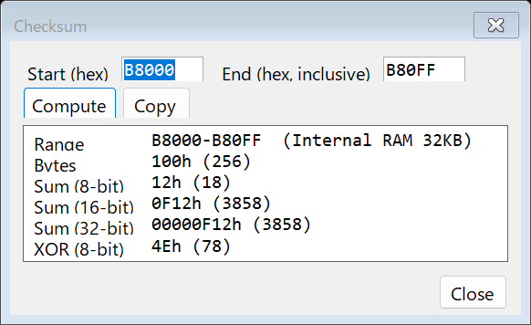
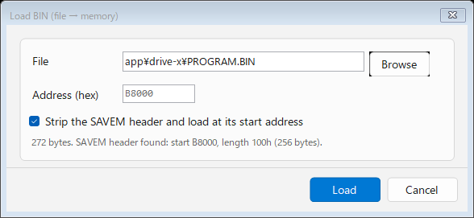
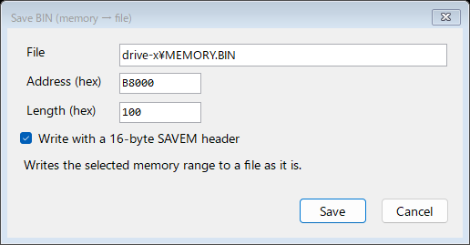
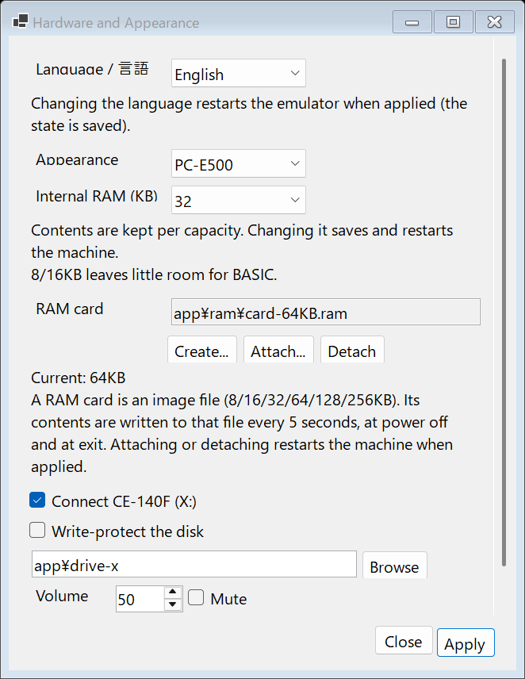
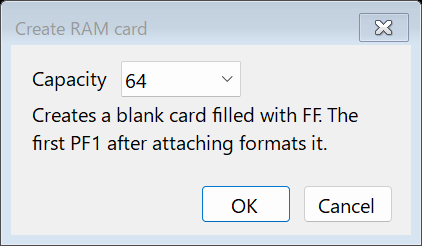
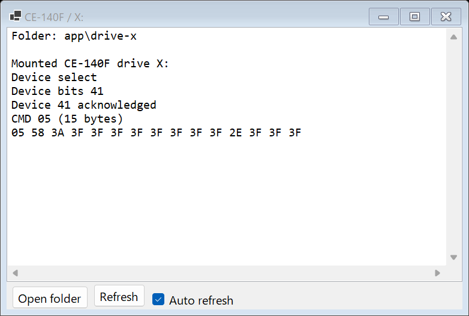

# PC-E500 / PC-E650 / PC-U6000 Emulator for Windows (PokeCom)

[日本語版 README](README.md)

A Windows desktop emulator that runs the internal ROM of the SHARP PC-E500 series pocket computers on an SC62015 CPU core. It supports the 256KB PC-E500 ROM and the 384KB PC-E650 / PC-U6000 ROM. The case and key layout follow photographs of the real machines; the LCD status indicators, BEEP, the CE-140F floppy drive, internal RAM and RAM cards are implemented. BASIC is the real machine's own code running from the ROM.



| | |
|---|---|
|  |  |
| Appearance set to PC-E650 | Debug window (registers, internal RAM, memory view and editing) |

The illustrated user manual is at [app/manual/index_en.html](app/manual/index_en.html) (the Help button opens it). The UI is available in Japanese and English; pick the language in Settings.

**ROM images are not included.** Dump the ROM from your own machine (see [Dumping the ROM](#dumping-the-rom-and-toolsmerge_savem_rompy)).

## Running

Double-click `Start-PC-E500.cmd`, or open `app/PC-E500.exe` directly.

- Windows x64. The .NET runtime is bundled; no Python or developer tools are needed to run it.
- Everything the program uses lives in the `app` folder, which can be copied elsewhere as a whole.

| Folder | Contents |
|---|---|
| `app/rom/` | Internal ROM images, loaded at start-up |
| `app/ram/` | RAM card image files (default location for creating and attaching) |
| `app/drive-x/` | Default folder of the CE-140F (drive X:) |
| `app/state/` | Settings, internal RAM contents, automatic snapshots, pre-reset backups |
| `app/manual/` | The illustrated manual (`index.html` Japanese, `index_en.html` English) |

- ROMs are read from `app/rom/`. "Open ROM" accepts 256KB and 384KB images; a dump straight from the machine with its 16-byte `SAVEM` header (256KB+16) opens as it is. Verified with a PC-E500 ROM (Ver.7.2) dumped from a real machine and a merged S3A+S3B PC-E650 ROM (Ver.8.5).
- Built and tested on this PC only; other Windows versions and ARM Windows are untested.

## First steps



1. When `S1(MAIN): NEW CARD` appears (katakana on a Japanese ROM), press **PF1** (**F1** on the PC) to initialise memory. A freshly attached RAM card asks for the same. Large capacities take a few seconds.
2. Press **BASIC** (**F7**). **RUN** lights up at the top of the LCD.
3. Type `1+2` and **Enter**; the result `3` is displayed.

To enter a program, **press BASIC again to switch to PRO**:

```basic
10 PRINT 123
```

Enter registers the line; press **BASIC** to return to **RUN**, then type `RUN` and Enter to see `123`. Numbered lines typed in RUN mode give a Syntax error.

## Keys

Click the on-screen keys or use the PC keyboard. Letters are sent as upper case. Input goes through the key matrix just like the real machine.

The ROM scans the matrix at 64 Hz, so about 55 ms per key (18 keys a second) is the limit. A held key repeats through Windows key repeat (31 a second); repeats the machine cannot take are dropped so no backlog builds up. Keystrokes you actually made are never dropped.

| PC key | PC-E500 |
|---|---|
| Letters, digits, space, operators | Matching key |
| Enter / Backspace / Delete / Insert | ENTER / BS / DEL / INS |
| Arrows | Cursor |
| F1–F5 | Function keys |
| F6 | MENU |
| F7 | BASIC, RUN/PRO toggle |
| F8 | 2ndF |
| Esc | ON/BRK |
| Ctrl | CTRL |
| Shift | SHIFT |

Clicking **SHIFT** or **CTRL** on the screen holds it until the next key; click again to release. Symbols such as `"`, `:` and `$` are converted to SHIFT sequences following the 7.3 ROM's table. The ROM reads SHIFT from the previous matrix scan, so SHIFT is pressed one scan (about 23 ms) ahead of the character key and released one scan after. Japanese IME input is not supported.

## Copying and pasting screen text

"Text I/O" on the toolbar, or **Ctrl+C**, shows the current LCD as 40 columns × 4 rows of text, recognised (normal and inverse) from the 6×8 font in the ROM. Drag to select and press "Copy selection"; with no selection the whole screen is copied. "Refresh screen" rereads the LCD. Graphics, double-size and shapes not in the font may come out as `□`.

"Paste from clipboard", or **Ctrl+V**, converts ASCII text to key presses: line breaks become ENTER and tabs four spaces. Lower-case letters are typed as upper case, characters not on the keyboard are skipped, up to 4096 characters at a time. Long BASIC listings are typed in order, so wait or raise the speed temporarily.

There is a small **RESET hole** between the BASIC and A keys, as on the real machine; the area around it is clickable too. There are two kinds of reset.

| Action | Effect |
|---|---|
| RESET hole | Restarts the CPU, LCD, keys and external bus only. Data survives |
| "All Reset" | The real ON+RESET. The ROM shows `S1(MAIN): CLEAR ALL DATA? (Y/N)`; Y erases everything, N resumes with the data intact |

All Reset merely enters the ROM's reset routine with ON/BRK held; the decision and the erase are the ROM's own code. The previous state is saved to `app/state/before-reset-<date>.e500state`. To wipe internal RAM, answer Y to an All Reset — the same procedure as on the real machine.

## Sub-windows

Settings, CE-140F, Text I/O and Debug are modeless: keys and toolbar buttons of the main window keep working while they are open, so you can watch the transfer log or the registers while the machine runs. Pressing the same button again brings the existing window forward; closing the main window closes them all. "Apply" in Settings reports a rejected value and keeps the window open so you can fix it.

The file choosers of Open ROM, Save, Load and BIN load/save are the standard Windows dialogs and therefore modal.

## Debug (CPU registers, memory view and editing)

"Debug" on the toolbar, or **Ctrl+D**, opens a window on the CPU state. It follows the running machine and refreshes every 250 ms (untick "Auto refresh" to update only with the button).


- **CPU registers**: A, B, BA, I, IL, IH, X, Y, U, S, PC, flags (C/Z), the running / HALT / power-off / fault state and the cycle count.
- **Internal RAM**: the 256 bytes inside the SC62015. The BP, PX and PY pointers and the KOL–SSR I/O registers are listed by name and address.
- **Memory**: `00000-FFFFF` as a hex dump with ASCII. Move with the scrollbar, a hex address in the box (`B8000`, `&HB8000` or `0xB8000` and Enter), the mouse wheel, the arrow keys, PageUp/PageDown, Ctrl+Home/End, or the PC, S, X, Y, U, Internal RAM, Card and ROM buttons. The bottom line names the region of the visible range and of the caret.

Bytes are coloured by region.

| Colour | Region |
|---|---|
| Black | Internal RAM and RAM card with their mirrors (writable) |
| Navy | Internal ROM (CE2), E650/U6000 extension ROM (CE3) |
| Grey | Unmapped (card slot without a card, CE6, the internal area, …) |



### Hex editor

Click a byte to place the caret and type `0`–`9`, `A`–`F`. Digits go in high nibble first and the caret advances after two. Only internal RAM and the RAM card can be edited; typing over ROM or unmapped space changes nothing and the reason is shown at the bottom. Edits are autosaved like any other RAM change.

### Checksum



The Checksum button shows the 8-, 16- and 32-bit sums, the XOR and the byte count of the range between a start and an end address (both inclusive), for checking a machine language program typed in from a listing. The start box is filled with the caret address.

### Load BIN / Save BIN

|  |  |
|---|---|

- **Load BIN** writes a file into memory at the given address. The 16-byte header written by the CE-140F `SAVE M` is detected automatically and the data returns to the start address recorded in it (untick to load anywhere). The whole range must be RAM; if a single byte would land in ROM or unmapped space nothing is written.
- **Save BIN** writes the given length from the given address to a file, by default with the same 16-byte header as `SAVE M`, so `LOAD M` or Load BIN can put it back where it came from.

Memory reads bypass the LCD controller, so looking at `2000-3FFF` does not disturb the display.

## Hardware settings and BEEP

Settings covers the UI language, the appearance (PC-E500 / PC-E650), internal RAM size, RAM card creation/attach/detach, CE-140F connection, folder and write protection, volume and mute, and the lines between LCD dots. The LCD scales its dots without gaps by default; "Show lines between LCD dots" draws the gaps like the real display.



Appearance switches the case shape and colour, LCD and key positions and the nameplate. The PC-U6000 shares the PC-E650 case, so only PC-E500 and PC-E650 are offered. Appearance does not change the ROM or RAM size; choose those separately.

### The 384KB PC-E650 / PC-U6000 ROM

The E650/U6000 internal ROM is mapped as follows.

| In the file | CPU address | Size | Chip select |
|---|---:|---:|---|
| `00000-1FFFF` | `20000-3FFFF` | 128KB | CE3 |
| `20000-5FFFF` | `C0000-FFFFF` | 256KB | CE2 |

"Open ROM" tells 256KB PC-E500 images and 384KB PC-E650/U6000 images apart automatically; the status bar shows the size and family. The 384KB file has the low-address extension ROM first and the 256KB main ROM after it.

The status bar also shows `ROM Ver.x.y`, read from the major/minor version bytes in the ROM's 16-byte trailer (the ones the service screen uses), not from the file name.

### Dumping the ROM and `tools/merge_savem_rom.py`

On the real machine, `SAVEM "d:filename",start,end` writes memory to a file (`d:` is the device name of whatever is connected).

```basic
SAVEM "L:S3A.ROM",&HC0000,&HFFFFF
SAVEM "L:S3B.ROM",&H20000,&H3FFFF     ' PC-E650 / PC-U6000 only
```

`SAVEM` output starts with a 16-byte header (`FF 00 06 01 10` + 3-byte length + 3-byte start address + `FF FF FF 00 0F`). A PC-E500 family `S3A.ROM` opens with the header in place. For the PC-E650/U6000, merge `S3A.ROM` and `S3B.ROM` into a 384KB image with `tools/merge_savem_rom.py` (Python 3).

```powershell
python tools/merge_savem_rom.py S3A.ROM S3B.ROM --info                              # inspect the headers
python tools/merge_savem_rom.py S3A.ROM S3B.ROM -o app/rom/PC-U6000-full.rom         # merge into 384KB
python tools/merge_savem_rom.py S3A.ROM -o app/rom/PC-E500.rom                       # strip the header only (256KB)
python tools/merge_savem_rom.py S3A.ROM S3B.ROM --strip                              # strip each file in place
python tools/merge_savem_rom.py S3B.ROM --main-rom PC-U6000.rom --layout full -o app/rom/PC-U6000-full.rom   # merge with a stripped main ROM
```

Coverage below 100% means the dump is incomplete. Chapter 13 of the manual walks through the whole procedure.

Stock internal RAM on the E650/U6000 is 64KB at `B0000-BFFFF`; the RAM card sits at `40000` according to its size.

#### Internal RAM expansion (62256 → 628128)

Internal RAM sits directly below `C0000` and grows downwards. The real E500 has one 32KB SRAM (62256), the E650/U6000 two of them (64KB); replacing each with a 128KB 628128 is a well-known expansion mod, and the emulator offers the same result.

| Model | Stock | 628128×1 | 628128×2 |
|---|---:|---:|---:|
| PC-E500 | 32KB (`B8000-BFFFF`) | 128KB (`A0000-BFFFF`) | — |
| PC-E650 / PC-U6000 | 64KB (`B0000-BFFFF`) | 128KB (`A0000-BFFFF`) | 256KB (`80000-BFFFF`) |

With a 384KB ROM the internal RAM choices are 64 / 128 / 256KB. The ROM itself measures the size at boot, so the choice shows up in BASIC (`PRINT FRE(0)` gives 61368, 126904 and 257976). 8/16/32KB do not exist on a real E650/U6000 and are not offered; such a stored setting starts as 64KB.

Reference: [E500 series memory expansion](https://www.oit.ac.jp/labs/rd/rssrv/kobayashi-lab/~yagshi/old_web/misc/pocketcom/memup/index.html)

- Internal RAM is **8 / 16 / 32 / 64 / 128 / 256 KB**, 32KB by default; **64 / 128 / 256 KB** with a 384KB ROM.
- Changing the size saves the current contents and restarts. Contents are kept per size, so switching back restores what that size held.

### RAM cards (image files)



Each RAM card is an image file. The file size is the card capacity (**8 / 16 / 32 / 64 / 128 / 256 KB**) and its bytes are the card contents, so cards can be created and swapped like real ones.

| Action | Meaning |
|---|---|
| Create... | Choose a capacity and create a new image (all FF). The default location is `app/ram/`. The new card is attached |
| Attach... | Attach an existing image file |
| Detach | Empty the slot |

"Apply" performs the change after saving the current contents, then restarts. With a new card the ROM asks for PF1 as `NEW CARD`.

The card contents are written to its image file every 5 seconds, at power off, at exit and on detach. Copying the file makes a duplicate card. Card changes never affect internal RAM.

- In RUN mode, `BEEP 1` and Enter beeps. The CPU's XOUT waveform is sent to the Windows audio output. Check sound at 1x; audio is not in sync at other speeds.
- Audio is written to winmm (waveOut) from a dedicated thread, because `waveOutWrite` blocks its caller when restarting a stalled stream (91 ms on average, 1.4 s at worst here). The device always holds 42 ms (256 samples × 8); less than about 32 ms runs dry between frames and the stream restarts with audible gaps.
- Key click length and auto-repeat interval come from the SC62015 sub-timer (64 Hz), matched against a recording of a real PC-E500: 13.5 ms click, 62.5 ms repeat.
- Toolbar buttons never take focus: a focused button would swallow Space and Enter, which are pocket computer keys.

## CE-140F (drive X:)

Following `Sharp_ce140f_emul`, the 11-pin protocol (device select, ACK/BUSY, 4-bit transfer, checksum) is implemented with a PC folder as the virtual disk, `app/drive-x/` by default. The "CE-140F" window shows the transfer log (refreshed every 0.5 s) and opens the folder.

```basic
SAVE "X:TEST.BAS"
SAVE "X:TEXT.BAS",A
LOAD "X:TEST.BAS"
```

Line 2 saves as ASCII. Sequential file I/O in RUN mode:

```basic
OPEN "X:DATA.DAT" FOR OUTPUT AS #2
PRINT #2,"HELLO"
CLOSE #2
OPEN "X:DATA.DAT" FOR INPUT AS #2
INPUT #2,A$
CLOSE #2
PRINT A$
```

FILES, COPY, NAME, SET, KILL, INIT and EOF/LOF/LOC/DSKF are implemented. File names are 8.3 with letters, digits, `_` and `-`, up to 1MB each; no subfolders. **INIT deletes the disk files in the folder, so give the CE-140F a folder of its own.** Sector images and drive mechanics are not reproduced.



## Saving and restoring

- RAM is saved every 5 seconds, at OFF and at exit, and survives power off. After a crash you may lose up to the last autosave.
- Internal RAM goes to `app/state/memory/<ROM SHA256>/internal-<size>KB.ram`; the RAM card goes to its own image file.
- A snapshot of the CPU, internal RAM, LCD and timers is saved automatically to `app/state/<ROM SHA256>.i<internal>-c<card>.e500state`. Settings are in `app/state/settings.json`.
- "Save" and "Load" keep and restore snapshots of your choice; loading restores the internal RAM size of the snapshot. The RAM card is not part of a snapshot: after a load the card keeps what its image file holds, and a snapshot cannot be loaded with a card of a different capacity attached (one saved without a card is loaded without a card).
- Snapshots cannot be saved or loaded during a CE-140F transfer or with a file OPEN; `CLOSE` first. RAM autosave continues. Virtual disk files are not part of snapshots.
- "All Reset" saves the previous state to `app/state/before-reset-<date>.e500state` first. The RAM card is kept.
- Files are hash-checked and replaced atomically from a temporary file. The ROM itself is not stored.
- Format v2; the old v1 (32KB internal, no card) still loads. Not compatible with other emulators.

## Scope

Implemented: SC62015 instruction execution, 256KB ROM, internal RAM and RAM card with mirrors, two HD61102 LCD controllers (240×32 dots), key matrix, timer interrupts, ON/BRK and OFF, 0.5/1/2/4x speed, state save/restore, BEEP, folder-based CE-140F.

**Not implemented:** printer, cassette, RS-232C/UART, RTC. Not every instruction, BASIC command or timing has been verified against the real machine; LCD busy time is omitted. Machine-code programs and peripheral-heavy programs need further verification.

## Manual

The user manual is at [app/manual/index_en.html](app/manual/index_en.html) (Japanese: [index.html](app/manual/index.html)); the Help button opens the one for the current language. Its pictures are rendered by the emulator itself with `PC-E500.exe --manual-shots <ROM> <folder> [ja|en]`; `build.ps1` regenerates `app/manual/images/` and `app/manual/images-en/` on every build.

## Development

Build tools: Visual Studio C++ x64 build tools and the .NET 10 SDK. Python 3 and Pillow are needed for the full test run (not for running the app).

```powershell
cd Emulator
./build.ps1
./test.ps1
```

- `src/native/`: CPU core, hardware and the C ABI DLL
- `src/desktop/`: C# / Windows Forms UI, input and persistence (`Lang.cs` holds the language switch; every visible string is written as `L.T(japanese, english)` at its point of use)
- `src/desktop/ManualShots.cs`: renders the manual's pictures (`--manual-shots`)
- `tests/test_core.cpp`: 92 checks on the CPU, every RAM size, debugger writes, LCD, timers, audio, CE-140F and the snapshot format
- `src/desktop/SmokeTest.cs`: integration test with the installed ROM: UI input, internal RAM file and card image restore, settings dialog, debugger editing and BIN I/O, Windows audio
- `tests/test_hardware.py`: on the real ROM: every RAM size, E650/U6000 expansion, ON+RESET, BEEP waveform and key click timing, multi-block and ASCII save/load, sequential files and file commands
- `tests/output/`: test results and screenshots
- `third_party/pockemul/`: the original sources and license

The CPU files are extracted from the original with `tools/prepare_core.py` (Python needed only to regenerate them).

## License

| Component | License |
|---|---|
| This project's sources (`src/`, `tests/`, `tools/`) | [GNU General Public License v2.0 or later](LICENSE) |
| SC62015 CPU core (`src/native/sc62015.*`, `third_party/pockemul/`) | GPL-2.0, ported from [matsumo/PockEmul](https://github.com/matsumo/PockEmul/tree/898c891abb25da94df8951f13a9fc4a0b986c69d). Copyright (C) Matsumo 1998,1999 |
| .NET runtime / Windows Forms bundled in the build | MIT; notices in `app/DOTNET-LICENSE.txt`, `app/DOTNET-THIRD-PARTY-NOTICES.txt`, `app/WINDOWSDESKTOP-LICENSE.txt` |
| Internal ROM, Technical Reference Manual | **Not included.** Copyright Sharp Corporation; dump the ROM from your own machine. No ROM is downloaded, embedded or redistributed |

Provenance details are in [THIRD_PARTY_NOTICES.md](THIRD_PARTY_NOTICES.md). SHARP, PC-E500, CE-140F and other names are trademarks of their respective owners. This project is not affiliated with Sharp Corporation.

## Acknowledgements

- **[matsumo/PockEmul](https://github.com/matsumo/PockEmul)** — the SC62015 core and E500 peripheral implementation this emulator is built on.
- **[ffxx68/Sharp_ce140f_emul](https://github.com/ffxx68/Sharp_ce140f_emul)** — analysis and implementation of the CE-140F 11-pin protocol, the reference for drive X:.
- **[E500 series memory expansion](https://www.oit.ac.jp/labs/rd/rssrv/kobayashi-lab/~yagshi/old_web/misc/pocketcom/memup/index.html)** — the 62256 → 628128 mod behind the 128KB/256KB settings.
- Users who contributed recordings and measurements of real PC-E500s (13.5 ms key click, 62.5 ms repeat) and the ROM, CE-2S01 and CE-140F analysis notes.
- Implementation, tests and documentation were written together with Anthropic's [Claude Code](https://claude.com/claude-code).
