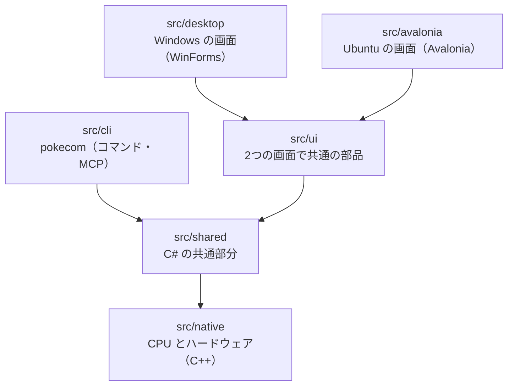

# ビルドとテスト

## Windows

ビルド環境: Visual Studio C++ x64ビルドツールと.NET 10 SDK。全テストにはPython 3とPillowも必要です（アプリ起動には不要）。

```powershell
cd Emulator
./build.ps1
./test.ps1
./package.ps1   # リリース用の zip とインストーラーを dist\ に作る
```

`package.ps1` は、ビルドしてから、配布するファイルを1つのフォルダに集め、そこから zip とインストーラーの両方を作ります（同じファイルが入ります）。バージョンは `src/desktop/PcE500.csproj` の `<Version>` で、`app/README.txt` の1行目にも同じバージョンが書かれていなければ止まります。インストーラーには [Inno Setup 6](https://jrsoftware.org/isinfo.php)（`winget install JRSoftware.InnoSetup`）が要ります。定義は `installer/PockeComE500.iss` です。最後に、zip とインストーラーの SHA-256 を `dist/PC-E500-Emulator-<バージョン>-win-x64-SHA256.txt`（`sha256sum -c` で読める形）に書き、リリースの本文に貼る形でも表示します。リリースの本文にはこの「## SHA-256」の節を必ず入れてください。

## コードの構成



- `src/native/`: CPUコアとハードウェア、C ABI の共有ライブラリ（Windows `e500core.dll`、Linux `libe500core.so`、macOS `libe500core.dylib`）
- `src/shared/`: DLL の呼び出し、BASIC のファイル、RAM の構成、液晶の文字の読み取りなど、全部のプログラムで使うもの
- `src/ui/`: 液晶・本体の配置・パッドの割り当て・プログラム読込など、2つの画面のあるプログラムで使うもの
- `src/avalonia/`: Ubuntu の画面（Avalonia）
- `src/cli/`: `pokecom`。コマンドと MCP のツールは `Ops.cs` の1つの表から作ります
- `src/desktop/`: C# / Windows Formsの画面・入力・保存（`Lang.cs` が言語切替。表示文字列は使用箇所で `L.T(日本語, 英語)` と書きます）
- `tests/test_core.cpp`: CPU・全RAM容量・デバッガ書込み・LCD・タイマー・音声・CE-140F・CE-126P と11ピンのバス・保存形式（2万あまりのチェック）
- `src/desktop/ManualShots.cs`: 取扱説明書用の画面画像の生成（`--manual-shots`）
- `src/desktop/SmokeTest.cs`: 配置ROM、UI入力、内蔵RAMファイルとRAMカードイメージの復元、設定画面、デバッガのメモリ書換えとBIN入出力、Windows音声出力、CE-126P の紙、右クリックのメニューとウィンドウの表示、液晶の表示、新しいバージョンのお知らせ、データフォルダの決め方の結合テスト
- `tests/test_hardware.py`: 実ROMから全RAM容量、E650/U6000の増設RAM、E500Sの内蔵RAM、BATTの表示シンボル、ON＋RESETのオールリセット、BEEP波形とキークリックの時間、複数ブロック／ASCII保存・復元、連続ファイルとファイル操作を検証
- `tests/test_roms.py`: `app/rom` にあるすべての ROM で、起動・計算・プログラム・CE-140F への SAVE と LOAD・LPRINT を試す（各段階の画面は `tests/output/roms/`）
- `installer/`、`package.ps1`: インストーラーの定義と、zip とインストーラーを作るスクリプト
- `tests/test_cli.py`: `pokecom` のコマンド・スクリプト・MCP と、マニュアルのコマンド一覧の漏れ
- `tests/test_cassette.cpp`: カセットの信号とコンテナ形式
- `.github/workflows/`: GitHub の Mac での `pokecom` のビルドとコアのテスト（手動、または `ci/` で始まるブランチ）
- `tests/output/`: テスト結果と画面画像
- `third_party/pockemul/`: 移植元のソースとライセンス

CPUファイルは `tools/prepare_core.py` で移植元から抽出しています。再生成にはPythonが必要ですが、通常のビルドには不要です。

## Ubuntu（Linux）

g++ と .NET 10 SDK を使います。`tests/test_cli.py` には、`app/rom` に置いた ROM が要ります。

```sh
sh tools/build-native.sh                        # bin/ に libe500core.so
sh tools/test-native.sh                         # コアのテスト
dotnet build src/avalonia -c Release            # 画面のあるもの
dotnet build src/cli -c Release                 # pokecom
python3 tests/test_cli.py
sh tools/package-linux.sh                       # dist/ に tar.gz と .deb
```

## macOS（pokecom）

Xcode のコマンドラインツールと .NET 10 SDK を使います。`dist/` に Apple シリコン用と Intel 用の tar.gz ができます。

```sh
sh tools/package-macos.sh
CXX=clang++ sh tools/test-native.sh
```

Windows の `pokecom` は `package.ps1` が zip にします（`tools/package-pokecom.ps1` だけでも作れます）。単独でビルドするなら、`build.ps1` のあとに `dotnet build src/cli -c Release` です。

## install.sh（Ubuntu・Mac）

- ルートの `install.sh` は最新のリリースから、名前の終わりが `linux-x64.tar.gz`・`amd64.deb`・`osx-arm64.tar.gz`・`osx-x64.tar.gz` のファイルを取ります。リリースにはそれぞれ1つだけ付けます。[pc-e500_tools](https://github.com/litchi-gh/pc-e500_tools) の `install.sh` も同じ名前で取ります。
- 手順書のコマンドは `main` の `install.sh` を実行するので、`main` に置きます。
- 手元のファイルで試すには `sh install.sh --emulator dist/…` です。`POCKECOM_HOME` と `HOME` を別のフォルダにすれば、自分の環境を変えずに試せます。

## マニュアルのコマンド一覧

`docs/manual/17_CLI_REFERENCE.md` と `docs/manual_en/17_CLI_REFERENCE.md` には、すべてのコマンドと引数を載せます。`Ops.cs` に足したら、両方に足してください。`tests/test_cli.py` が漏れを調べます。
