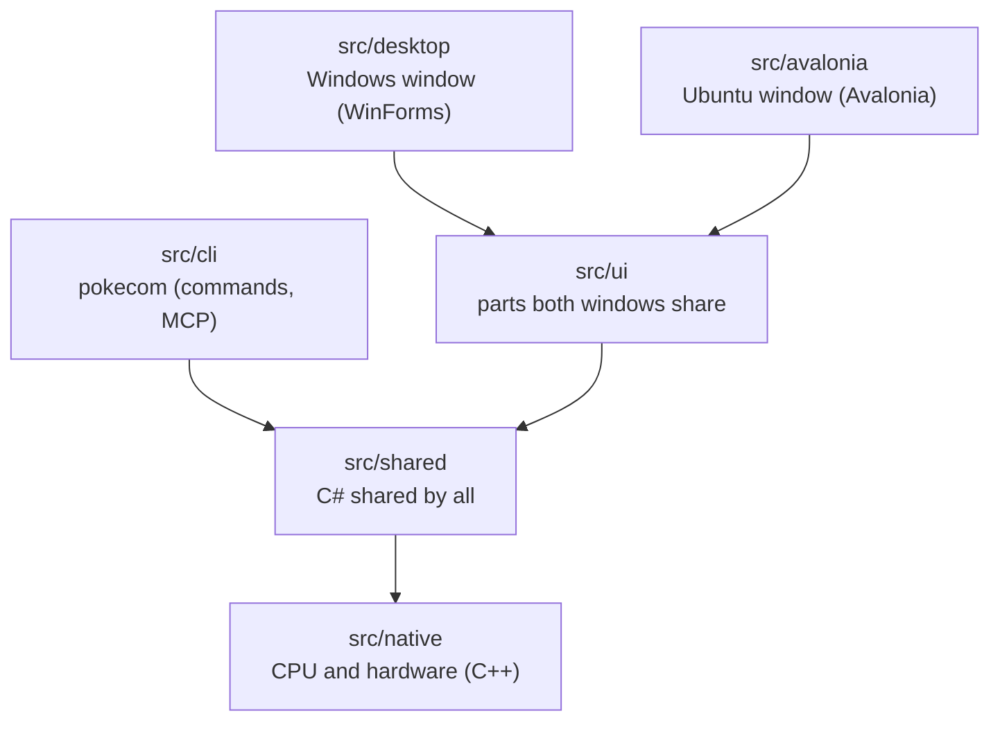

# 1. Building and testing

## Windows

Build tools: Visual Studio C++ x64 build tools and the .NET 10 SDK. Python 3 and Pillow are needed for the full test run (not for running the app).

```powershell
cd Emulator
./build.ps1
./test.ps1
./package.ps1   # the release zip and installer, into dist\
```

`package.ps1` builds, gathers the release's files into one folder and makes both the zip and the installer from it. The version is `<Version>` in `src/desktop/PcE500.csproj`, and the first line of `app/README.txt` must name it too. The installer needs [Inno Setup 6](https://jrsoftware.org/isinfo.php) (`winget install JRSoftware.InnoSetup`); it is defined in `installer/PockeComE500.iss`. Last, it writes the SHA-256 of the zip and the installer to `dist/PC-E500-Emulator-<version>-win-x64-SHA256.txt` (in the form `sha256sum -c` reads) and prints them ready to paste: every release’s notes carry that "## SHA-256" section.

## How the code is laid out



- `src/native/`: CPU core, hardware and the C ABI library (`e500core.dll` on Windows, `libe500core.so` on Linux, `libe500core.dylib` on macOS)
- `src/shared/`: what every program uses: calling the library, BASIC files, RAM layout, reading the LCD's characters
- `src/ui/`: what both programs with a window use: the LCD, the case layout, pad mappings, loading programs
- `src/avalonia/`: the window on Ubuntu (Avalonia)
- `src/cli/`: `pokecom`. Its commands and MCP tools are made from the one table in `Ops.cs`
- `src/desktop/`: C# / Windows Forms UI, input and persistence (`Lang.cs` holds the language switch; every visible string is written as `L.T(japanese, english)` at its point of use)
- `src/desktop/ManualShots.cs`: renders the manual's pictures (`--manual-shots`)
- `tests/test_core.cpp`: some twenty thousand checks on the CPU, every RAM size, debugger writes, LCD, timers, audio, the CE-140F, the CE-126P and the 11-pin bus, and the snapshot format
- `src/desktop/SmokeTest.cs`: integration test with the installed ROM: UI input, internal RAM file and card image restore, settings dialog, debugger editing and BIN I/O, Windows audio, the CE-126P paper, the right-click menu and window views, the LCD look, the new-version notice and where data lives
- `tests/test_hardware.py`: on the real ROM: every RAM size, E650/U6000 expansion, the E500S's internal RAM, the BATT symbol, ON+RESET, BEEP waveform and key click timing, multi-block and ASCII save/load, sequential files and file commands
- `tests/test_roms.py`: every ROM in `app/rom` through start-up, a calculation, a program, SAVE and LOAD on the CE-140F and LPRINT (screens in `tests/output/roms/`)
- `installer/`, `package.ps1`: the installer's definition and the script that makes the zip and the installer
- `tests/test_cli.py`: `pokecom`'s commands, scripts and MCP, and that the manual's command reference misses nothing
- `tests/test_cassette.cpp`: cassette signals and containers ([chapter 3](03_CASSETTE.md))
- `.github/workflows/`: builds `pokecom` and runs the core's tests on GitHub's Macs (by hand, or on a branch starting with `ci/`)
- `tests/output/`: test results and screenshots
- `third_party/pockemul/`: the original sources and license

The CPU files are extracted from the original with `tools/prepare_core.py` (Python needed only to regenerate them).

## Ubuntu (Linux)

With g++ and the .NET 10 SDK. `tests/test_cli.py` needs a ROM in `app/rom`.

```sh
sh tools/build-native.sh                        # libe500core.so into bin/
sh tools/test-native.sh                         # the core's tests
dotnet build src/avalonia -c Release            # the one with a window
dotnet build src/cli -c Release                 # pokecom
python3 tests/test_cli.py
sh tools/package-linux.sh                       # tar.gz and .deb into dist/
```

## macOS (pokecom)

With Xcode's command line tools and the .NET 10 SDK; the tar.gz for Apple silicon and for Intel go into `dist/`:

```sh
sh tools/package-macos.sh
CXX=clang++ sh tools/test-native.sh
```

On Windows `package.ps1` makes `pokecom`'s zip (`tools/package-pokecom.ps1` makes it alone). To build it alone, run `dotnet build src/cli -c Release` after `build.ps1`.

## install.sh (Ubuntu, Mac)

- `install.sh` at the root takes from the newest release the files whose names end in `linux-x64.tar.gz`, `amd64.deb`, `osx-arm64.tar.gz` and `osx-x64.tar.gz`: a release carries one of each. [pc-e500_tools](https://github.com/litchi-gh/pc-e500_tools)' `install.sh` takes them by the same names.
- The manual runs `install.sh` of `main`, so it belongs there.
- Try it on files of your own with `sh install.sh --emulator dist/...`; with `POCKECOM_HOME` and `HOME` set to other folders your own set-up is left alone.

## The command reference in the manual

`docs/manual/17_CLI_REFERENCE.md` and `docs/manual_en/17_CLI_REFERENCE.md` hold every command and argument. What is added to `Ops.cs` goes into both; `tests/test_cli.py` checks.
