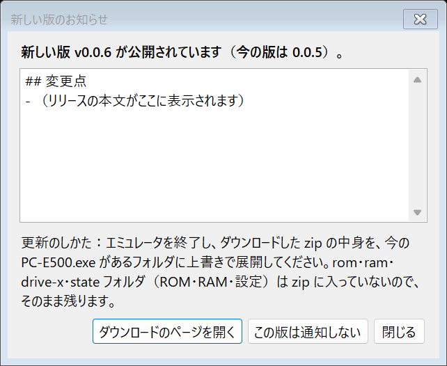

# 1. Windows で使う

配布は[リリース](https://github.com/litchi-gh/pc-e500_emulator_pockecom/releases)のインストーラー（`PC-E500-Emulator-<バージョン>-win-x64-setup.exe`）と zip（`PC-E500-Emulator-<バージョン>-win-x64.zip`）の2通りです。どちらも署名はありません。0.0.4 より後のリリースでは本文に各ファイルの SHA-256 を載せています。ダウンロードしたファイルが本物かは、PowerShell の `Get-FileHash <ファイル名>` で出る値と比べて確かめられます。

- インストーラー：最初に「自分だけ」（管理者の権限なし。既定）か「すべてのユーザー」かを選べます。プログラムは `%LocalAppData%\Programs\PockeComE500\`（すべてのユーザーなら `C:\Program Files\PockeComE500\`）に入ります。ROM・RAM・設定などのデータはどちらでも利用者ごとの `%LocalAppData%\PockeComE500\` に置きます（スタートメニューの「PC-E500 Emulator のデータフォルダ」や、右クリックのメニューの「データフォルダを開く」で開けます）。アンインストールしてもデータは残ります。
- zip：展開したフォルダの `PC-E500.exe` を起動します。データは `PC-E500.exe` の横に置きます。

ソースからビルドした場合は、`Start-PC-E500.cmd` をダブルクリックしてください。`app/PC-E500.exe` を直接開くこともできます。

- Windows x64用。ビルド済みアプリには.NETランタイムを同梱しており、Pythonや開発環境のインストールは不要です。
- zip とソースからのビルドでは、アプリが使うファイルはすべて `app` フォルダ内で完結します。`app` フォルダごと別の場所へコピーしても動作します。インストーラーで入れた場合、下の表のフォルダは `%LocalAppData%\PockeComE500\` の中にあります。

| フォルダ | 内容 |
|---|---|
| `app/rom/` | 内蔵ROMイメージ。起動時にここから読み込みます（「ROMを開く」でほかの場所の ROM を開いたときは、次の起動でもその ROM を開きます） |
| `app/ram/` | RAMカードのイメージファイル（作成・装着先の既定） |
| `app/drive-x/` | CE-140F（X:ドライブ）の既定の保存フォルダ |
| `app/state/` | 設定、コントローラーの割り当て（`controller.json`）、内蔵RAMの内容、自動保存スナップショット、リセット前のバックアップ |
| `app/manual/` | 画像付きの取扱説明書（`index.html` 日本語、`index_en.html` 英語）。ツールバーの「使い方」で開きます |

- `app/rom/` にあるROMを読み込みます。「ROMを開く」で256KBまたは384KBのROMを選択できます。実機の `SAVEM` で吸い出したままの16バイトヘッダー付きファイル（256KB+16）もそのまま開けます。PC-E500・PC-E500S・PC-E550・PC-1480U・PC-1490UII・PC-E650・PC-U6000 の ROM で動作確認済みです。
- 動作環境（OS・CPU・メモリなど）は [README](../../README.md#動作環境) にあります。動作を確かめたのは Windows 11（x64）です。Windows 10 と ARM 版の Windows では確かめていません。

## 画面のないエミュレータ（pokecom）

端末・スクリプト・AI のツールから使うコマンドライン版は、`pokecom-<バージョン>-win-x64.zip` として別に配布しています。[16章](16_CLI.md)を見てください。

## 新しいバージョンのお知らせ

起動したとき、1日に1回まで GitHub の[リリース](https://github.com/litchi-gh/pc-e500_emulator_pockecom/releases)に新しいバージョンが出ていないかを問い合わせ、あればツールバーと右クリックのメニューで知らせます。ボタンを押すと変更点が出て、「ダウンロードのページを開く」でリリースのページを開けます。ダウンロードや置き換えはしません。

GitHub の公開 API（`api.github.com`）へは、アカウントなしで問い合わせます。送るのは今のバージョンの番号（User-Agent）だけです。自動の確認は「設定」の「起動時に新しいバージョンを確認する」で止められ、右クリックのメニューの「新しいバージョンを確認...」でいつでも確認できます。

## 更新する

更新は手で行います。先にエミュレータを終了し、入れかたに合わせて次のようにします。ROM・RAM・設定・X: のファイルは、どの入れかたでもそのまま残ります。

| 入れかた | 更新のしかた |
|---|---|
| インストーラー | [リリース](https://github.com/litchi-gh/pc-e500_emulator_pockecom/releases)から新しい `PC-E500-Emulator-<バージョン>-win-x64-setup.exe` を取って実行します。前のものに上書きでインストールされます |
| zip | 新しい `PC-E500-Emulator-<バージョン>-win-x64.zip` の中身を、今の `PC-E500.exe` があるフォルダに上書きで展開します。`rom`・`ram`・`drive-x`・`state` のフォルダは残ります |
| コマンドライン（`pokecom`） | 新しい `pokecom-<バージョン>-win-x64.zip` を展開すると、`pokecom-<バージョン>-win-x64` という新しいフォルダができます。前のフォルダの `rom` に ROM を置いていたときは、新しいフォルダの `rom` に移します。前のフォルダは消してかまいません |

- コマンドラインの ROM を `%LocalAppData%\PockeComE500\rom` に置いておくと、更新のたびに移す必要はありません（[16章](16_CLI.md#rom-の探し方)）。
- PATH や AI のツールの設定に前のフォルダの `pokecom.exe` を書いていたときは、新しいフォルダに書き換えます。

更新できたかは、エミュレータのタイトルバーの「PC-E500 Emulator v0.2.0」のような表示や、`pokecom version` の表示で確かめます。

---

[目次](../README.md) ｜ [2. Ubuntu（Linux）で使う →](02_LINUX.md)
