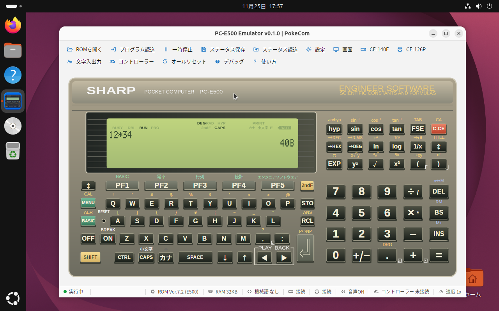
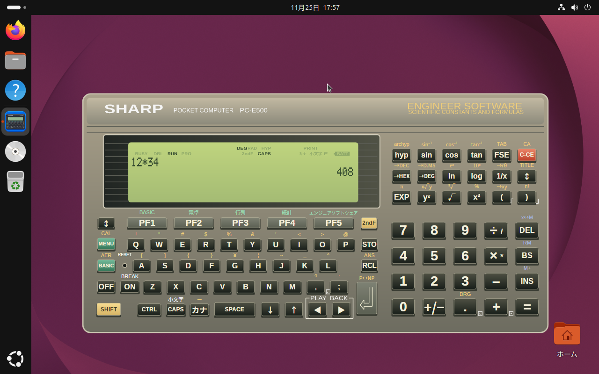

# 2. Ubuntu（Linux）で使う

Ubuntu のデスクトップで、Windows 版と同じ操作のエミュレータが動きます。ROM の処理も、保存するファイルの形式も同じです。



## 動作環境

| 項目 | 内容 |
|---|---|
| OS | Ubuntu 24.04 以降（x86-64）。デスクトップは Wayland でも X11 でもかまいません（Wayland では XWayland を通して動きます） |
| 入れておくもの | .NET のランタイムは同梱しています。`.deb` で入れると、足りないライブラリ（X11・フォント・ALSA など）も一緒に入ります |
| フォント | 日本語の表示に Noto Sans CJK を使います（`fonts-noto-cjk`。Ubuntu の日本語の環境には入っています） |
| ディスク | 約 180MB |

## 入れかた

[リリース](https://github.com/litchi-gh/pc-e500_emulator_pockecom/releases)から、どちらかを入手します。

### .deb（アプリの一覧に入れる）

```sh
sudo apt install ./pc-e500-emulator_<版>_amd64.deb
```

アプリの一覧に「PC-E500 Emulator」が加わります。端末からは `pc-e500` で起動します。コマンドラインの [`pokecom`](16_CLI.md) も入ります。

| もの | 場所 |
|---|---|
| プログラム | `/opt/pc-e500/` |
| データ（ROM・RAM カード・X: のフォルダ・設定） | `~/.local/share/PockeComE500/`（利用者ごと） |

外すときは `sudo apt remove pc-e500-emulator` です。データは残ります。

### tar.gz（好きな場所に置く）

```sh
tar xzf PC-E500-Emulator-<版>-linux-x64.tar.gz
cd PC-E500-Emulator-<版>-linux-x64
./PC-E500
```

データは、展開したフォルダの中に置きます（zip の Windows 版と同じ）。

## ROM を置く

ROM は含まれていません。[実機から吸い出した ROM](04_ROM.md) を、データの `rom` フォルダに置いて起動します。

```sh
mkdir -p ~/.local/share/PockeComE500/rom      # .deb で入れた場合
cp 'PC-E500(7.2).ROM' ~/.local/share/PockeComE500/rom/
```

右クリックのメニューの「データフォルダを開く」でも開けます。ほかの場所の ROM は「ROMを開く」で選びます。

## Windows 版との違い

操作は [5章](05_FIRST_STEPS.md)からの説明のとおりです。違うのは次の点だけです。

| 項目 | Ubuntu |
|---|---|
| ファイルを選ぶ画面 | デスクトップの標準のもの（GNOME ならファイル選択の画面）が開きます |
| 「プログラム読込」の実行 | 選んだあとで「読み込んだあと、実行しますか」と聞きます（Windows では、選ぶウィンドウのチェックで決めます）。ドラッグ＆ドロップのときは、最後に答えたとおりにします |
| 音 | ALSA の既定の出力に出します（Ubuntu では PipeWire につながります） |
| CE-126P の印刷先 | USB のサーマルプリンタ（`/dev/usb/lp0` など）と、CUPS に登録したプリンタ（[12章](12_CE-126P.md)） |
| コントローラー | カーネルのジョイスティック（`/dev/input/js0` など）を読みます（[13章](13_CONTROLLER.md)） |
| テーマ | 「システムに合わせる」は、デスクトップのライト・ダークに合わせます |
| 液晶の標準の表示 | ドットの縁を、画面のピクセルに合わせてなめらかに描きます |

「本体だけ」「画面だけ」の表示、ドラッグでの移動、絵の縁での拡大・縮小、「常に手前に表示」も同じように使えます。



## 更新

新しい版が出ると、ツールバーに「新しい版」のボタンが出ます。エミュレータを終了してから、`.deb` なら新しいものを同じように `apt install`、tar.gz なら中身を今のフォルダに上書きで展開します。ROM・RAM・設定はそのまま残ります。

## Windows とデータを行き来する

状態ファイル（`.e500state`）、RAM カードのイメージ（`.ram`）、X: のフォルダのファイルは、Windows 版と同じ形式です。コピーすればそのまま使えます。設定（`state/settings.json`）には、ROM や X: のフォルダの場所が入っているので、写したときは「ROMを開く」と「設定」で選び直してください。

BASIC のテキストは、行末が LF だけのファイル（Linux で作ったもの）も読めます。

---

[← 1. Windows で使う](01_WINDOWS.md) ｜ [目次](../README.md) ｜ [3. Mac で使う（コマンドライン） →](03_MACOS.md)
