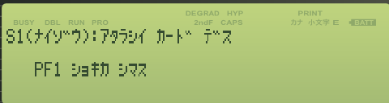

# 5. 最初の操作



1. `S1(MAIN): NEW CARD`（日本語ROMでは `アタラシイ カードデス`）と出たら **PF1**（PCの **F1**）を押してメモリを初期化します。新しいRAMカードを装着したときはカード側の初期化にもPF1を押します。大容量では完了まで数秒かかります。
2. **BASIC**（PCの **F7**）を押します。液晶上部が **RUN** 表示になります。
3. `1+2` を入力して **Enter**。結果の `3` が表示されます。

プログラムを入力するときは **BASICをもう一度押し、PRO表示に切り替えます**。

```basic
10 PRINT 123
```

Enterで登録し、**BASIC** で **RUN** 表示に戻してから `RUN`、Enterを入力すると `123` が表示されます。RUNモードのまま行番号付きプログラムを入力するとSyntax errorになります。

文字列を出力するには、RUN表示で `PRINT "HELLO"`、Enterを入力してください。

---

[← 4. ROM を用意する](04_ROM.md) ｜ [目次](../README.md) ｜ [6. キー操作とリセット →](06_KEYS.md)
