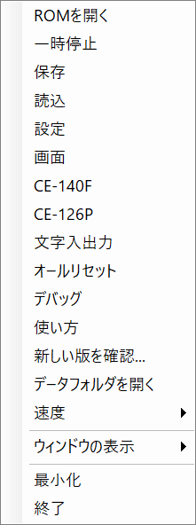
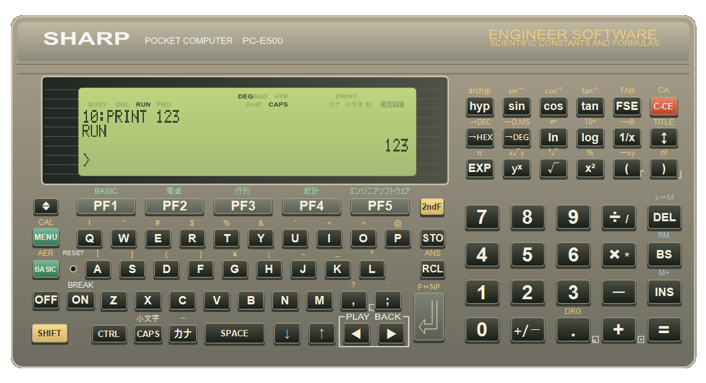
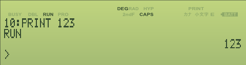
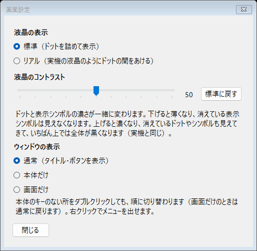
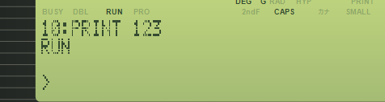
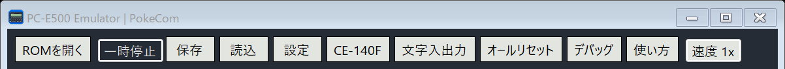

# 7. 表示とウィンドウ

## ステータスバー

ウィンドウのいちばん下のステータスバーは、欄に分かれています。

- **左端**：本体の状態（緑の点は実行中、黄色は一時停止、灰色は電源OFF）。押すと一時停止・再開します。
- **その横**：「プログラム読込」などのメッセージを5秒間、右側の欄に代えて出します。自動保存に失敗しているときは、その知らせが右側の欄と並んで残ります。
- **右側**：ROM のバージョンと系列、内蔵 RAM と RAM カード（`RAM 32KB+64KB` のように）、機械語エリア、CE-140F、CE-126P、音声、コントローラー（「コントローラーを使う」が入のときだけ。既定は入）、速度（0.5x〜4x）。マウスを乗せると詳しい内容（ROM の容量とファイル、カードのファイル名など）が出ます。メモリの欄を押すと「設定」、機械語の欄は機械語エリアの大きさを決めるウィンドウ、CE-140F・CE-126P の欄はそれぞれのウィンドウを開き、音声の欄は消音を切り替え、コントローラーの欄は「コントローラー」のウィンドウを開き、速度の欄は 0.5x → 1x → 2x → 4x の順に速度を切り替えます（音を確認するときは 1x にしてください）。

ウィンドウが狭いとき（画面の拡大率が大きいときも）は、右側の欄を CE-140F → CE-126P → コントローラー → 速度 → 音声 → 機械語 → RAM → ROM の順に短い表記（「未接続」「1x」など）にします。何の欄かはアイコンで分かり、マウスを乗せると元の表記が出ます。それでも入りきらなければ、左の欄から隠れます。本体だけ・画面だけの表示では出ません。

## 右クリックのメニュー

本体・ツールバー・ステータスバーのどこを右クリックしても、ツールバーと同じ操作のメニューが出ます。速度、ウィンドウの表示、常に手前に表示、新しい版の確認、機械語エリア、データフォルダを開く、最小化・終了もここにあります。タイトルバーやボタンのない表示では、ここから操作します。

## ウィンドウの表示（ダブルクリックで切り替え）

本体のキーのない所をダブルクリックすると、**通常 → 本体だけ → 画面だけ → 通常** と切り替わります。右クリックのメニューの「ウィンドウの表示」や、「画面」でも選べます。

| 本体だけ | 画面だけ |
|---|---|
|  |  |
| タイトルバーとボタンをなくし、本体の絵だけにします（角は透明） | 液晶の部分だけにします |

- 切り替えても、液晶の位置と大きさは変わりません。通常に戻すと、元の位置と大きさに戻ります。
- 本体だけ・画面だけの表示では、絵をドラッグするとウィンドウが動き、絵の縁（本体の外形、または液晶の縁）をドラッグすると大きさが変わります。縦横の比は保ちます。
- 表示・大きさ・位置は次の起動に引き継ぎます。
- キーの上のダブルクリックは、これまでどおり2回の入力です。

## 液晶の表示とコントラスト（「画面」）

| | |
|---|---|
|  |  |
| ツールバーの「画面」 | リアル表示の液晶 |

- **液晶の表示**：「標準」はドットを詰めて描きます。「リアル」は実機の液晶のように、ドットの間を少しあけます。
- **液晶のコントラスト**：0〜100 で、50 が既定です。実機のつまみと同じく、ドットと表示シンボルの濃さが一緒に変わります。下げると消えている表示シンボルが見えなくなり、上げると消えているドットも見えてきて、100 では全体が黒くなります。
- **残像（フレーム補完）**：ドットが点く・消えるのを、すぐに切り替えず数コマかけて変えます（点くのは約 0.01 秒、消えるのは約 0.02 秒で大半まで。消えるドットも2コマほどで消えます）。実機の液晶の遅い反応に近く、プログラムが書き換えている途中の画面がちらつくのを抑えます。1ドットずつ動くもの（ゲームの自機や流れる星など）は、前の位置から次の位置へなめらかに滑らせて描きます。リアル表示のドットの間の線は動きません。動いている絵は、最大で1歩ぶん遅れて表示されます。既定は入です。画面はディスプレイの書き換え（1秒に60回など）に合わせて1回ずつ描くので、残像を切っても動きは途切れません。
- 変更はすぐに反映し、設定に保存します。

## サブウィンドウ

「設定」「画面」「CE-140F」「CE-126P」「文字入出力」「コントローラー」「機械語エリア」「デバッグ」はモードレスで開きます。開いている間もメインウィンドウのキー入力やボタン操作はそのまま使えます。ポケコンを動かしながら通信履歴やレジスタを見たり、設定画面を開いたまま画面を確認したりできます。

同じボタンをもう一度押すと、新しく開かずに既にあるウィンドウを前面に出します。メインウィンドウを閉じると、開いているサブウィンドウもまとめて閉じます。「設定」の「適用」は設定に問題があればメッセージを出してウィンドウを開いたままにするので、値を直してから適用し直せます。

「ROMを開く」「プログラム読込」「ステータス保存」「ステータス読込」「BIN書込み／書出し」のファイル選択は、Windows や Ubuntu のデスクトップの標準の画面です（開いている間はほかの操作ができません）。「使い方」は、この説明書をブラウザで開きます。

サブウィンドウはどれも同じ作りです。中身は見出し付きの面に分け、「閉じる」などのボタンは下の帯に右寄せで並べます（Enter で押すボタンはアクセントカラーで、「閉じる」の左）。「自動更新」「接続」のチェックや結果の文は、下の帯の左に出します。

「設定」「コントローラー」「文字入出力」「CE-126P」のウィンドウは、横に広げても中身が変わらないので、横には広げられません（縦は変えられます）。「デバッグ」は狭くはできますが、最初の幅より広くはできません。

---

[← 6. キー操作とリセット](06_KEYS.md) ｜ [目次](../README.md) ｜ [8. 設定と音 →](08_SETTINGS.md)
