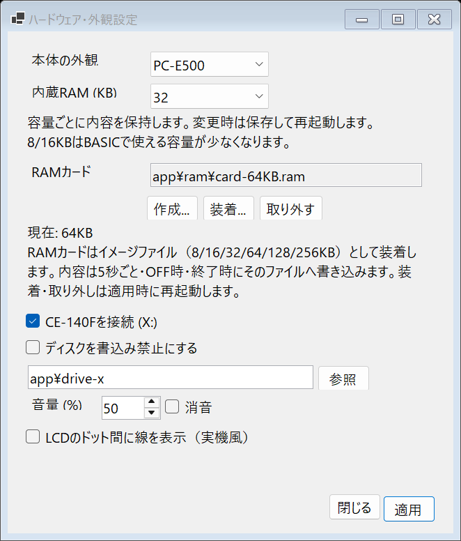

# 8. 設定と音

「設定」は「表示」「本体」「CE-140F」「音・電源・その他」の4つに分かれています。表示言語（日本語／English）、テーマ（Windows に合わせる／ライト／ダーク。Ubuntu では「システムに合わせる」。言語とテーマは適用時にエミュレータを再起動します）、本体の外観（PC-E500 / PC-E650）、内蔵RAMの容量、RAMカードの作成・装着・取り外し、CE-140Fの接続・保存先・書込み禁止、音量・消音、自動電源OFF、常に手前に表示を変更できます。「常に手前に表示」に印を付けると、メインウィンドウがほかのウィンドウの下に隠れません（右クリックのメニューからも切り替えられます）。

「自動電源OFF」を外すと、キーを押さずに放っておいても本体の電源が切れません（実機は約10分で切れます）。ROM が数えている残り時間を、本体の時間で1秒ごとに初めの値へ戻しています（キーを押したのと同じ）。

「画面」で、液晶の表示とコントラスト、ウィンドウの表示を変更できます。液晶は既定ではドットを隙間なく拡大します（標準）。「リアル」にすると、実機の液晶のようにドットの間を少しあけて表示します。コントラストは実機のつまみと同じく、ドットと表示シンボルの濃さを一緒に変えます。下げると消えている表示シンボルが見えなくなり、上げると消えているドットやシンボルも見えてきて、100 では全体が黒くなります。

本体を右クリックすると、ツールバーと同じ操作のメニューが出ます（速度・ウィンドウの表示・常に手前に表示・最小化・終了も含みます）。本体のキーのない所をダブルクリックすると、ウィンドウの表示が「通常 → 本体だけ（枠なし） → 画面だけ（液晶のみ） → 通常」と切り替わります。枠のない表示では、絵をドラッグしてウィンドウを動かし、絵の縁をドラッグして大きさを変えられます（縦横の比は保ちます）。ウィンドウの表示・大きさ・位置は保存され、次の起動でもその表示で始まります。

外観設定は筐体の形・色、液晶とキーの位置、機種銘板を切り替えます。PC-U6000はPC-E650と同じ筐体で銘板が違うだけのため、外観の選択肢はPC-E500とPC-E650の2つです。外観はROMやRAM容量を自動変更しないため、使用する機種のROMとRAMは別途選択してください。

## 音

- RUN表示で `BEEP 1`、Enterを入力すると鳴ります。CPUのXOUT波形をPCの音声出力へ送ります。音の確認は速度1xで行ってください。高速・低速実行時の音声同期は実機同等ではありません。
- Windows では、音声はwinmm（waveOut）へ専用スレッドから書き出します。`waveOutWrite` は停止したストリームを開始し直すときに呼び出し元を止め、実測で平均91ms・最大1.4秒かかります。これをCPUを進めるスレッドで呼ぶと機械ごと止まるため、UIスレッドはサンプルを渡すだけにしています。デバイスには常に42ms分（256サンプル×8）を持たせます。これを32ms程度より浅くするとフレームの合間に枯渇し、書き込みのたびにストリームが再開されて音が途切れます。
- キーを押したときのクリック音の長さと、押しっぱなしにしたときの連打間隔は、SC62015のサブタイマ（64Hz）が決めます。実機PC-E500の録画と突き合わせて、クリック13.5ms・連打62.5msに合わせています。
- Ubuntu では、ALSA の既定の出力に出します（PipeWire や PulseAudio につながります）。
- ツールバーのボタンはフォーカスを取りません。フォーカスされたボタンはスペースやEnterを自分の押下に使ってしまい、ポケコンへ届かなくなるためです。

---

[← 7. 表示とウィンドウ](07_WINDOW.md) ｜ [目次](../README.md) ｜ [9. 内蔵 RAM と RAM カード →](09_RAM.md)
