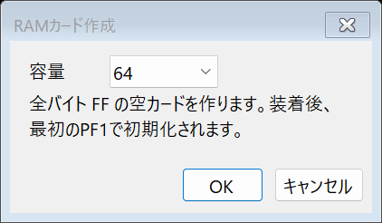

# 9. 内蔵 RAM と RAM カード

## 内蔵RAMの増設（62256 → 628128 換装）

内蔵RAMは`C0000`の直下へ、容量に応じて下方向へ伸びる形で配置されます。実機のE500・E500Sは32KBのSRAM（62256）1個、E650/U6000は2個で64KBを構成しており、これを128KBの628128へ置き換えるメモリ増設改造が知られています。エミュレータでも同じ結果を選べます。

| 機種 | 実機標準 | 628128×1 | 628128×2 |
|---|---:|---:|---:|
| PC-E500 / PC-E500S | 32KB (`B8000-BFFFF`) | 128KB (`A0000-BFFFF`) | — |
| PC-E650 / PC-U6000 | 64KB (`B0000-BFFFF`) | 128KB (`A0000-BFFFF`) | 256KB (`80000-BFFFF`) |

E650/U6000の384KB ROMを開いた場合、「設定」の内蔵RAMでは64 / 128 / 256KBを選べます。容量はROM側が起動時に判定するため、選んだ容量はそのままBASICの空き容量に反映されます（`PRINT FRE(0)`が64KBで61368、128KBで126904、256KBで257976）。8/16/32KBは実機のE650/U6000には存在しない構成のため選択肢に出さず、設定ファイルにそれらが残っていた場合は64KBとして起動します。PC-E500Sの384KB ROMではPC-E500と同じ容量を選べます。

参考: [E500系機のメモリ増設改造](https://www.oit.ac.jp/labs/rd/rssrv/kobayashi-lab/~yagshi/old_web/misc/pocketcom/memup/index.html)

- 内蔵RAMは **8 / 16 / 32 / 64 / 128 / 256 KB**。既定は32KBです。E650/U6000の384KB ROMでは **64 / 128 / 256 KB**（既定は64KB）になります。PC-E500SはPC-E500と同じです。
- 容量を変えると現在の内容を保存して再起動します。容量ごとに別の内容を保持するため、元の容量に戻すとその容量の保存内容を読み込みます。

## RAMカード（イメージファイル）

RAMカードは1枚ごとにイメージファイルとして扱います。ファイルの大きさがそのままカードの容量（**8 / 16 / 32 / 64 / 128 / 256 KB** のいずれか）で、中身がカードの内容です。実機でカードを差し替えるのと同じ感覚で、複数のカードを作って入れ替えられます。

| 操作 | 内容 |
|---|---|
| 作成... | 容量を選んで新しいイメージファイルを作ります（全バイトFF）。既定の保存先は `ram/` です。作成後は装着状態になります |
| 装着... | 既存のイメージファイルを選んでスロットに装着します |
| 取り外す | スロットを空にします |

「適用」で装着・取り外しを反映し、現在の内容を保存してから再起動します。新しいカードを装着して起動すると、ROMが `NEW CARD` としてPF1での初期化を求めます。

カードの内容は5秒ごと、電源OFF時、アプリ終了時、カードの取り外し時にそのイメージファイルへ書き込みます。ファイルを別名でコピーすればカードの複製になります。RAMカードの容量が変わっても内蔵RAMの内容には影響しません。

---

[← 8. 設定と音](08_SETTINGS.md) ｜ [目次](../README.md) ｜ [10. プログラムと文字のやり取り →](10_PROGRAMS.md)
