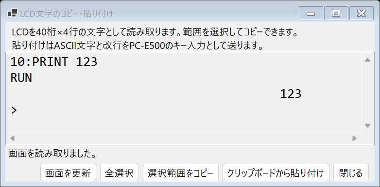

# 10. プログラムと文字のやり取り

## プログラムを読み込む（「プログラム読込」・ドラッグ＆ドロップ）

ツールバーの「プログラム読込」か、ウィンドウへのドラッグ＆ドロップで、PC のファイルを本体に読み込めます。ファイルを選ぶウィンドウの下にある「読み込んだら実行する（BAS は RUN）」に印を付けると、BAS は `LOAD "X:名前",R` で読み込み、そのまま実行します。この印は覚えておき、ドラッグ＆ドロップのときもそれに従います。読み込みは1つずつです。前の読み込みのキー入力（機械語エリアの確保や `LOAD`）が終わるまで、次は読み込めません。一時停止中も読み込めません。

- **BAS（本体で保存した形）**：RAM に直接書き込みます。`LOAD` は打たず、CE-140F の接続も、BASIC のモードもいりません（プログラムの実行中は読み込めません）。前のプログラムは置き換わり、変数はそのまま残ります（`LOAD` と同じ）。「読み込んだら実行する」なら、BASIC の RUN か PRO の表示のときに `RUN` を自動で入力します。パスワード付きのファイルは、次のテキストと同じ方法で読み込みます。
- **BAS（テキスト）**：CE-140F のフォルダに置いてから、`LOAD "X:名前"` を自動で入力します。CE-140F を接続し、BASIC の RUN か PRO の表示にしておいてください（プログラムの実行中は読み込めません）。名前は CE-140F が受け付ける 8.3 形式に直します（`my prog.bas` は `MYPROG.BAS`）。フォルダに同じ名前の違うファイルがあれば、上書きするかを聞きます。
- **BIN（`SAVE M` の16バイトのヘッダー付き）**：ヘッダーに書かれたアドレスへ、そのままメモリに書き込みます。書き込む範囲は、今ある内蔵 RAM か RAM カードにすべて入っている必要があります（RAM のない番地は、ほかの所の写しに当たるので読み込みません）。
  - 範囲が内蔵 RAM の機械語エリアの外の空き（BASIC の空き）だけなら、BASIC に上書きされることがあるので、先に機械語エリアをその先頭から `BFBFF` まで確保するかを聞きます。「はい」で確保が終わってから書き込み、「いいえ」で確保せずに書き込み、「キャンセル」で何もしません。
  - 範囲が BASIC のプログラム・変数・スタック・作業域・システムなど使用中の所にかかるときは、そのままでは書きません。機械語エリアとして先に確保できるときだけ、確保してから読み込むかを聞きます（「いいえ」で何もしません）。
  - 確保は BASIC の RUN か PRO の表示で、空きが足りるときにできます。読み込めなかった BIN や、ヘッダーのない BIN は、デバッグの「BIN書込み」でアドレスを指定してください。

BASIC のテキストは、行末が CR+LF でも LF だけ（Linux や Mac で作ったもの）でも読めます。

Ubuntu では、ファイルを選んだあとに「読み込んだあと、実行しますか」と聞きます。ドラッグ＆ドロップのときは、最後に答えたとおりにします。

## 画面文字のコピー・貼り付け

ツールバーの「文字入出力」または **Ctrl+C** を開くと、現在のLCDを40桁×4行の文字として表示します。通常文字と反転表示をROM内の6×8フォントから判定します。テキスト欄をドラッグして範囲を選び「選択範囲をコピー」を押してください。選択していない場合は画面全体をコピーします。「画面を更新」で現在のLCDを読み直します。グラフィック、倍角、フォントにない形は `□` になる場合があります。

「クリップボードから貼り付け」または **Ctrl+V** はASCII文字を実機のキー入力へ変換し、改行をENTER、タブを空白4個として送ります。英小文字は現在のPCキーボード入力と同様に大文字として入力します。日本語などキー配置にない文字は省略し、一度に4096文字まで受け付けます。長いBASICプログラムは順番に入力されるため、完了まで待つか一時的に速度を上げてください。

## 実機とのファイルのやり取り

| 形式 | エミュレータ → 実機 | 実機 → エミュレータ |
|---|---|---|
| 通常（中間コード、`SAVE "X:..."`） | 問題なし（実機で SAVE したものと1バイトも違わない同じファイルになります） | 問題なし |
| 機械語（`SAVE M`／`LOAD M`） | 問題なし | 問題なし |
| テキスト（`SAVE "X:...",A`） | 全行は届きますが、CE-140F のエミュレータ（ハード）では読み込みの最後にエラーが出ます（下記） | 問題なし |

**CE-140F のエミュレータ（ハード）でテキストを LOAD すると、最後にエラーになる。** ハードのエミュレータ（ffxx68 版。これを元にしたものも同じ）は、テキストの LOAD でファイルの終わりに来ると、終わりの値（0FFh）を1文字として送ってから 1Ah を送ります。ROM はこれを余計な1行として扱うので、どんな形のファイルでも、読み込みの最後にエラーになります。

- 最後の行まで改行（CR+LF）があれば、全行は届き、最後に「Undefined line」が出るだけです。プログラムはそのまま RUN できます。
- 最後の行に改行がないと、その行が壊れるか落ちます（「Line buffer overflow」など）。最後に 1Ah があると「I/O error」になります。
- 実機へ渡すときは、通常の形（`,A` なし）にしてください。テキストのファイルは、エミュレータで `LOAD` してから `SAVE "X:..."` で保存し直せば、通常の形になります。エミュレータはテキストの最後の行に改行がなくても、1Ah があっても読めます。

エミュレータのテキストの保存は、ハードのエミュレータと同じく 1Ah を付けず、最後の行まで CR+LF を付けます。

---

[← 9. 内蔵 RAM と RAM カード](09_RAM.md) ｜ [目次](../README.md) ｜ [11. CE-140F（X: ドライブ） →](11_CE-140F.md)
