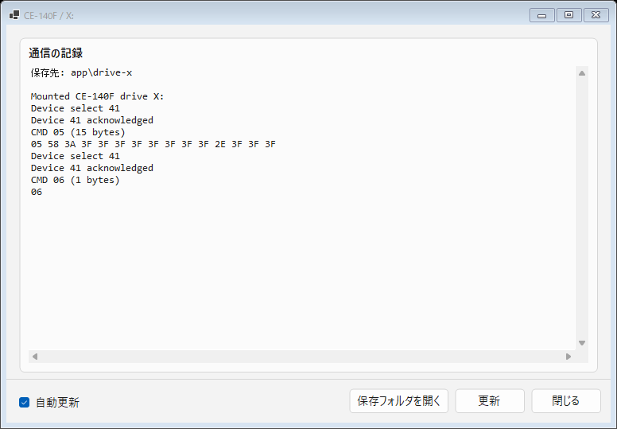

# 11. CE-140F（X: ドライブ）

`Sharp_ce140f_emul` を参考に、11ピン通信のデバイス選択、ACK/BUSY、4ビット転送、チェックサムを実装しました。PC上のフォルダを仮想ディスクとして使い、既定の保存先は `drive-x/` です。「CE-140F」で通信履歴を表示し、保存フォルダを開けます。履歴は0.5秒ごとに自動更新するので、SAVEやLOADの通信を実行しながら見られます。

PRO表示でプログラムを入力してから、次のように保存・読み込みできます。

```basic
SAVE "X:TEST.BAS"
SAVE "X:TEXT.BAS",A
LOAD "X:TEST.BAS"
```

2行目はASCII形式です。ASCII形式のファイルは、CE-140F のエミュレータ（ハード）と同じく、最後に 1Ah（EOF）を付けずに保存します。実機とやり取りするときの注意は「[実機とのファイルのやり取り](10_PROGRAMS.md#実機とのファイルのやり取り)」を見てください。読み込みでは、ファイルの中に 1Ah があればそこをファイルの終わりとして扱うので、PC などで 1Ah を付けたファイルも読めます。読み込んだプログラムを実行するには、BASICキーでRUN表示に戻して `RUN` を入力します。

RUN表示で連続ファイルを入出力する例です。

```basic
OPEN "X:DATA.DAT" FOR OUTPUT AS #2
PRINT #2,"HELLO"
CLOSE #2
OPEN "X:DATA.DAT" FOR INPUT AS #2
INPUT #2,A$
CLOSE #2
PRINT A$
```

FILES、COPY、NAME、SET、KILL、INITと、EOF/LOF/LOC/DSKFの通信処理も実装しています。ファイル名は英数字・`_`・`-`の8.3形式で、1つのファイルは最大1MBです。サブフォルダには対応しません。**INITは選択したフォルダの中の、FILES に出る 8.3 形式のファイルをすべて削除するため、CE-140F専用フォルダを指定してください。** 実フロッピーのセクタイメージや機械動作は再現しません。

## エラー

ドライブの答えに応じて、ROM が次のエラーを出します。

| 場面 | エラー |
|---|---|
| ファイルがない（`LOAD`・`KILL`・`COPY`・`NAME` など） | `File not found` |
| 「書き込み禁止」にしている、または `SET` で保護したファイルを変える | `File write protected` |
| `NAME` の新しい名前が、もうある・使えない | `NAME error` |
| `OPEN` した向きと逆の読み書き | `Mode error` |
| 1つのファイルが 1MB を超える `SAVE` | `Disk full` |
| 使えないファイル名 | `Syntax error` |
| 空のファイルの `LOAD`、そのほか | `I/O error` |

`KILL` はファイルだけを消します。フォルダの中のサブフォルダには触れません。

## 通信の記録

「CE-140F」のウィンドウに、本体とやり取りしたコマンドが並びます。うまく動かないときは、ここでエラーの理由を見られます。



---

[← 10. プログラムと文字のやり取り](10_PROGRAMS.md) ｜ [目次](../README.md) ｜ [12. CE-126P（プリンタ） →](12_CE-126P.md)
