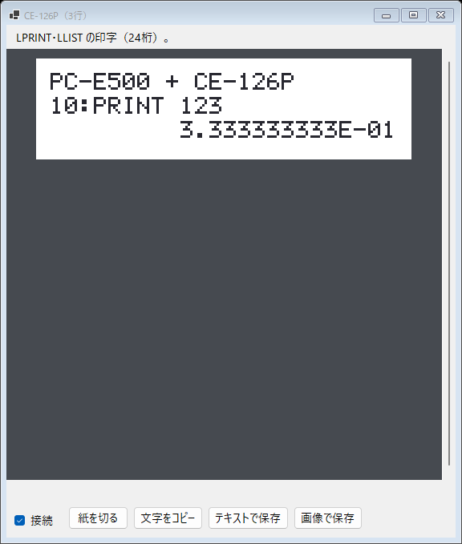

# 12. CE-126P（プリンタ）

ROMのプリンタドライバがそのまま動くように、11ピンのCE-126Pを再現しました（手順の解析は [pc-e500_tools](https://github.com/litchi-gh/pc-e500_tools)）。起動時から接続されていて、`LPRINT`・`LLIST`・`PRINT=LPRINT` の出力が24桁で印字されます。「CE-126P」で紙を表示します。紙はROMの文字フォントで描き、テキストまたはPNGで保存・コピーできます。



```basic
LPRINT "HELLO"
LLIST
```

- 「接続」を外すと、実機でプリンタをつないでいないときと同じく、ROM が `LPRINT` などを読み飛ばします（エラーにはなりません）。印字の途中で外すと `Printer error` になります。接続の状態は設定に残ります。
- CE-140Fと同じ11ピンにつないだ状態で、両方使えます。
- 「CE-126P」ウィンドウの「印刷先」で、印字をプリンタにも送れます。印刷先は設定に残ります。
  - USB のサーマルプリンタ（58mm・横384ドット、ESC/POS。MPT-II など）：ドライバや印刷キューなしで機器に直接送り、1行ずつすぐ印字します。字は ROM の文字の形を縦横3倍にし、1字2mm・1行4mm です。印字が3秒止まると、紙を12mm送ります。
  - Windows のプリンタ：印字が3秒止まったところで、それまでの行を実寸（1字2mm、1行4mm）でまとめて1つの印刷にします。用紙がいっぱいになれば次のページに続けます。
  - 「紙を印刷」で、紙の全体を印刷先へ送ります。
  - プリンタに送れないとき（つながっていない、ほかで使用中など）は、その行は紙のウィンドウにだけ残り、理由をウィンドウの下に表示します。エミュレータは止まりません。
- 紙は最大2000行で、古い行から消えます。紙は状態保存に含めませんが、プリンタのバス上の状態は含めるので、印字の途中でもいつでも保存できます（読み込むと、その行をもう一度最後まで印字します）。
- 印字の時間は再現しません（すぐ印字します）。

## Ubuntu で印刷する

「印刷先」には USB のサーマルプリンタと、CUPS に登録したプリンタが並びます。印字の決まりは Windows と同じです。

| 印刷先 | 準備 |
|---|---|
| USB のサーマルプリンタ | `/dev/usb/lp0` などに直接書きます。書けるのは `lp` グループの利用者なので、`sudo usermod -aG lp $USER` を実行して、ログインし直します |
| CUPS のプリンタ | デスクトップの設定の「プリンター」で登録しておきます。`lp` コマンドで送ります |

```sh
ls -l /dev/usb/lp*     # USB のプリンタが見えているか
lpstat -e              # CUPS のプリンタの名前
```

---

[← 11. CE-140F（X: ドライブ）](11_CE-140F.md) ｜ [目次](../README.md) ｜ [13. コントローラー →](13_CONTROLLER.md)
