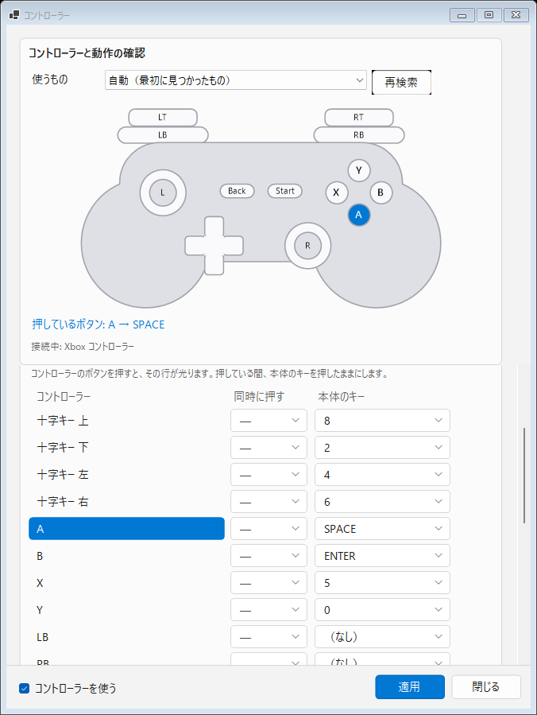

# 13. コントローラー



ツールバーの「コントローラー」で開きます。ゲームパッドのボタンに本体のキーを割り当てて、ゲームなどを遊べます。XInput（Xbox 系）と、Windows のゲームコントローラー（DirectInput 系）のパッドが使えます。

- 使うもの：使うパッドを選びます。「自動」は最初に見つかったものを使います。パッドをつないだあとは「再検索」を押してください（抜き差しは自動でも見つけます）。
- パッドの絵：押しているボタンが光り、スティックの位置やトリガーの押し具合も出ます。その下の「押しているボタン」の行に、ボタンと本体のキーが出ます。絵のボタンを押すと、その割り当ての行へ移ります。
- プリセット：割り当ての組をいくつも持てます。「追加...」は今のプリセットを写して新しく作り、「名前の変更...」「削除」もできます。用意してあるのは「テンキー 2・4・6・8」（既定）と「カーソルキー」です。
- ボタンの割り当て：ボタンごとに本体のキーを選びます。「同時に押す」で SHIFT か CTRL を一緒に押すこともできます。パッドのボタンを押している間、本体のキーも押したままになります。
- ボタンの位置合わせ...：DirectInput のパッドでは、ボタンの番号と絵の位置が実物と違うことがあります。そのときは絵に示された所のボタンを順に押して合わせます（「とばす」「やめる」もできます）。
- コントローラーを使う：外すとパッドを使いません。

「適用」で `state/controller.json` に保存します。パッドが効くのは、メインウィンドウが前にあるときだけです。ほかのウィンドウが前にあるときは、パッドで押しているキーが離れます。

## Ubuntu のコントローラー

カーネルのジョイスティック（`/dev/input/js0` など）を読みます。つないだあとは「再検索」を押すか、そのまま待つと見つかります。割り当て・プリセット・「ボタンの位置合わせ」は Windows と同じです。

```sh
ls -l /dev/input/js*   # パッドが見えているか
```

---

[← 12. CE-126P（プリンタ）](12_CE-126P.md) ｜ [目次](../README.md) ｜ [14. デバッグと機械語エリア →](14_DEBUGGER.md)
