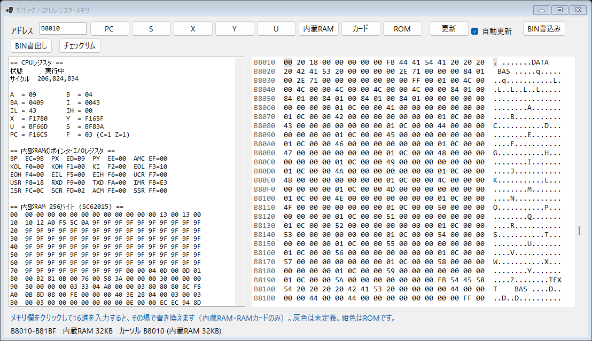
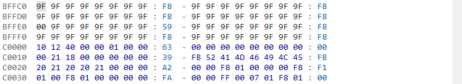
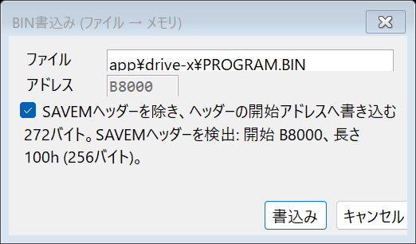
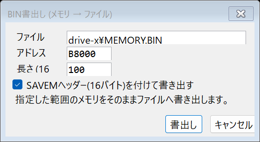
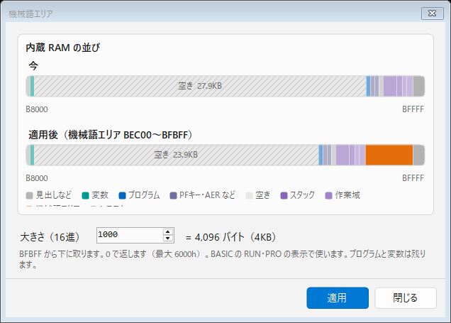

# 14. デバッグと機械語エリア

ツールバーの「デバッグ」または **Ctrl+D** で、CPUの状態を見るウィンドウを開きます。実行を止めずに見られるよう別ウィンドウで開き、250msごとに自動更新します（「自動更新」を外すと「更新」を押したときだけ読み直します）。



- メモリマップ（上）：内蔵 RAM の並びを色分けした帯です（変数・プログラム・PF キーと AER・空き・スタック・作業域・機械語エリア・システム）。RAM カードを付けているときは、その帯も出ます。区画を押すとメモリの表示がその先頭へ飛びます。帯の下の ▲ が今見ている位置です。マウスを乗せると区画の名前・番地・大きさが出ます。
- CPU（左）：A、B、BA、I、IL、IH、X、Y、U、S、PC、F を欄に並べ、実行中／HALT／電源OFF／エラー停止の状態を色付きの印で、フラグの C と Z を点く印で出します。経過サイクル数も出ます。その下に、SC62015 の内部 RAM 256 バイトと、BP・PX・PY のポインタ、KOL〜SSR の I/O レジスタを名前とアドレス付きで並べます。
- メモリ（右）：`00000-FFFFF` の16進ダンプです。1行は 16 バイトか 8 バイトで、ツールバーの「16 バイト/行」「8 バイト/行」で切り替えます（既定は 16）。8 バイトごとに、その後ろに「: XX」でチェックサムを付けます（下記）。右端のスクロールバーで全域を移動できるほか、アドレス欄に16進を入れてEnter（`B8000`、`&HB8000`、`0xB8000` のいずれでも可）、ホイール、矢印キー・PageUp/PageDown・Ctrl+Home/End、「PC」「S」「X」「Y」「U」「内蔵RAM」「カード」「ROM」のボタンで飛べます。下段に、表示範囲とカーソル位置がどの領域かを表示します。

```
B8010  00 20 18 00 00 00 00 00 : 38  - FB 44 41 54 41 20 20 20 : 75
```

メモリ欄は領域ごとに色分けします。

| 色 | 領域 |
|---|---|
| 黒 | 内蔵RAM・RAMカードとそのミラー（書き換え可） |
| 青 | 内蔵ROM（CE2）、E500S/E650/U6000の拡張ROM（CE3） |
| 灰 | 未定義（カード未装着時のスロット、CE6、内部エリアなど） |



## バイナリエディタ

メモリ欄のバイトをクリックしてカーソルを置き、`0`〜`9`・`A`〜`F` を打つとその場で書き換わります。上位・下位の順に1桁ずつ入力し、2桁で次のバイトへ進みます。書き換えられるのは内蔵RAMとRAMカードの範囲だけで、ROMや未定義領域に打っても変化せず、下段にその理由を表示します。書き換えた内容は通常のRAMと同じく自動保存されます。

## 8バイトごとのチェックサム

メモリ欄の「:」の右はその左の 8 バイトの和の下位 8 ビットです（青で表示します）。雑誌などに載った機械語のリストは 8 バイトごとにこの値が付いているので、打ち込んだあとに行ごとに照らし合わせられます。書き換えると、その場で値が変わります。

## BIN書込み・BIN書出し

|  |  |
|---|---|

- BIN書込み: ファイルの内容を指定アドレスから書き込みます。CE-140Fの `SAVE M` が作る16バイトヘッダー付きファイルでは、ヘッダーを自動検出し、ヘッダーに記録された開始アドレスへヘッダーを除いて書き込みます（チェックを外せば任意のアドレスへ書き込めます）。書込み先はRAMの範囲に収まっている必要があり、1バイトでもROMや未定義領域にかかる場合は何も書き込みません。
- BIN書出し: 指定アドレスから指定した長さをファイルへ書き出します。既定では `SAVE M` と同じ16バイトヘッダーを付けるので、`LOAD M` やBIN書込みでそのまま元の位置へ戻せます。

メモリの読み出しはLCDコントローラを通さないため、`2000-3FFF` を覗いても表示は乱れません。

## 機械語エリア



ステータスバーの「機械語」の欄（または右クリックのメニューの「機械語エリア...」）で、機械語プログラム用に RAM を確保できます。ウィンドウには内蔵 RAM の並びが「今」と「適用後」の2本の帯で出るので、確保する場所と、空きがどれだけ減るかを見ながら決められます。大きさを16進のバイト数で決めて「適用」を押すと、`BFBFF` から下へその大きさを取ります。0 にすると返します。いちばん大きい値はそのときの空き領域から決まります。

確保は本体の ROM の処理で行います（`POKE &HBFE03,...:CALL &HFFFD8` を自動で入力します）。指定するのは確保したあとの大きさで、足す量ではありません。ROM はほかの作業域とスタックを下へずらしてメインメニューに戻るので、そのあと BASIC キーを押して BASIC に戻します。BASIC のプログラムと変数は残ります。BASIC の RUN か PRO の表示で使ってください。今の大きさはステータスバーの欄に出て、マウスを乗せると番地の範囲が出ます。

BIN を読み込んでも機械語エリアは確保されません（実機の `LOAD M` と同じ）。「プログラム読込」で機械語エリアの外に入る BIN を読み込むときは、確保するかを聞きます（[10章](10_PROGRAMS.md#プログラムを読み込むプログラム読込ドラッグドロップ)）。

---

[← 13. コントローラー](13_CONTROLLER.md) ｜ [目次](../README.md) ｜ [15. 保存と復元 →](15_SAVE.md)
