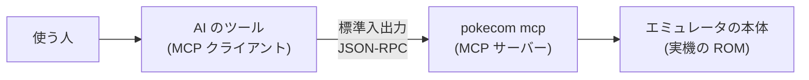

# 18. MCP サーバー（AI から使う）

`pokecom mcp` は、AI のツール（Claude Code、Claude Desktop、VS Code、Cursor など）からエミュレータを操作するための MCP サーバーです。AI が BASIC のプログラムを書き、実際に動かし、液晶や印字を見て直す、といった使い方ができます。

[MCP](https://modelcontextprotocol.io/)（Model Context Protocol）は、AI のツールに外の道具をつなぐための共通の取り決めです。



- 通信は標準入出力だけです。ネットワークの口は開きません。
- [17章](17_CLI_REFERENCE.md)の操作が、すべて MCP のツールになっています（`script` と `mcp` を除く37個）。
- 本体は1台です。最初に使われたときに起動し、AI のツールが終わるまで同じ本体を使い続けます。
- 画面のあるエミュレータの RAM・設定には触れません。開いているウィンドウを操作するものではありません。

## 用意するもの

1. `pokecom`（[16章](16_CLI.md#用意するもの)）
2. ROM（[ROM の探し方](16_CLI.md#rom-の探し方)）。AI のツールは、思わぬフォルダでサーバーを起動することがあるので、**環境変数 `POKECOM_ROM` か `--rom` で、場所をはっきり指定する**のが確実です

先に、端末で動くことを確かめておきます。

```console
$ pokecom exec "PRINT 1+2" --rom "/path/to/PC-E500(7.2).ROM"
```

## つなぎかた

どのツールでも、決めることは3つだけです。

| 項目 | 値 |
|---|---|
| コマンド | `pokecom`（フルパスで書くのが確実） |
| 引数 | `mcp` と、要るオプション（`--rom`・`--ram`・`--card`・`--disk` など） |
| 種類 | stdio（標準入出力） |

パスの例です。

| システム | コマンド |
|---|---|
| Windows | `C:\\Tools\\pokecom\\pokecom.exe`（JSON では `\` を2つ書きます） |
| Ubuntu（.deb） | `/usr/bin/pokecom` |
| Ubuntu（tar.gz） | `/home/名前/pockecom/Emulator/pokecom` |
| Mac | `/Users/名前/pockecom/Emulator/pokecom` |

### Claude Code

```sh
claude mcp add pokecom -- /usr/bin/pokecom mcp --rom "/home/me/PC-E500(7.2).ROM"
```

プロジェクトで共有するなら、フォルダに `.mcp.json` を置きます。

```json
{
  "mcpServers": {
    "pokecom": {
      "command": "/usr/bin/pokecom",
      "args": ["mcp", "--disk", "./disk"],
      "env": { "POKECOM_ROM": "/home/me/PC-E500(7.2).ROM" }
    }
  }
}
```

`/mcp` で、つながっているかを確かめられます。

### Claude Desktop

設定の「開発者」から設定ファイル（`claude_desktop_config.json`）を開き、`mcpServers` に加えて、起動し直します。

| システム | 設定ファイル |
|---|---|
| Windows | `%APPDATA%\Claude\claude_desktop_config.json` |
| Mac | `~/Library/Application Support/Claude/claude_desktop_config.json` |

```json
{
  "mcpServers": {
    "pokecom": {
      "command": "C:\\Tools\\pokecom\\pokecom.exe",
      "args": ["mcp"],
      "env": { "POKECOM_ROM": "C:\\Tools\\pokecom\\rom\\PC-E500(7.2).ROM" }
    }
  }
}
```

### VS Code（GitHub Copilot など）

`.vscode/mcp.json` に書きます。

```json
{
  "servers": {
    "pokecom": {
      "type": "stdio",
      "command": "/usr/bin/pokecom",
      "args": ["mcp"],
      "env": { "POKECOM_ROM": "/home/me/PC-E500(7.2).ROM" }
    }
  }
}
```

### Cursor

プロジェクトの `.cursor/mcp.json`（全部のプロジェクトで使うなら `~/.cursor/mcp.json`）に、Claude Desktop と同じ形で書きます。

### Codex CLI

`~/.codex/config.toml` に書きます。

```toml
[mcp_servers.pokecom]
command = "/usr/bin/pokecom"
args = ["mcp"]
env = { POKECOM_ROM = "/home/me/PC-E500(7.2).ROM" }
```

### そのほかのツール

標準入出力（stdio）の MCP サーバーを登録できるツールなら、同じ3つを設定すれば使えます。MCP のプロトコルの版は `2025-06-18`・`2025-03-26`・`2024-11-05` に対応しています。

## 使ってみる

つないだら、ふつうの言葉で頼みます。

| 頼みごと | AI が使うツール |
|---|---|
| 「PC-E500 の BASIC で素数を求めるプログラムを書いて、動かして」 | `run` |
| 「この game.bas を読み込んで、右キーを2秒押したときの画面を見せて」 | `load`、`type`、`key_down`、`wait`、`key_up`、`screen` |
| 「B8000 から 64 バイトを見せて」 | `memory` |
| 「X: にあるファイルの一覧と、エラーの原因を調べて」 | `drive_files`、`drive_trace` |
| 「この BIN を読み込んで、CALL した後のレジスタを見せて」 | `load_bin`、`exec`、`registers` |

### うまく頼むこつ

- **長い結果は `LPRINT` で出させる。** 液晶は4行しかありません。`run` と `exec` は、印字された行も返します。
- **`INPUT` のあるプログラムは、答えも伝える。** `run` の `input` に入ります。
- **図形は絵で見せる。** `screen` に `picture` を付けると、液晶のドットを PNG で返します。
- **入力待ちや無限ループは、時間切れ（コード3）で返る。** `seconds` を延ばすか、`key` で BRK を押させます。
- **やり直しの前に状態を残す。** `save_state` と `load_state` で、同じ所から何度でも試せます。

## ツールの一覧

引数は [17章](17_CLI_REFERENCE.md)と同じです。MCP では、名前の `-` が `_` になります（`wait-text` は `wait_text`）。

| 分類 | ツール |
|---|---|
| 本体 | `start` `info` `configure` `reset` `all_reset` `save_state` `load_state` `roms` |
| プログラム | `run` `load` `program` `exec` `reserve` |
| キーと画面 | `type` `key` `key_down` `key_up` `wait` `wait_text` `screen` |
| 音 | `record` |
| CE-126P | `printed` `paper_cut` |
| CE-140F | `drive_files` `drive_put` `drive_get` `drive_trace` |
| RAM カード | `card_create` |
| デバッグ | `registers` `set_register` `memory` `poke` `imem` `poke_imem` `ram_map` `load_bin` `save_bin` |

### 返ってくるもの

```
Screen:
RUN
                                      25
>
Symbols: RUN CAPS DEG
```

- 画面を見せるツールは、液晶の4行と、点いている表示シンボルを返します。
- `screen` に `picture: true` を付けると、PNG の画像も付きます。
- 失敗すると `isError` が付き、理由が文字で返ります。サーバーは止まりません。
- 標準入力は通信に使うので、`file` に `-` は使えません。プログラムは `program` に直接書きます。

### 番地とバイト列の書き方

番地は16進の文字列で書きます（`"B8000"`、`"&HB8000"`、`"0xB8000"`）。バイト列は `"08 05 06"` のように書きます。

## ファイルの扱い

サーバーは、起動した利用者の権限で動きます。ツールの引数にファイル名を書けば、その利用者が読み書きできるファイルを読み書きします（`load`・`drive_put`・`save_state`・`screen` の `png` など）。X: のフォルダ（`--disk`）の中身は、プログラムの `SAVE`・`KILL`・`INIT` でも変わります。**`INIT` はそのフォルダのディスク対象のファイルを消す**ので、専用のフォルダを指定してください。指定しなければ、終わると消える一時フォルダを使います。

多くの AI のツールは、ツールを使う前に確認を出します。初めのうちは、確認を出したまま使うことを勧めます。

## つながらないとき

| 症状 | 見るところ |
|---|---|
| サーバーが起動しない | コマンドのパスを端末で実行できるか。Mac でブラウザからダウンロードしたときは [`xattr`](03_MACOS.md#入れかた) を済ませたか |
| 「ROM が見つかりません」 | `POKECOM_ROM` か `--rom` をフルパスで指定したか |
| ツールが出てこない | ツールの設定を読み直したか（多くは再起動が要ります） |
| 画面が変わらない | 前のプログラムが動いたままでないか。`key` で `BRK`、または `start` でまっさらにします |
| 自分で通信を見たい | 下のように、1行の JSON を流せます |

```console
$ printf '%s\n' \
  '{"jsonrpc":"2.0","id":1,"method":"initialize","params":{"protocolVersion":"2025-06-18"}}' \
  '{"jsonrpc":"2.0","method":"notifications/initialized"}' \
  '{"jsonrpc":"2.0","id":2,"method":"tools/call","params":{"name":"run","arguments":{"program":"10 PRINT 5*5"}}}' \
  | pokecom mcp
```

---

[← 17. pokecom のコマンド一覧](17_CLI_REFERENCE.md) ｜ [目次](../README.md) ｜ [19. 対応範囲と、環境ごとの違い →](19_COMPATIBILITY.md)
