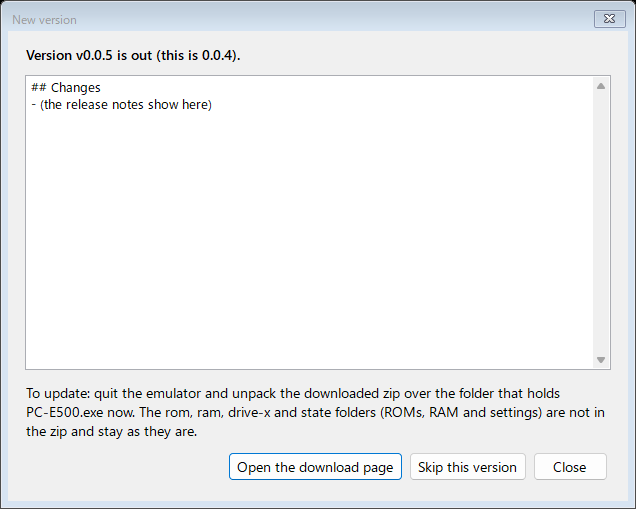

# 1. On Windows

Releases on the [releases page](https://github.com/litchi-gh/pc-e500_emulator_pockecom/releases) come as an installer (`PC-E500-Emulator-<version>-win-x64-setup.exe`) and a zip (`PC-E500-Emulator-<version>-win-x64.zip`). Neither is signed. From the release after 0.0.4 on, the release notes list each file’s SHA-256: compare it with what PowerShell’s `Get-FileHash <file>` prints to check a download.

- **Installer**: install for you only (no administrator; the default) or for all users. The program goes to `%LocalAppData%\Programs\PockeComE500\` (or `C:\Program Files\PockeComE500\` for all users); ROMs, RAM, settings and state go per user to `%LocalAppData%\PockeComE500\` either way. Uninstalling leaves them.
- **Zip**: run `PC-E500.exe` in the unpacked folder; the data stays beside it.

Built from source, double-click `Start-PC-E500.cmd`, or open `app/PC-E500.exe` directly.

- Windows x64. The .NET runtime is bundled; no Python or developer tools are needed to run it.
- With the zip or a source build everything the program uses lives in the `app` folder, which can be copied elsewhere as a whole. Installed, the folders below are in `%LocalAppData%\PockeComE500\`.

| Folder | Contents |
|---|---|
| `app/rom/` | Internal ROM images, loaded at start-up (a ROM opened from elsewhere with Open ROM is opened again at the next start) |
| `app/ram/` | RAM card image files (default location for creating and attaching) |
| `app/drive-x/` | Default folder of the CE-140F (drive X:) |
| `app/state/` | Settings, controller presets (`controller.json`), internal RAM contents, automatic snapshots, pre-reset backups |
| `app/manual/` | The illustrated manual (`index.html` Japanese, `index_en.html` English) |

- ROMs are read from `app/rom/`. "Open ROM" accepts 256KB and 384KB images; a dump straight from the machine with its 16-byte `SAVEM` header (256KB+16) opens as it is. Verified to work with ROMs of the PC-E500, PC-E500S, PC-E550, PC-1480U, PC-1490UII, PC-E650 and PC-U6000.
- The system requirements (OS, CPU, memory and so on) are in [the README](../../README_en.md#system-requirements). Tested on Windows 11 (x64); Windows 10 and Windows on ARM are untested.

## The emulator with no window (pokecom)

The command line, for terminals, scripts and AI tools, comes separately as `pokecom-<version>-win-x64.zip`: see [chapter 16](16_CLI.md).

## New versions

At start-up, once a day at most, the emulator asks GitHub [Releases](https://github.com/litchi-gh/pc-e500_emulator_pockecom/releases) whether a new version is out, and announces it on the toolbar and in the right-click menu. The button shows what changed, and "Open the download page" opens the release page. It never downloads or replaces anything.

The Start menu's "PC-E500 Emulator data folder", or "Open the data folder" in the right-click menu, opens the data folder.

The question goes to GitHub's public API (`api.github.com`) without an account, sending only the running version (as the User-Agent). Turn the automatic check off with "Check for a new version at start-up" in Settings; "Check for a new version..." in the right-click menu checks at any time.

## Updating

Updating is done by hand. Quit the emulator first, then do as fits the way it was installed. ROMs, RAM, settings and the files of X: stay whichever way.

| Installed with | How to update |
|---|---|
| The installer | Get the new `PC-E500-Emulator-<version>-win-x64-setup.exe` from [Releases](https://github.com/litchi-gh/pc-e500_emulator_pockecom/releases) and run it. It installs over the old one |
| The zip | Unpack the new `PC-E500-Emulator-<version>-win-x64.zip` over the folder that holds `PC-E500.exe` now. The `rom`, `ram`, `drive-x` and `state` folders stay |
| The command line (`pokecom`) | Unpacking the new `pokecom-<version>-win-x64.zip` makes a new folder, `pokecom-<version>-win-x64`. If you kept a ROM in the old folder's `rom`, move it to the new folder's `rom`. The old folder can then go |

- With the command line's ROM in `%LocalAppData%\PockeComE500\rom`, nothing needs moving at an update ([chapter 16](16_CLI.md#where-the-rom-is-looked-for)).
- If the PATH or an AI tool's settings name the old folder's `pokecom.exe`, change them to the new folder.

To see that it worked, look at the title bar ("PC-E500 Emulator v0.2.0" or the like) or at what `pokecom version` prints.

---

[Contents](../README_en.md) ｜ [2. On Ubuntu (Linux) →](02_LINUX.md)
