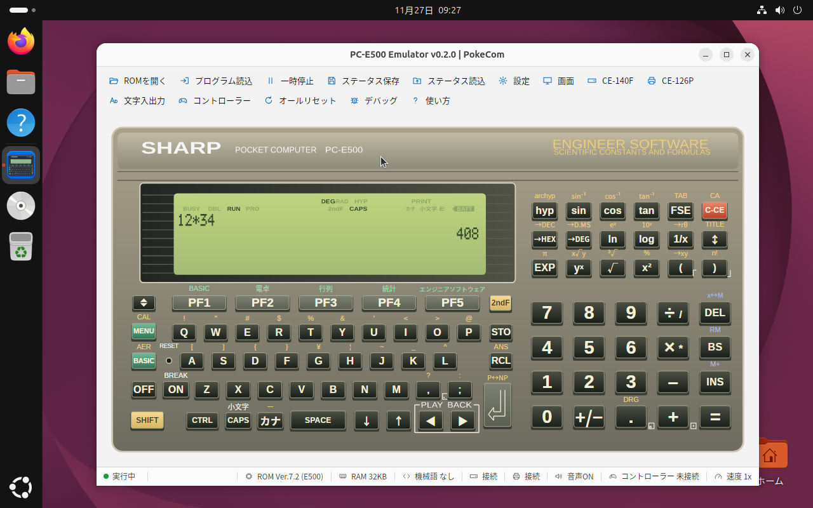
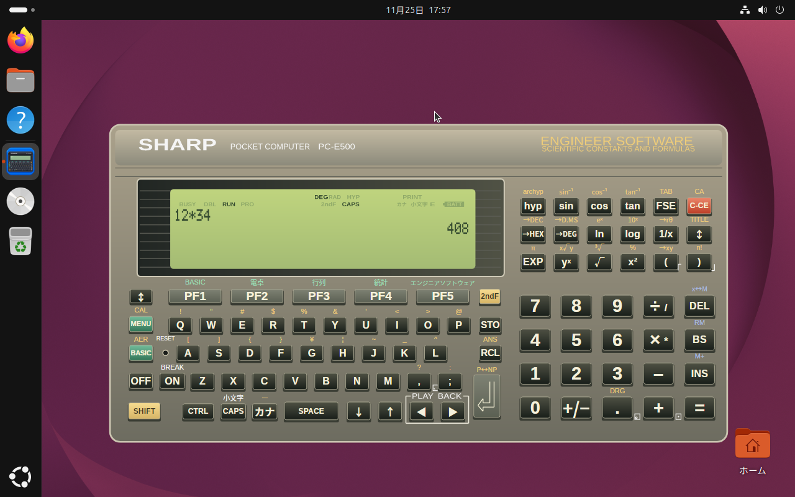

# 2. On Ubuntu (Linux)

The emulator runs on the Ubuntu desktop and is used just like the Windows program. The ROM does the same work, and the files it saves are the same.



## Requirements

| Item | |
|---|---|
| OS | Ubuntu 24.04 or later (x86-64), Wayland or X11 (through XWayland on Wayland) |
| To install first | Nothing: the .NET runtime is included. The `.deb` brings the libraries it needs (X11, fonts, ALSA) with it |
| Fonts | Japanese text uses Noto Sans CJK (`fonts-noto-cjk`, already there on a Japanese Ubuntu) |
| Disk | About 180 MB |

## Installing

Open a terminal and paste this line. It takes the newest version from GitHub and installs it. To update, run the same line again (ROMs, RAM and settings stay).

```sh
wget -qO- https://raw.githubusercontent.com/litchi-gh/pc-e500_emulator_pockecom/main/install.sh | sh
```

`wget -qO- address` takes the script `install.sh` from GitHub, and `| sh` runs it. Options go after `| sh -s --`. To put a ROM of yours (here `~/PC-E500(7.2).ROM`) in place too:

```sh
wget -qO- https://raw.githubusercontent.com/litchi-gh/pc-e500_emulator_pockecom/main/install.sh | sh -s -- --rom ~/'PC-E500(7.2).ROM'
```

To see what it does first, split it.

```sh
wget -qO- https://raw.githubusercontent.com/litchi-gh/pc-e500_emulator_pockecom/main/install.sh > install.sh
less install.sh
sh install.sh
```

| Command | What it does |
|---|---|
| `wget -qO- address > install.sh` | Takes the script and saves it in the current folder |
| `less install.sh` | Shows it (`q` ends) |
| `sh install.sh` | Runs it |

| Option | |
|---|---|
| `--rom file` | Copies a ROM of yours into the `rom` folder. `( )` mean something to the shell, so the name goes in `'…'` |
| `--deb` | Installs the `.deb` (asks for the administrator's password) |
| `--emulator file` | Uses a `.tar.gz` you have (a `.deb`, with `--deb`) instead of downloading |

### What is installed

| What | Without `--deb` | With `--deb` |
|---|---|---|
| The program | `~/pockecom/Emulator` | `/opt/pc-e500` |
| Terminal commands (`pc-e500`, [`pokecom`](16_CLI.md)) | `~/.local/bin` | `/usr/bin` |
| ROMs, RAM cards, the X: folder, settings | In `~/pockecom/Emulator` | `~/.local/share/PockeComE500`, per user |
| The app list | "PC-E500 Emulator" | "PC-E500 Emulator" |
| Administrator | Not needed | Needed |
| Libraries missing (X11, fonts, ALSA...) | Not installed (their names show at the end) | Installed too |

- Run it without `sudo`. Only with `--deb` does the script use `sudo apt-get`.
- If `~/.local/bin` is not on the PATH (where commands are looked for), a line is added to `~/.bashrc`. **Open a new terminal** and `pc-e500` and `pokecom` work.
- For another folder than `~/pockecom`, write `POCKECOM_HOME=folder sh install.sh`.
- The folders are those of the [PC-E500 development tools](https://github.com/litchi-gh/pc-e500_tools)' `install.sh`; an emulator installed by that one is used as it is.

See that it is installed:

```sh
pokecom version
pokecom roms
pc-e500
```

| Command | What it does | When all is well |
|---|---|---|
| `pokecom version` | Shows the version | `0.2.1` or the like |
| `pokecom roms` | Lists the ROMs found | Yours is there |
| `pc-e500` | Starts the emulator | Its window opens |

## Putting the ROM in place

No ROM is included. Put [one dumped from your own machine](04_ROM.md) in the `rom` folder and start the program. Installed with `--rom`, it is there already. To put one later:

```sh
cp ~/'PC-E500(7.2).ROM' ~/pockecom/Emulator/rom/
```

Installed with `--deb`:

```sh
cp ~/'PC-E500(7.2).ROM' ~/.local/share/PockeComE500/rom/
```

`cp from to` copies a file.

"Open the data folder" in the right-click menu opens the folder. "Open ROM" chooses a ROM anywhere else.

## What differs from Windows

Everything from [chapter 5](05_FIRST_STEPS.md) on applies. Only these differ.

| Item | Ubuntu |
|---|---|
| Choosing files | The desktop's own window (GNOME's file chooser) |
| Running after "Load program" | Asked after the file is chosen (on Windows, a check box in the file window). A dropped file follows the last answer |
| Sound | To ALSA's default output (PipeWire on Ubuntu) |
| Where the CE-126P prints | A USB thermal printer (`/dev/usb/lp0` and so on) or a printer set up in CUPS ([chapter 12](12_CE-126P.md)) |
| Game controllers | The kernel's joysticks (`/dev/input/js0` and so on; [chapter 13](13_CONTROLLER.md)) |
| Theme | "As the system" follows the desktop's light or dark |
| Standard LCD look | The dots' edges are smoothed to the screen's pixels |

The case-only and screen-only views, moving by dragging, sizing by the edges and "Always on top" work the same way.



## Updating and uninstalling

When a new version is out, a "New version" button appears on the toolbar. Quit the emulator and run the line of [Installing](#installing) again (with `--deb`, if that is how it was installed). ROMs, RAM and settings stay.

To take it out, installed without `--deb` (the data goes too, so move ROMs and the like first):

```sh
rm -r ~/pockecom/Emulator
rm ~/.local/bin/pc-e500 ~/.local/bin/pokecom ~/.local/share/applications/pc-e500.desktop
```

Installed with `--deb` (the data stays):

```sh
sudo apt remove pc-e500-emulator
```

| Command | What it does |
|---|---|
| `rm -r folder` | Deletes a folder with what is in it |
| `rm file…` | Deletes files: here the terminal commands and the entry in the app list |
| `sudo apt remove name` | Takes a package out |

## Moving data to and from Windows

State files (`.e500state`), RAM card images (`.ram`) and the files in the X: folder are in the same form as on Windows: copy them and go on. The settings (`state/settings.json`) hold the places of the ROM and the X: folder, so choose those again with "Open ROM" and Settings after copying them.

BASIC text whose lines end with LF alone, as files made on Linux do, loads as well.

---

[← 1. On Windows](01_WINDOWS.md) ｜ [Contents](../README_en.md) ｜ [3. On a Mac (command line) →](03_MACOS.md)
