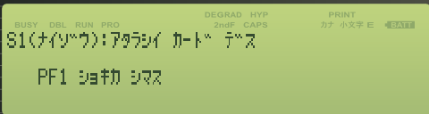

# 5. First steps



1. When `S1(MAIN): NEW CARD` appears (katakana on a Japanese ROM), press **PF1** (**F1** on the PC) to initialise memory. A freshly attached RAM card asks for the same. Large capacities take a few seconds.
2. Press **BASIC** (**F7**). **RUN** lights up at the top of the LCD.
3. Type `1+2` and **Enter**; the result `3` is displayed.

To enter a program, **press BASIC again to switch to PRO**:

```basic
10 PRINT 123
```

Enter registers the line; press **BASIC** to return to **RUN**, then type `RUN` and Enter to see `123`. Numbered lines typed in RUN mode give a Syntax error.

To print a string, type `PRINT "HELLO"` and Enter in RUN mode.

---

[← 4. Getting the ROM](04_ROM.md) ｜ [Contents](../README_en.md) ｜ [6. Keys and resetting →](06_KEYS.md)
