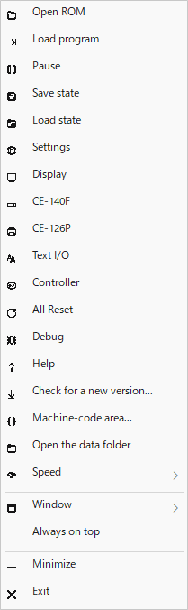
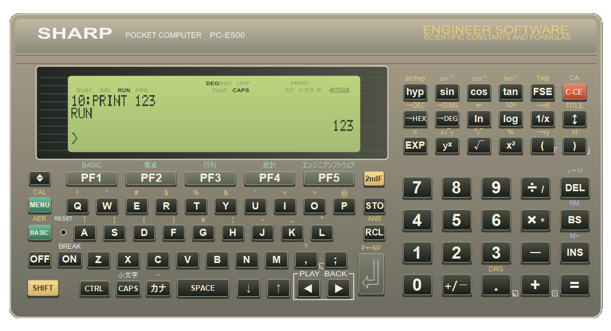
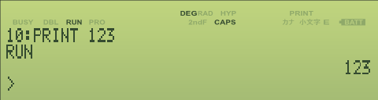
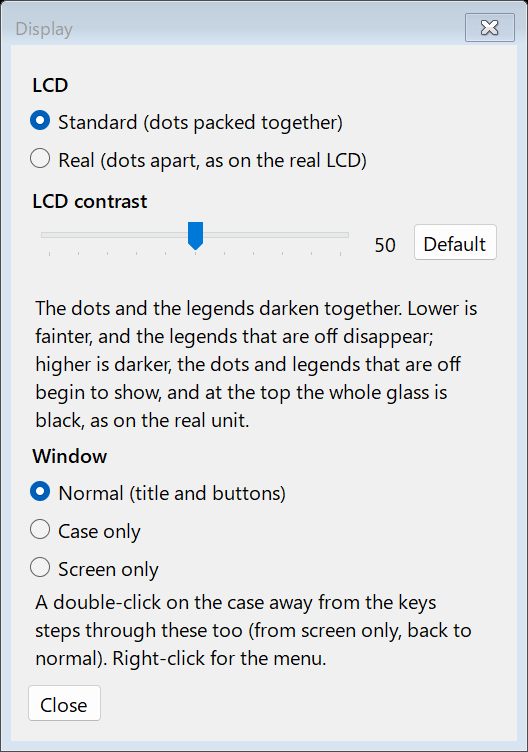
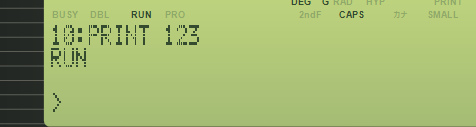
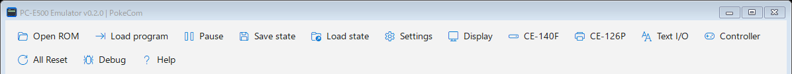

# 7. Display and windows

## Status bar

The status bar along the bottom of the window is split into fields.

- **Left**: the machine's state (a green dot running, yellow paused, grey switched off). Click it to pause or resume.
- **Next to it**: messages such as Load program's, for five seconds, in place of the fields at the right. A failed autosave stays on show beside the fields.
- **Right**: the ROM version and family, internal RAM and the RAM card (`RAM 32KB+64KB` and the like), the machine-code area, the CE-140F, the CE-126P, sound, the controller (only while "Use a controller" is ticked; it is by default) and the speed (0.5x to 4x). Hover for the details (the ROM's size and file, the card's file name and so on). The memory field opens Settings, the ML field the window that sizes the machine-code area, the CE-140F and CE-126P fields open their windows, the sound field mutes or unmutes, the controller field opens the Controller window, and the speed field goes round 0.5x → 1x → 2x → 4x (use 1x when checking sound).

When the window is narrow (or the display is scaled up), the fields at the right switch to short forms ("off", "1x" and the like) one by one, CE-140F, CE-126P, controller, speed, sound, ML, RAM and ROM in that order; the icon tells which field it is, and hovering shows the full text. Only if that is still too wide do the leftmost fields go. The case-only and screen-only views have no status bar.

## Right-click menu

Right-click anywhere on the case, the toolbar or the status line for a menu with the toolbar's commands, plus the speed, the window view, Always on top, Check for a new version..., Machine-code area..., Open the data folder, Minimize and Exit. In the views without a title bar and buttons, this menu is how you operate the emulator.

## Window views (double-click to switch)

Double-click the case away from the keys to step through **normal → case only → screen only → normal**. "Window" in the right-click menu and the Display window choose a view too.

| Case only | Screen only |
|---|---|
|  |  |
| No title bar or buttons, only the case (its corners are see-through) | Only the LCD |

- Switching keeps the LCD where it is and the same size on the screen; back in normal, the window returns to its earlier place and size.
- In the case-only and screen-only views, drag the picture to move the window, and drag its edge (the outline of the case, or the edge of the LCD) to resize it. The proportions are kept.
- The view, size and place carry over to the next start.
- A double-click on a key is still two presses.

## LCD look and contrast (Display)

| | |
|---|---|
|  |  |
| Display on the toolbar | The LCD in the real display |

- **LCD**: Standard packs the dots together; Real leaves a little space between them, as on the real LCD.
- **LCD contrast**: 0 to 100, 50 by default. As with the real unit's dial, the dots and the legends darken together: lower hides the legends that are off, higher shows the dots that are off, and 100 makes the whole glass black.
- **Afterimage (frame interpolation)**: a dot turning on or off changes over a few frames instead of at once (most of the way in about 0.01 s on, 0.02 s off; a dot going off is gone in about two frames). It is close to the slow response of the real LCD and keeps a picture caught half redrawn from flickering. Something that moves a dot at a time (a game's ship, scrolling stars) is drawn sliding smoothly from its last place to the next. The lines between the dots in the Real look do not move. A moving picture shows up to one step late. On by default. The screen is drawn once per refresh of the display (60 times a second, say), so movement runs evenly with or without it.
- Changes show at once and are saved in the settings.

## Sub-windows

Settings, Display, CE-140F, CE-126P, Text I/O, Controller, Machine-code area and Debug are modeless: keys and toolbar buttons of the main window keep working while they are open, so you can watch the transfer log or the registers while the machine runs. Pressing the same button again brings the existing window forward; closing the main window closes them all. "Apply" in Settings reports a rejected value and keeps the window open so you can fix it.

The file choosers of Open ROM, Load program, Save state, Load state and BIN load/save are the system's own (Windows', or the Ubuntu desktop's) and therefore modal.

Every sub-window is built the same way: the content on cards with headings, and the buttons such as Close in a footer at the bottom right (the one Enter presses, in the accent colour, to the left of Close). Checks such as Auto refresh and Connected, and result messages, sit at the left of the footer.

The Settings, Controller, Text I/O and CE-126P windows cannot be made wider, as their content would not change; they can be made taller. Debug can be made narrower, but not wider than it opens.

---

[← 6. Keys and resetting](06_KEYS.md) ｜ [Contents](../README_en.md) ｜ [8. Settings and sound →](08_SETTINGS.md)
