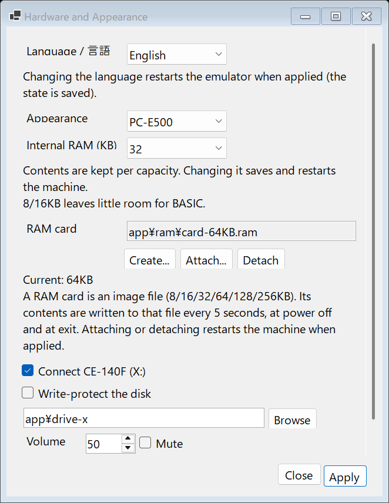

# 8. Settings and sound

Settings is split into Display, Machine, CE-140F, and Sound, power and more. It covers the UI language, the theme (as Windows — as the system, on Ubuntu —, light or dark; a new language or theme restarts the emulator when applied), the appearance (PC-E500 / PC-E650), internal RAM size, RAM card creation/attach/detach, CE-140F connection, folder and write protection, volume and mute, the auto power off, and always on top. With "Always on top" ticked, the main window is never hidden under other windows (the right-click menu switches it too).

With "Auto power off" cleared, the machine no longer switches itself off when left without a key (the real one does after about 10 minutes): once a second of the machine's time, the count the ROM runs down is put back to its start, as a key press does.

Display covers the LCD look, its contrast and the window view. By default the LCD scales its dots without gaps (Standard); "Real" leaves a little space between them, as on the real LCD. The contrast works like the real unit's dial, on the dots and the legends together: lower hides the legends that are off, higher shows the dots and legends that are off, and at 100 the whole glass is black.

Right-click the case for a menu with the toolbar's commands (plus the speed, the window view, Always on top, Minimize and Exit). A double-click on the case away from the keys steps the window through Normal → Case only (no frame) → Screen only (the LCD alone) → Normal. Without the frame, drag the picture to move the window and its edge to resize it (keeping its proportions). The view, its size and its place are saved, and the next start opens in that view.

Appearance switches the case shape and colour, LCD and key positions and the nameplate. The PC-U6000 shares the PC-E650 case, so only PC-E500 and PC-E650 are offered. Appearance does not change the ROM or RAM size; choose those separately.

## Sound

- In RUN mode, `BEEP 1` and Enter beeps. The CPU's XOUT waveform is sent to the PC's audio output. Check sound at 1x; audio is not in sync at other speeds.
- On Windows, audio is written to winmm (waveOut) from a dedicated thread, because `waveOutWrite` blocks its caller when restarting a stalled stream (91 ms on average, 1.4 s at worst here). Called on the thread that runs the CPU, it would stop the whole machine, so the UI thread only hands over the samples. The device always holds 42 ms (256 samples × 8); less than about 32 ms runs dry between frames and the stream restarts with audible gaps.
- Key click length and auto-repeat interval come from the SC62015 sub-timer (64 Hz), matched against a recording of a real PC-E500: 13.5 ms click, 62.5 ms repeat.
- On Ubuntu it goes to the default ALSA output (which PipeWire or PulseAudio takes).
- Toolbar buttons never take focus: a focused button would swallow Space and Enter, which are pocket computer keys.

---

[← 7. Display and windows](07_WINDOW.md) ｜ [Contents](../README_en.md) ｜ [9. Internal RAM and RAM cards →](09_RAM.md)
