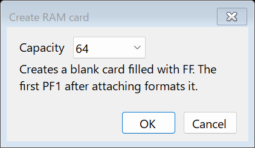

# 9. Internal RAM and RAM cards

## Internal RAM expansion (62256 → 628128)

Internal RAM sits directly below `C0000` and grows downwards. The real E500 and E500S have one 32KB SRAM (62256), the E650/U6000 two of them (64KB); replacing each with a 128KB 628128 is a well-known expansion mod, and the emulator offers the same result.

| Model | Stock | 628128×1 | 628128×2 |
|---|---:|---:|---:|
| PC-E500 / PC-E500S | 32KB (`B8000-BFFFF`) | 128KB (`A0000-BFFFF`) | — |
| PC-E650 / PC-U6000 | 64KB (`B0000-BFFFF`) | 128KB (`A0000-BFFFF`) | 256KB (`80000-BFFFF`) |

With an E650/U6000 384KB ROM the internal RAM choices are 64 / 128 / 256KB. The ROM itself measures the size at boot, so the choice shows up in BASIC (`PRINT FRE(0)` gives 61368, 126904 and 257976). 8/16/32KB do not exist on a real E650/U6000 and are not offered; such a stored setting starts as 64KB. The PC-E500S's 384KB ROM offers the same sizes as the PC-E500.

Reference: [E500 series memory expansion](https://www.oit.ac.jp/labs/rd/rssrv/kobayashi-lab/~yagshi/old_web/misc/pocketcom/memup/index.html)

- Internal RAM is **8 / 16 / 32 / 64 / 128 / 256 KB**, 32KB by default; **64 / 128 / 256 KB** (64KB by default) with an E650/U6000 384KB ROM; the PC-E500S is as the PC-E500.
- Changing the size saves the current contents and restarts. Contents are kept per size, so switching back restores what that size held.

## RAM cards (image files)

Each RAM card is an image file. The file size is the card capacity (**8 / 16 / 32 / 64 / 128 / 256 KB**) and its bytes are the card contents, so cards can be created and swapped like real ones.

| Action | Meaning |
|---|---|
| Create... | Choose a capacity and create a new image (all FF). The default location is `ram/`. The new card is attached |
| Attach... | Attach an existing image file |
| Detach | Empty the slot |

"Apply" performs the change after saving the current contents, then restarts. With a new card the ROM asks for PF1 as `NEW CARD`.

The card contents are written to its image file every 5 seconds, at power off, at exit and on detach. Copying the file makes a duplicate card. Card changes never affect internal RAM.

---

[← 8. Settings and sound](08_SETTINGS.md) ｜ [Contents](../README_en.md) ｜ [10. Programs and text →](10_PROGRAMS.md)
