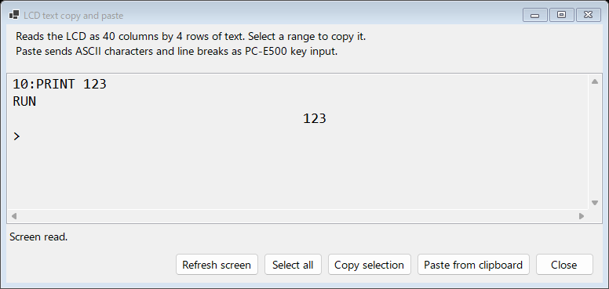

# 10. Programs and text

## Loading a file (Load program, drag and drop)

Load program on the toolbar, or a file dropped on the window, loads a PC file into the machine. With "Run after loading (RUN for a BAS)" ticked at the bottom of the file window, a BAS is loaded with `LOAD "X:name",R` and runs at once. The tick is remembered, and a dropped file follows it too. Files load one at a time: the next cannot load until the keys the last one types (a machine-code area reservation, a `LOAD`) are done. Nothing loads while the machine is paused.

- **BAS (as the machine saves it)**: written straight into RAM. No `LOAD` is typed, and neither the CE-140F nor a BASIC mode is needed (not while a program runs). It replaces the program in memory and leaves the variables, as `LOAD` does. With "Run after loading", `RUN` is typed when BASIC's RUN or PRO prompt is up. A file with a password loads as a text one does, below.
- **BAS (text)**: the file is put in the CE-140F folder and `LOAD "X:name"` is typed. Connect the CE-140F and be at BASIC's RUN or PRO prompt (not while a program runs). The name is cut down to the 8.3 form the CE-140F takes (`my prog.bas` becomes `MYPROG.BAS`); if the folder has another file of that name, you are asked before it is overwritten.
- **BIN (with the 16-byte `SAVE M` header)**: written straight into memory at the address in the header. The whole range must lie in the internal RAM or the RAM card there now (an address with no RAM is a mirror of another place, so the file is not loaded).
  - When the range lies only in free space outside the machine-code area (BASIC's free space), BASIC can overwrite it, so you are asked whether to reserve the machine-code area from its start up to `BFBFF` first. Yes reserves and writes once that is done, No writes without reserving, Cancel does nothing.
  - When the range touches space in use (BASIC's program, variables, stacks, work areas, the system and so on), it is not written as it is. Only when that range can be reserved as the machine-code area first are you asked whether to reserve it and then load (No does nothing).
  - Reserving works at BASIC's RUN or PRO prompt, when there is enough free space. For a BIN that could not be loaded, or one without the header, use Load BIN in the debugger and give the address.

BASIC text loads with CR+LF at the line ends or with LF alone (made on Linux or a Mac).

On Ubuntu the question whether to run it comes after the file is chosen; a dropped file follows the last answer.

## Copying and pasting screen text

"Text I/O" on the toolbar, or **Ctrl+C**, shows the current LCD as 40 columns × 4 rows of text, recognised (normal and inverse) from the 6×8 font in the ROM. Drag to select and press "Copy selection"; with no selection the whole screen is copied. "Refresh" rereads the LCD. Graphics, double-size and shapes not in the font may come out as `□`.

"Paste from clipboard", or **Ctrl+V**, converts ASCII text to key presses: line breaks become ENTER and tabs four spaces. Lower-case letters are typed as upper case, characters not on the keyboard are skipped, up to 4096 characters at a time. Long BASIC listings are typed in order, so wait or raise the speed temporarily.

## Exchanging files with a real machine

| Format | Emulator → real machine | Real machine → emulator |
|---|---|---|
| Normal (tokenized, `SAVE "X:..."`) | Fine: the file is byte for byte what the real machine saves | Fine |
| Machine code (`SAVE M` / `LOAD M`) | Fine | Fine |
| Text (`SAVE "X:...",A`) | Every line arrives, but a hardware CE-140F emulator ends the LOAD with an error (below) | Fine |

**A text LOAD through a hardware CE-140F emulator ends with an error.** At the end of a text file, the hardware emulator (ffxx68's, and those built on it) sends its end-of-file value (FFh) as a character before the closing 1Ah. The ROM takes it for one more line, so whatever the file's form, the LOAD ends with an error.

- With a line end (CR+LF) on every line, all lines arrive and only "Undefined line" shows at the end; the program runs as it is.
- With no line end on the last line, that line is mangled or lost (e.g. "Line buffer overflow"); with a 1Ah at the end, "I/O error".
- For a real machine, use the normal form (no `,A`). A text file becomes one when the emulator `LOAD`s it and saves it again with `SAVE "X:..."`; the emulator reads text with no line end on the last line, or with a 1Ah.

The emulator saves text as the hardware emulator does: no 1Ah, and CR+LF on every line, the last one too.

---

[← 9. Internal RAM and RAM cards](09_RAM.md) ｜ [Contents](../README_en.md) ｜ [11. CE-140F (drive X:) →](11_CE-140F.md)
