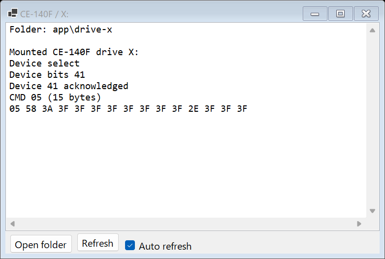

# 11. CE-140F (drive X:)

Following `Sharp_ce140f_emul`, the 11-pin protocol (device select, ACK/BUSY, 4-bit transfer, checksum) is implemented with a PC folder as the virtual disk, `drive-x/` by default. The "CE-140F" window shows the transfer log (refreshed every 0.5 s) and opens the folder.

Enter a program in PRO mode, then save and load it like this.

```basic
SAVE "X:TEST.BAS"
SAVE "X:TEXT.BAS",A
LOAD "X:TEST.BAS"
```

Line 2 saves as ASCII. An ASCII file is saved without a closing 1Ah (EOF), as a hardware CE-140F emulator saves it; see [Exchanging files with a real machine](10_PROGRAMS.md#exchanging-files-with-a-real-machine) before sending text to a real machine. Loading stops at a 1Ah if the file has one, so a file a PC or another tool ended with 1Ah loads too. To run a program you loaded, press BASIC to return to RUN and type `RUN`.

Sequential file I/O in RUN mode:

```basic
OPEN "X:DATA.DAT" FOR OUTPUT AS #2
PRINT #2,"HELLO"
CLOSE #2
OPEN "X:DATA.DAT" FOR INPUT AS #2
INPUT #2,A$
CLOSE #2
PRINT A$
```

FILES, COPY, NAME, SET, KILL, INIT and EOF/LOF/LOC/DSKF are implemented. File names are 8.3 with letters, digits, `_` and `-`, up to 1MB each; no subfolders. **INIT deletes the disk files in the folder, so give the CE-140F a folder of its own.** Sector images and drive mechanics are not reproduced.

## Errors

The ROM shows these, as the drive answers.

| When | Error |
|---|---|
| There is no such file (`LOAD`, `KILL`, `COPY`, `NAME`...) | `File not found` |
| Changing anything while write-protected, or a file protected with `SET` | `File write protected` |
| `NAME` to a name taken or unusable | `NAME error` |
| Reading or writing the other way than it was `OPEN`ed | `Mode error` |
| A `SAVE` of more than 1 MB | `Disk full` |
| A file name that cannot be used | `Syntax error` |
| `LOAD` of an empty file, and others | `I/O error` |

`KILL` removes files only, and leaves folders in the folder alone.

## The transfer log

The CE-140F window lists the commands exchanged with the machine, and tells why one failed.



---

[← 10. Programs and text](10_PROGRAMS.md) ｜ [Contents](../README_en.md) ｜ [12. CE-126P (printer) →](12_CE-126P.md)
