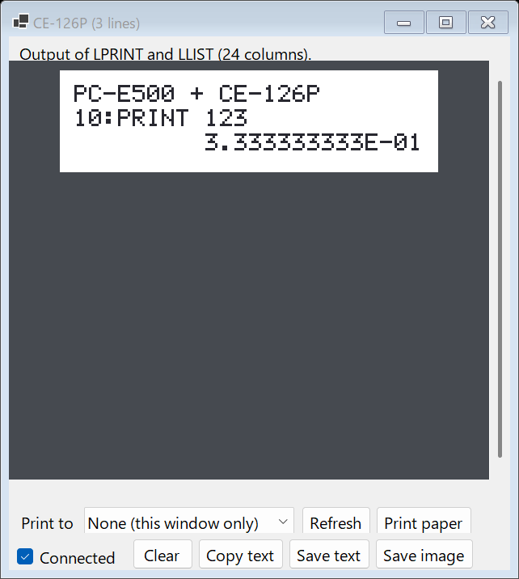

# 12. CE-126P (printer)

The 11-pin CE-126P is reproduced so the ROM's own printer driver runs unchanged (its protocol is analysed in [pc-e500_tools](https://github.com/litchi-gh/pc-e500_tools)). It is connected from start-up, and `LPRINT`, `LLIST` and `PRINT=LPRINT` print 24 columns. The "CE-126P" window shows the paper, drawn with the ROM's character font; it can be copied or saved as text or PNG.



```basic
LPRINT "HELLO"
LLIST
```

- Untick "Connected" and the ROM skips `LPRINT` and the like without an error, as on a real machine with no printer. Untick it in the middle of a line and you get `Printer error`. The setting is kept.
- It shares the 11-pin bus with the CE-140F; both work together.
- **Printing on a printer**: "Print to" in the CE-126P window sends the lines on to a printer as well; the choice is kept in the settings.
  - **A USB thermal printer** (58 mm, 384 dots across, ESC/POS, such as the MPT-II): written to directly, with no driver or print queue, a line at a time as it comes. The ROM's glyphs are drawn at three times their size, 2 mm a character and 4 mm a line. After printing has paused for 3 seconds, the paper is fed 12 mm.
  - **A Windows printer**: when printing has paused for 3 seconds, the lines since the last job print as one job at their real size (2 mm a character, 4 mm a line), page after page.
  - "Print paper" sends the whole paper to the printer.
  - A line that cannot reach the printer (unplugged, or in use elsewhere) stays on the paper in the window, the reason shows at the bottom of the window, and the machine goes on.
- The paper keeps up to 2000 lines, dropping the oldest. The paper is not part of snapshots, but the printer's place on the bus is, so saving works at any time mid-line (a loaded snapshot prints that line again in full).
- Print time is not reproduced; lines print at once.

## Printing on Ubuntu

"Print to" lists USB thermal printers and the printers set up in CUPS. They print as on Windows.

| Printer | To get ready |
|---|---|
| A USB thermal printer | Written to directly, at `/dev/usb/lp0` or the like. Users of the `lp` group may write there: run `sudo usermod -aG lp $USER` and log in again |
| A CUPS printer | Add it under Printers in the desktop's settings. It is sent with the `lp` command |

```sh
ls -l /dev/usb/lp*     # is the USB printer seen?
lpstat -e              # the names of the CUPS printers
```

---

[← 11. CE-140F (drive X:)](11_CE-140F.md) ｜ [Contents](../README_en.md) ｜ [13. Game controllers →](13_CONTROLLER.md)
