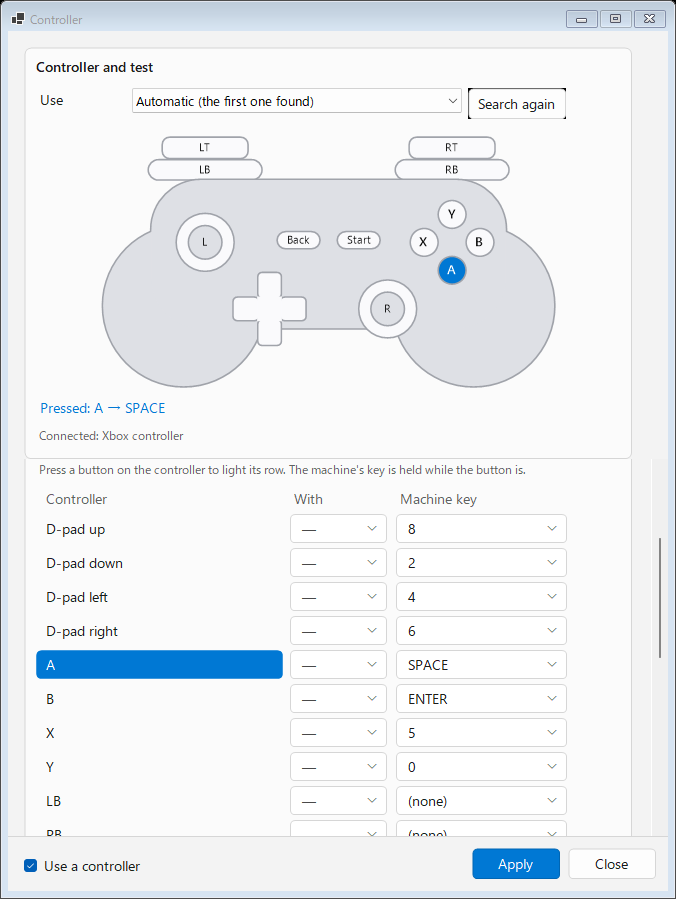

# 13. Game controllers



"Controller" on the toolbar opens it. Map the machine's keys to the buttons of a gamepad to play games and the like. XInput (Xbox-style) pads and Windows game controllers (DirectInput) work.

- **Use**: the pad to use. "Automatic (the first one found)" takes the first one found. After plugging a pad in, press "Search again" (a pad plugged in or out is also found on its own).
- **The pad picture**: the buttons you press light up, and it shows where the sticks are and how far the triggers are pressed. The "Pressed: …" line below it shows the buttons and the machine's keys. Click a button on the picture to go to its row.
- **Presets**: keep as many sets of mappings as you like. "Add..." copies the preset shown into a new one; "Rename..." and "Delete" are there too. Two come built in: "Number keys 2/4/6/8" (the default) and "Cursor keys".
- **Buttons**: choose the machine key for each button. "With" presses SHIFT or CTRL along with it. While the pad button is down, the machine's key is held down.
- **Match button places...**: on a DirectInput pad, the button numbers may not sit where the picture puts them. Then press the buttons at the places the picture shows, one by one ("Skip" and "Stop" are there too).
- **Use a controller**: untick it and the pad is not used.

"Apply" saves to `state/controller.json`. The pad works only while the main window is in front (when another window is in front, the keys it holds are let go).

## Controllers on Ubuntu

The kernel's joysticks (`/dev/input/js0` and so on) are read. After plugging a pad in, press "Search again" or just wait. The mappings, the presets and "Match button places" are as on Windows.

```sh
ls -l /dev/input/js*   # is the pad seen?
```

---

[← 12. CE-126P (printer)](12_CE-126P.md) ｜ [Contents](../README_en.md) ｜ [14. Debugger and the machine-code area →](14_DEBUGGER.md)
