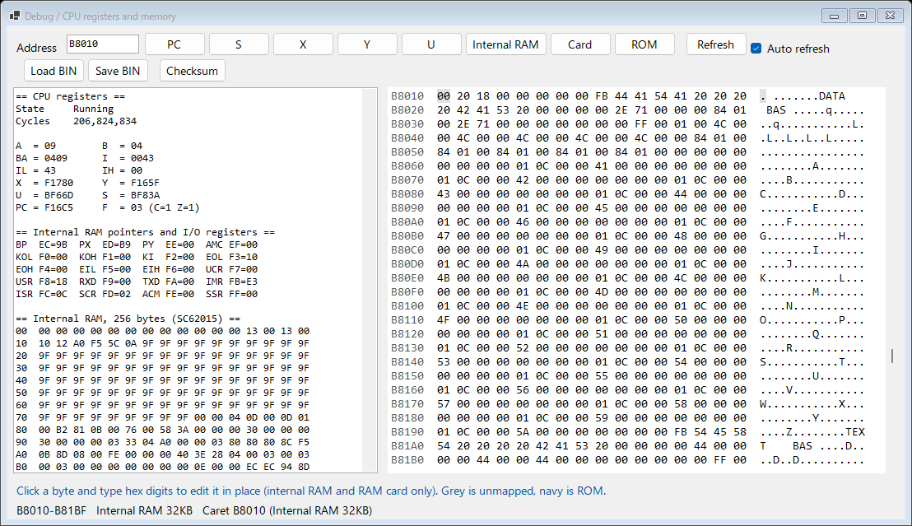
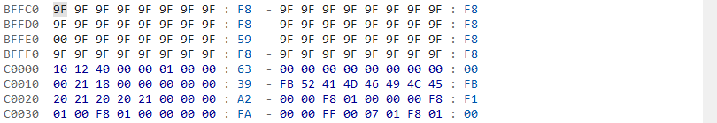
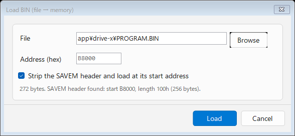
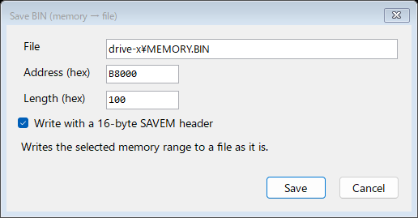
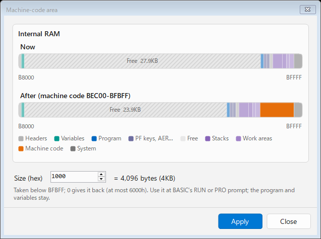

# 14. Debugger and the machine-code area

"Debug" on the toolbar, or **Ctrl+D**, opens a window on the CPU state. It follows the running machine and refreshes every 250 ms (untick "Auto refresh" to update only when you press "Refresh").



- **Memory map** (top): the internal RAM as a coloured bar (variables, program, PF keys and AER, free space, stacks, work areas, machine-code area, system), with a second bar for the RAM card when one is in. Click a region to take the memory view to its start; the marker under the bar is where the view is. Hover for the region's name, range and size.
- **CPU** (left): A, B, BA, I, IL, IH, X, Y, U, S, PC and F as tiles, the running / HALT / power-off / fault state as a coloured badge, the C and Z flags as lamps, and the cycle count. Below them, the 256 bytes of SC62015 internal RAM, with the BP, PX and PY pointers and the KOL–SSR I/O registers listed by name and address.
- **Memory** (right): `00000-FFFFF` as a hex dump, 16 or 8 bytes a row (the "16 bytes/row" and "8 bytes/row" choice on the toolbar; 16 by default), each group of eight followed by ": XX", its checksum (below). Move with the scrollbar, a hex address in the box (`B8000`, `&HB8000` or `0xB8000` and Enter), the mouse wheel, the arrow keys, PageUp/PageDown, Ctrl+Home/End, or the PC, S, X, Y, U, Internal RAM, Card and ROM buttons. The bottom line names the region of the visible range and of the caret.

```
B8010  00 20 18 00 00 00 00 00 : 38  - FB 44 41 54 41 20 20 20 : 75
```

Bytes are coloured by region.

| Colour | Region |
|---|---|
| Black | Internal RAM and RAM card with their mirrors (writable) |
| Blue | Internal ROM (CE2), E500S/E650/U6000 extension ROM (CE3) |
| Grey | Unmapped (card slot without a card, CE6, the internal area, …) |



## Hex editor

Click a byte to place the caret and type `0`–`9`, `A`–`F`. Digits go in high nibble first and the caret advances after two. Only internal RAM and the RAM card can be edited; typing over ROM or unmapped space changes nothing and the reason is shown at the bottom. Edits are autosaved like any other RAM change.

## Checksum of each eight bytes

After each ":" in the memory view is the low byte of the sum of the eight bytes before it (in blue). Machine code listings in magazines print this value for every eight bytes, so a program typed in can be checked line by line. It changes as you edit.

## Load BIN / Save BIN

|  |  |
|---|---|

- **Load BIN** writes a file into memory at the given address. The 16-byte header written by the CE-140F `SAVE M` is detected automatically and the data returns to the start address recorded in it (untick to load anywhere). The whole range must be RAM; if a single byte would land in ROM or unmapped space nothing is written.
- **Save BIN** writes the given length from the given address to a file, by default with the same 16-byte header as `SAVE M`, so `LOAD M` or Load BIN can put it back where it came from.

Memory reads bypass the LCD controller, so looking at `2000-3FFF` does not disturb the display.

## Machine-code area



The ML field of the status bar (or Machine-code area... in the right-click menu) reserves RAM for machine code. The window shows the internal RAM as two bars, now and after applying, so you can see where the area goes and how much free space it takes. Set the size in hex bytes and press Apply: that many bytes below `BFBFF` are taken. 0 gives them back. The most you can take follows from the free RAM at the time.

The machine's own ROM routine does it (`POKE &HBFE03,...:CALL &HFFFD8` is typed for you). The size given is the size the area ends up, not an amount added. The ROM moves the other work areas and stacks down and ends at the main menu, and the BASIC key is then pressed to come back. The BASIC program and variables stay. Use it at BASIC's RUN or PRO prompt. The field shows the size now; hover for the address range.

Loading a BIN reserves nothing (as `LOAD M` on the machine). When Load program puts a BIN outside the machine-code area, you are asked whether to reserve it first ([chapter 10](10_PROGRAMS.md#loading-a-file-load-program-drag-and-drop)).

---

[← 13. Game controllers](13_CONTROLLER.md) ｜ [Contents](../README_en.md) ｜ [15. Saving and restoring →](15_SAVE.md)
